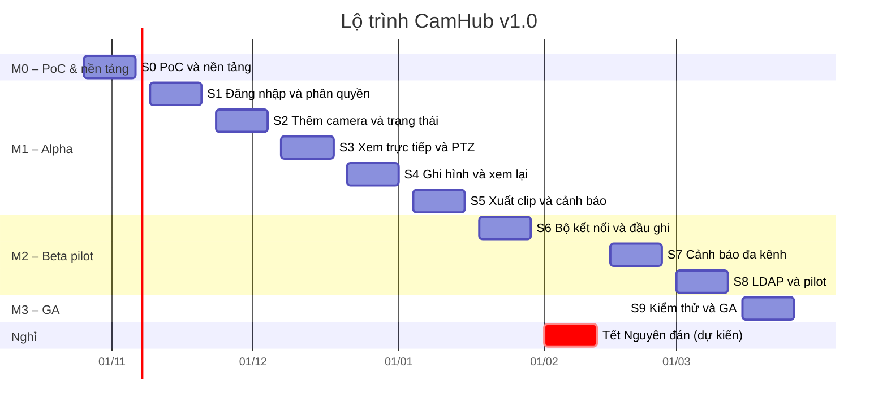

# Kế hoạch triển khai theo phase – CamHub v1.0

> Ngày: 23/10/2026 · Phiên bản: 0.1 · Nguồn: [User_Stories_IP_Camera_Web.md](../User_Stories_IP_Camera_Web.md), [SADD](../../requirements/SADD_IP_Camera_Web.md)

Mỗi phase là một sprint 2 tuần và có một file riêng. Mỗi file gồm mục tiêu, phạm vi, lịch tuần, task chi tiết theo từng item (kèm file mã nguồn sẽ tạo/sửa theo cấu trúc SADD mục 3.8), giờ công, điều kiện vào/ra, demo và rủi ro.

## 1. Danh sách phase

| Phase | Mốc | Thời gian | Nội dung | Item | Điểm | Giờ task |
| --- | --- | --- | --- | --- | --- | --- |
| [S0](phase-00-S0-poc-nen-tang.md) | M0 – PoC & nền tảng | 26/10/2026 – 06/11/2026 | PoC và nền tảng kỹ thuật | 5 | 29 | 141 |
| [S1](phase-01-S1-dang-nhap-phan-quyen.md) | M1 – Alpha | 09/11/2026 – 20/11/2026 | Đăng nhập, cây địa điểm, phân quyền | 5 | 29 | 128 |
| [S2](phase-02-S2-them-camera-trang-thai.md) | M1 – Alpha | 23/11/2026 – 04/12/2026 | 2FA, nhật ký, thêm camera và trạng thái | 5 | 28 | 99 |
| [S3](phase-03-S3-xem-truc-tiep.md) | M1 – Alpha | 07/12/2026 – 18/12/2026 | Xem trực tiếp, bố cục, PTZ | 6 | 29 | 88 |
| [S4](phase-04-S4-ghi-hinh-xem-lai.md) | M1 – Alpha | 21/12/2026 – 01/01/2027 | Ghi hình, timeline, lưu trữ, cấu hình luồng | 5 | 29 | 81 |
| [S5](phase-05-S5-xuat-clip-canh-bao-alpha.md) | M1 – Alpha | 04/01/2027 – 15/01/2027 | Xuất clip, vùng, cảnh báo hệ thống, tổng quan, sao lưu – hoàn tất Alpha | 6 | 31 | 106 |
| [S6](phase-06-S6-ket-noi-dia-diem.md) | M2 – Beta pilot | 18/01/2027 – 29/01/2027 | Bộ kết nối địa điểm, đầu ghi, chất lượng luồng | 6 | 28 | 81 |
| [S7](phase-07-S7-canh-bao-da-kenh.md) | M2 – Beta pilot | 15/02/2027 – 26/02/2027 | Cảnh báo đa kênh và xử lý; xem lại từ thiết bị | 6 | 29 | 84 |
| [S8](phase-08-S8-pilot-ldap-vai-tro.md) | M2 – Beta pilot | 01/03/2027 – 12/03/2027 | Đồng bộ nhiều camera, cấu hình mẫu, vai trò tùy chỉnh, LDAP/AD – pilot | 5 | 26 | 70 |
| [S9](phase-09-S9-kiem-thu-ga.md) | M3 – GA | 15/03/2027 – 26/03/2027 | Story Could, kiểm thử tải và bảo mật, UAT – GA | 3 | 16 | 67 |
| **Tổng** | | 26/10/2026 – 26/03/2027 | | 52 | **274** | **945** |

## 2. Lộ trình

## 3. Quy ước

- **Ngày bắt đầu:** S0 bắt đầu thứ Hai 26/10/2026. Mỗi sprint 2 tuần, bắt đầu thứ Hai, kết thúc thứ Sáu tuần sau.
- **Nghỉ Tết Nguyên đán:** dự kiến 01/02–12/02/2027. S7 lùi sang 15/02/2027, cần xác nhận lịch nghỉ chính thức của tổ chức.
- **Đội:** BE = Backend Java (2 người); PY = Python – Device Gateway, Media Worker, Site Connector (1 người); FE = Frontend Vue (2 người); QA = Kiểm thử (1 người); OPS = DevOps (bán thời gian, kiêm PY hoặc BE).
- **Mã task** `US-30.2` = task thứ 2 của US-30. Mỗi file test Gherkin đặt tại `tests/e2e/features/<ID>_<tên>.feature`.
- **Migration** Flyway đặt tên theo sprint: `V<sprint>_<n>__<mô_tả>.sql` (ví dụ `V4_1__recording.sql`).
- **Cập nhật:** khi đổi sprint của một item, sửa trong backlog rồi sinh lại các file phase để tránh lệch.

## 4. Cổng kiểm soát giữa các mốc

| Cổng | Sau phase | Điều kiện chính |
| --- | --- | --- |
| G0 – Kết luận PoC | S0 | MediaMTX đạt NFR-01 trong PoC; nếu không, quyết định lại ADR-03 trước S1 |
| G1 – Alpha | S5 | Toàn bộ 26 story Must chạy trên staging; diễn tập khôi phục đạt |
| G2 – Beta | S8 | Toàn bộ story Should; pilot 20–50 camera, ≥ 3 hãng chạy ổn định |
| G3 – GA | S9 | Tiêu chí nghiệm thu BRS mục 7; kiểm thử tải và kiểm thử xâm nhập đạt; ký phê duyệt |

## 5. Câu hỏi mở ảnh hưởng kế hoạch

- BQ-01: chấp nhận M1 dài 12 tuần (S0–S5)?
- BQ-02: thêm S10 cho UAT/sửa lỗi hay chuyển US-15 sang phiên bản sau?
- BQ-03: Zalo OA sẵn sàng trước S7?
- Lịch nghỉ Tết Nguyên đán 2027 chính thức của tổ chức.
