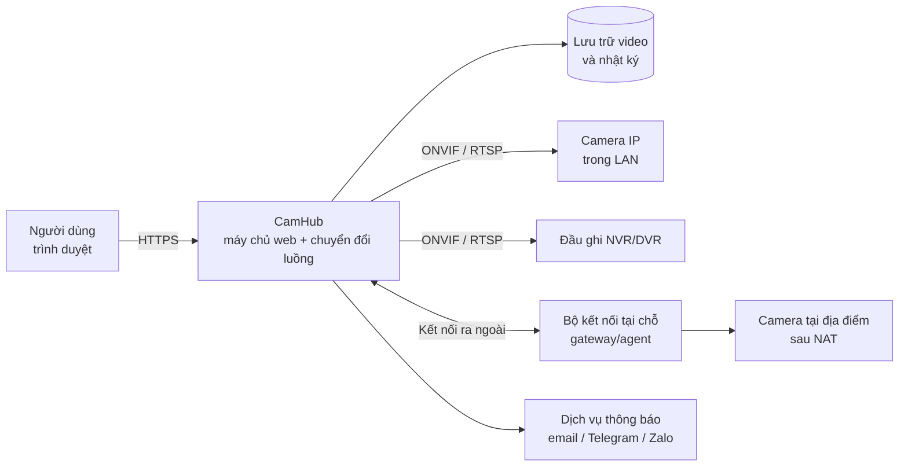
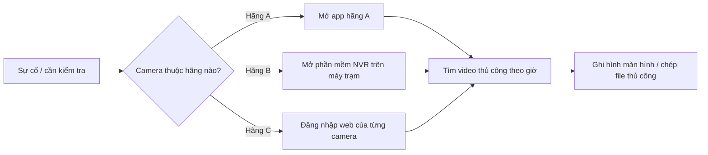
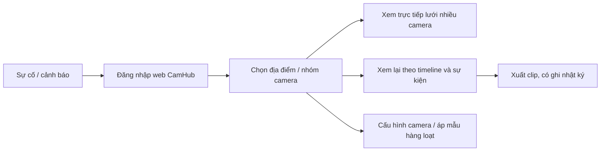

# Đặc tả Yêu cầu Nghiệp vụ (BRS) – Nền tảng Web quản lý Camera IP

> Tuân theo cấu trúc *Business Requirements Specification* tại ISO/IEC/IEEE 29148:2018, mục 9.3.
> Ngày: 21/10/2026 · Người soạn: Business Analyst · Phiên bản: 0.3 (Bản nháp)

| Phiên bản | Ngày | Người sửa | Thay đổi |
| --- | --- | --- | --- |
| 0.3 | 21/10/2026 | BA | Sửa theo checklist 29148: tách yêu cầu gộp (thêm BR-34 đến BR-38), bỏ chi tiết kỹ thuật khỏi BR, thêm cột Nguồn, RTO/RPO, mục Phụ thuộc, kế hoạch dự phòng, hồ sơ người dùng; chốt OQ-01 |
| 0.2 | 21/10/2026 | BA | Tái cấu trúc theo ISO/IEC/IEEE 29148:2018; bổ sung thuộc tính yêu cầu và ma trận truy vết |
| 0.1 | 21/10/2026 | BA | Tạo bản nháp đầu tiên |

**Quy ước phát biểu yêu cầu** (theo 29148, mục 5.2.4):

- **"phải" (shall):** yêu cầu bắt buộc, có tính ràng buộc.
- **"nên" (should):** mục tiêu mong muốn, không bắt buộc.
- **"sẽ" (will):** mô tả sự thật hoặc ý định, không phải yêu cầu.

Mức ưu tiên thực hiện được ghi riêng theo MoSCoW (Must / Should / Could).

---

## 1. Giới thiệu (Introduction)

### 1.1 Mục đích nghiệp vụ (Business purpose)

Tổ chức đang vận hành camera IP của nhiều hãng. Mỗi hãng một phần mềm riêng nên việc giám sát bị phân mảnh, chậm xử lý sự cố và khó kiểm soát truy cập. Dự án nhằm hợp nhất toàn bộ hoạt động kết nối, xem trực tiếp, xem lại và cấu hình camera về một nền tảng web duy nhất.

### 1.2 Phạm vi nghiệp vụ (Business scope)

Tên hệ thống đề xuất: **CamHub – Nền tảng Web quản lý Camera IP** (tên tạm).

Phiên bản 1.0 bao gồm **toàn bộ** yêu cầu nghiệp vụ ở mục 4.1, triển khai nội bộ cho một tổ chức. Mức ưu tiên MoSCoW dùng để sắp thứ tự phát triển trong phiên bản 1.0, không dùng để loại yêu cầu.

**Trong phạm vi (phiên bản 1.0)**

- Kết nối camera IP qua ONVIF, RTSP và qua đầu ghi NVR/DVR có hỗ trợ ONVIF/RTSP
- Quản lý danh sách camera theo địa điểm và nhóm
- Xem trực tiếp một hoặc nhiều camera, điều khiển PTZ
- Ghi hình, xem lại theo dòng thời gian, xuất clip
- Cấu hình camera từ xa
- Quản lý người dùng, phân quyền, nhật ký thao tác
- Cảnh báo cơ bản: mất kết nối, phát hiện chuyển động
- Giao diện web responsive cho máy tính và điện thoại

**Ngoài phạm vi (phiên bản 1.0)**

- Ứng dụng di động native (iOS/Android)
- Phân tích hình ảnh bằng AI (nhận diện khuôn mặt, biển số, đếm người)
- Camera analog không qua đầu ghi có hỗ trợ IP
- Nâng cấp firmware camera hàng loạt
- Tích hợp kiểm soát ra vào, báo cháy
- Thanh toán / gói cước
- Vận hành SaaS nhiều khách hàng (dự kiến phiên bản sau, xem 3.3)

### 1.3 Tổng quan nghiệp vụ (Business overview)

Người dùng chỉ làm việc qua trình duyệt. CamHub giao tiếp với camera bằng chuẩn mở, chuyển luồng video sang định dạng trình duyệt phát được, lưu video và nhật ký, rồi gửi cảnh báo ra các kênh thông báo.

### 1.4 Định nghĩa (Definitions)

| Thuật ngữ | Giải thích |
| --- | --- |
| Camera IP | Camera truyền hình ảnh qua mạng máy tính (LAN/Internet) |
| ONVIF | Chuẩn mở giúp thiết bị an ninh của nhiều hãng giao tiếp với nhau (Profile S: luồng video, G: ghi hình, T: luồng nâng cao) |
| RTSP | Real Time Streaming Protocol: giao thức truyền luồng video thời gian thực |
| NVR / DVR | Đầu ghi hình cho camera IP / camera analog |
| PTZ | Pan-Tilt-Zoom: xoay ngang, nghiêng, phóng to |
| Preset | Vị trí PTZ đã lưu để gọi lại nhanh |
| Luồng chính / phụ | Luồng chất lượng cao / luồng chất lượng thấp, tiết kiệm băng thông |
| WebRTC / HLS | Công nghệ phát video trên trình duyệt |
| WDR | Wide Dynamic Range: cân bằng vùng sáng/tối trong khung hình |
| Gateway/agent | Phần mềm hoặc thiết bị đặt tại địa điểm, chủ động kết nối ra máy chủ để không cần mở cổng router |
| Địa điểm (Site) | Một cơ sở vật lý có lắp camera (chi nhánh, kho, cửa hàng) |
| MoSCoW | Phương pháp xếp ưu tiên: Must, Should, Could, Won't |

Viết tắt: xem Phụ lục 8.1.

### 1.5 Các bên liên quan chính (Major stakeholders)

| Stakeholder | Vai trò trong dự án | Mối quan tâm chính |
| --- | --- | --- |
| Project Sponsor | Phê duyệt ngân sách, phạm vi | Hiệu quả đầu tư, tiến độ |
| Product Owner | Ưu tiên yêu cầu, nghiệm thu | Giá trị cho người dùng |
| Bộ phận An ninh / Vận hành | Người dùng chính | Xem nhanh, ổn định, cảnh báo kịp thời |
| Bộ phận IT | Triển khai, vận hành hạ tầng | Bảo mật, băng thông, lưu trữ |
| Pháp chế / Tuân thủ | Rà soát quy định | Bảo vệ dữ liệu cá nhân (Nghị định 13/2023/NĐ-CP) |
| Đội phát triển | Xây dựng sản phẩm | Yêu cầu rõ ràng, khả thi |
| Nhà cung cấp camera / tích hợp | Cung cấp thiết bị, hỗ trợ kỹ thuật | Tương thích thiết bị |
| Người bị ghi hình (chủ thể dữ liệu) | Bên ngoài, không dùng hệ thống | Quyền riêng tư, được thông báo về việc giám sát |

---

## 2. Tài liệu tham chiếu (References)

| Mã | Tài liệu |
| --- | --- |
| REF-01 | ISO/IEC/IEEE 29148:2018 – Systems and software engineering – Life cycle processes – Requirements engineering |
| REF-02 | Nghị định 13/2023/NĐ-CP về bảo vệ dữ liệu cá nhân |
| REF-03 | ONVIF Profile S, G, T Specifications |
| REF-04 | RFC 7826 – Real-Time Streaming Protocol Version 2.0 (và RFC 2326 cho RTSP 1.0) |
| REF-05 | Luật An ninh mạng 2018 |

---

## 3. Yêu cầu quản lý nghiệp vụ (Business management requirements)

### 3.1 Môi trường nghiệp vụ (Business environment)

| # | Vấn đề hiện tại | Ảnh hưởng |
| --- | --- | --- |
| P1 | Mỗi hãng camera có phần mềm/app riêng | Người vận hành phải mở nhiều app, khó theo dõi đồng thời |
| P2 | Phần mềm NVR/VMS thường chỉ chạy trên máy cài đặt | Khó truy cập từ xa, phụ thuộc máy trạm |
| P3 | Cấu hình camera phải vào từng giao diện web của thiết bị | Tốn thời gian, dễ sai, khó cấu hình hàng loạt |
| P4 | Tìm lại video theo thời gian/sự kiện chậm | Chậm xử lý sự cố, khiếu nại, điều tra |
| P5 | Chia sẻ tài khoản chung, không phân quyền | Rủi ro bảo mật, không truy vết được ai đã làm gì |

Các yếu tố bên ngoài tác động đến hệ thống:

- **Quy định pháp lý:** hình ảnh con người là dữ liệu cá nhân, chịu điều chỉnh của REF-02.
- **Thị trường thiết bị:** đa dạng hãng, mức tuân thủ ONVIF không đồng đều.
- **Hạ tầng mạng:** băng thông upload tại các địa điểm khác nhau.

### 3.2 Sứ mệnh, mục tiêu (Mission, goals and objectives)

**Sứ mệnh:** mọi camera của tổ chức được giám sát, tra cứu và quản trị từ một nơi, an toàn và có kiểm soát.

Các con số dưới đây là đề xuất ban đầu, cần Sponsor xác nhận.

| Mã | Mục tiêu | KPI | Mục tiêu đạt | Thời hạn | Giải quyết vấn đề |
| --- | --- | --- | --- | --- | --- |
| BO-01 | Hợp nhất giám sát về một nền tảng | Tỷ lệ camera hiện có kết nối thành công | ≥ 95% | 6 tháng sau go-live | P1, P2 |
| BO-02 | Rút ngắn thời gian thêm camera | Thời gian thêm 1 camera ONVIF | ≤ 2 phút | Tại go-live | P1 |
| BO-03 | Tìm lại video nhanh hơn | Thời gian tìm được đoạn video cần xem | ≤ 1 phút | Tại go-live | P4 |
| BO-04 | Giảm công cấu hình | Thời gian cấu hình 10 camera cùng lúc | Giảm 70% so với hiện tại | 3 tháng sau go-live | P3 |
| BO-05 | Tăng an toàn truy cập | Tỷ lệ thao tác quan trọng được ghi nhật ký theo người dùng | 100% | Tại go-live | P5 |

### 3.3 Mô hình nghiệp vụ (Business model)

**Quyết định (OQ-01, 21/10/2026): triển khai nội bộ trước, chuyển sang SaaS ở phiên bản sau.**

| Giai đoạn | Mô hình | Ảnh hưởng đến yêu cầu |
| --- | --- | --- |
| Phiên bản 1.0 | Nội bộ: tổ chức tự vận hành cho các địa điểm của mình | Không cần thanh toán, gói cước; một tổ chức duy nhất |
| Phiên bản sau | SaaS: cung cấp cho nhiều khách hàng, thu phí theo camera/tháng | Cần đa khách hàng (multi-tenant), cách ly dữ liệu, gói cước, onboarding khách hàng |

Để chuyển sang SaaS không phải làm lại, phiên bản 1.0 phải tổ chức dữ liệu theo cấp "Tổ chức" (mục 4.6) ngay từ đầu (xem ràng buộc ở mục 7).

### 3.5 Lợi ích và chi phí (bổ sung)

| Lợi ích | Cách đo | Số liệu |
| --- | --- | --- |
| Giảm giờ công thêm và cấu hình camera | Giờ công/tháng trước và sau (BO-02, BO-04) | Cần đo baseline |
| Giảm thời gian xử lý sự cố, khiếu nại | Thời gian từ yêu cầu đến có bằng chứng (BO-03) | Cần đo baseline |
| Giảm chi phí bản quyền phần mềm VMS của từng hãng | Chi phí bản quyền/năm | Cần IT cung cấp |
| Giảm rủi ro vi phạm dữ liệu cá nhân | Số sự cố truy cập trái phép | Cần Pháp chế cung cấp |

Chi phí đầu tư (phát triển, máy chủ, lưu trữ, vận hành) và thời gian hoàn vốn sẽ được bổ sung khi có quyết định OQ-02 và ngân sách.

### 3.4 Môi trường thông tin (Information environment)

| Loại thông tin | Nguồn | Thời gian lưu | Độ nhạy cảm |
| --- | --- | --- | --- |
| Video ghi hình | Camera / NVR | Theo cấu hình từng camera (đề xuất mặc định 30 ngày) | Cao – dữ liệu cá nhân |
| Ảnh chụp, clip đã xuất | Người dùng | Theo chính sách tổ chức | Cao |
| Thông tin camera (IP, tài khoản, mật khẩu) | Kỹ thuật viên | Suốt vòng đời camera | Rất cao – phải mã hóa |
| Tài khoản và phân quyền người dùng | Admin | Suốt vòng đời tài khoản | Cao |
| Nhật ký thao tác | Hệ thống | Tối thiểu 12 tháng | Trung bình |
| Sự kiện, cảnh báo | Camera / hệ thống | Đề xuất 90 ngày | Trung bình |

Hệ thống bên ngoài có trao đổi thông tin: camera và đầu ghi (ONVIF/RTSP), dịch vụ email, Telegram/Zalo, và có thể có LDAP/Active Directory.

---

## 4. Yêu cầu vận hành nghiệp vụ (Business operational requirements)

### 4.1 Quy trình nghiệp vụ (Business processes)

**Quy trình hiện tại (As-Is)**

**Quy trình mục tiêu (To-Be)**

Hệ thống hỗ trợ 6 quy trình nghiệp vụ (BP). Yêu cầu nghiệp vụ (BR) của từng quy trình nằm ngay bên dưới quy trình đó. Có 38 yêu cầu: BR-34 đến BR-38 được tách ra từ các yêu cầu gộp ở v0.2. Mã cũ được giữ nguyên, không tái sử dụng.

Ý nghĩa các cột trong bảng yêu cầu:

- **Nguồn:** stakeholder đề xuất hoặc chịu trách nhiệm xác nhận yêu cầu (mục 1.5). AN = An ninh/Vận hành, IT = Bộ phận IT, PC = Pháp chế, PO = Product Owner. Nguồn ở v0.3 do BA đề xuất, cần xác nhận khi review.
- **Truy vết:** mục tiêu BO ở mục 3.2 mà yêu cầu phục vụ.
- **KC (phương pháp kiểm chứng):** I = Kiểm tra (Inspection), A = Phân tích (Analysis), D = Trình diễn (Demonstration), T = Kiểm thử (Test).

#### BP-01 Kết nối và quản lý camera

| ID | Phát biểu yêu cầu | Lý do | Ưu tiên | Nguồn | Truy vết | KC |
| --- | --- | --- | --- | --- | --- | --- |
| BR-01 | Hệ thống phải tự dò tìm các camera hỗ trợ ONVIF trong cùng mạng LAN với bộ kết nối của địa điểm. | Giảm thao tác nhập tay khi lắp đặt | Must | IT | BO-02 | T |
| BR-02 | Hệ thống phải cho phép thêm camera thủ công bằng địa chỉ IP, cổng, tài khoản, mật khẩu hoặc đường dẫn luồng video của camera. | Hỗ trợ camera không bật dò tìm ONVIF | Must | IT | BO-01 | T |
| BR-03 | Hệ thống phải nhận toàn bộ kênh camera của một đầu ghi NVR/DVR khi đầu ghi được thêm vào. | Nhiều địa điểm đã dùng đầu ghi | Should | IT | BO-01, BO-02 | T |
| BR-04 | Hệ thống phải hiển thị trạng thái trực tuyến/mất kết nối của từng camera và thời điểm mất kết nối gần nhất. | Phát hiện sớm camera hỏng | Must | AN | BO-01 | D |
| BR-05 | Hệ thống phải cho phép tổ chức camera theo địa điểm, khu vực, nhóm và lọc theo tên, trạng thái, hãng. | Quản lý số lượng lớn camera | Must | AN | BO-01 | D |
| BR-06 | Hệ thống phải kết nối được camera ở mạng khác qua Internet mà không yêu cầu mở cổng trên router tại địa điểm. | Nhiều địa điểm không có IP tĩnh | Should | IT | BO-01 | T |
| BR-07 | Hệ thống phải cho phép thêm hàng loạt camera từ một file danh sách theo mẫu do hệ thống cung cấp. | Triển khai nhanh địa điểm lớn | Could | IT | BO-02 | T |

#### BP-02 Giám sát trực tiếp

| ID | Phát biểu yêu cầu | Lý do | Ưu tiên | Nguồn | Truy vết | KC |
| --- | --- | --- | --- | --- | --- | --- |
| BR-08 | Hệ thống phải phát hình ảnh trực tiếp trên các trình duyệt được hỗ trợ (NFR-08) mà không yêu cầu cài thêm phần mềm. | Truy cập mọi nơi, không phụ thuộc máy trạm (P2) | Must | AN | BO-01 | T |
| BR-09 | Hệ thống phải hiển thị đồng thời nhiều camera theo lưới 1, 4, 9 hoặc 16 ô. | Giám sát đồng thời camera khác hãng (P1) | Must | AN | BO-01 | D |
| BR-34 | Hệ thống phải lưu bố cục lưới và danh sách camera đã chọn riêng cho từng người dùng. | Mở lại nhanh màn hình giám sát quen dùng | Must | AN | BO-01 | D |
| BR-10 | Hệ thống phải tự chuyển sang luồng chất lượng thấp khi băng thông khả dụng thấp hơn bitrate của luồng đang xem, và cho phép người dùng chọn luồng thủ công. | Duy trì hình ảnh khi mạng yếu | Should | AN | BO-01 | T |
| BR-11 | Hệ thống phải cho phép điều khiển xoay, nghiêng, zoom (PTZ) với camera có hỗ trợ. | Theo dõi đối tượng di chuyển | Must | AN | BO-01 | D |
| BR-35 | Hệ thống phải cho phép lưu và gọi lại vị trí PTZ đặt trước (preset). | Chuyển nhanh đến vị trí cần quan sát | Must | AN | BO-01 | D |
| BR-12 | Hệ thống phải cho phép chụp ảnh nhanh, phóng to kỹ thuật số và xem toàn màn hình. | Ghi nhận bằng chứng tức thời | Should | AN | BO-03 | D |
| BR-13 | Hệ thống phải hỗ trợ nghe âm thanh và đàm thoại hai chiều với camera có hỗ trợ. | Cảnh báo, hướng dẫn tại chỗ | Could | AN | BO-01 | D |

#### BP-03 Ghi hình và tra cứu video

| ID | Phát biểu yêu cầu | Lý do | Ưu tiên | Nguồn | Truy vết | KC |
| --- | --- | --- | --- | --- | --- | --- |
| BR-14 | Hệ thống phải ghi hình theo chế độ liên tục, theo lịch hoặc theo sự kiện, cấu hình riêng cho từng camera. | Cân bằng nhu cầu lưu trữ và chi phí | Must | AN, IT | BO-03 | T |
| BR-15 | Hệ thống phải cho phép xem lại theo dòng thời gian, chọn ngày giờ và hiển thị đánh dấu các đoạn có sự kiện. | Tìm video nhanh (P4) | Must | AN | BO-03 | T |
| BR-16 | Hệ thống phải hỗ trợ phát lại ở tốc độ 0,5x đến 16x, tạm dừng và xem từng khung hình. | Rà soát nhanh đoạn video dài | Must | AN | BO-03 | T |
| BR-17 | Hệ thống phải phát lại đồng bộ nhiều camera trên cùng một mốc thời gian. | Theo dấu sự việc qua nhiều góc quay | Should | AN | BO-03 | D |
| BR-18 | Hệ thống phải xuất đoạn video theo khoảng thời gian chọn thành file phát được bằng trình phát video phổ biến mà không cần phần mềm của hãng camera. | Cung cấp bằng chứng cho bên ngoài | Must | AN | BO-03 | T |
| BR-19 | Hệ thống phải cho phép đặt thời gian lưu trữ theo camera và tự xóa video quá hạn. | Kiểm soát dung lượng, tuân thủ REF-02 | Must | IT, PC | BO-03 | T |
| BR-20 | Hệ thống phải cho phép xem lại video lưu trên thẻ nhớ SD hoặc đầu ghi của thiết bị. | Tận dụng dữ liệu đã ghi tại chỗ | Should | AN | BO-03 | T |

#### BP-04 Cấu hình thiết bị

| ID | Phát biểu yêu cầu | Lý do | Ưu tiên | Nguồn | Truy vết | KC |
| --- | --- | --- | --- | --- | --- | --- |
| BR-21 | Hệ thống phải cho phép cấu hình độ phân giải, tốc độ khung hình, bitrate và chuẩn nén video của camera. | Tránh vào từng giao diện camera (P3) | Must | IT | BO-04 | T |
| BR-22 | Hệ thống phải cho phép cấu hình độ sáng, tương phản, chế độ hồng ngoại ngày/đêm, WDR. | Tối ưu chất lượng hình ảnh từ xa | Should | IT | BO-04 | T |
| BR-23 | Hệ thống phải cho phép cấu hình địa chỉ IP, máy chủ đồng bộ thời gian và múi giờ của camera. | Đồng bộ thời gian cho xem lại chính xác | Should | IT | BO-04 | T |
| BR-24 | Hệ thống phải cho phép vẽ vùng phát hiện chuyển động, chỉnh độ nhạy và vùng che riêng tư. | Giảm cảnh báo giả; bảo vệ quyền riêng tư | Must | AN, PC | BO-04 | D |
| BR-25 | Hệ thống phải cho phép tạo cấu hình mẫu và áp dụng cho nhiều camera cùng lúc. | Giảm công cấu hình hàng loạt (P3) | Should | IT | BO-04 | T |
| BR-26 | Hệ thống phải cho phép đổi mật khẩu và khởi động lại camera từ xa. | Xử lý sự cố, tăng bảo mật | Should | IT | BO-04, BO-05 | T |
| BR-27 | Hệ thống phải chỉ hiển thị tham số mà camera hỗ trợ; khi một thay đổi không áp dụng được, hệ thống phải hiển thị tên tham số và lý do do camera trả về. | Tránh cấu hình sai do khác biệt giữa các hãng | Must | IT | BO-04 | T |

#### BP-05 Quản trị truy cập

| ID | Phát biểu yêu cầu | Lý do | Ưu tiên | Nguồn | Truy vết | KC |
| --- | --- | --- | --- | --- | --- | --- |
| BR-28 | Hệ thống phải yêu cầu mỗi người dùng đăng nhập bằng tài khoản cá nhân. | Chấm dứt dùng chung tài khoản (P5) | Must | IT | BO-05 | T |
| BR-36 | Hệ thống phải hỗ trợ xác thực hai lớp (2FA) và cho phép Admin bắt buộc 2FA theo vai trò. | Giảm rủi ro lộ mật khẩu | Must | IT | BO-05 | T |
| BR-29 | Hệ thống phải phân quyền theo vai trò (mục 4.6) và theo phạm vi camera/nhóm/địa điểm, tách riêng quyền xem trực tiếp, xem lại, xuất video và cấu hình. | Nguyên tắc quyền tối thiểu | Must | IT, PC | BO-05 | T |
| BR-30 | Hệ thống phải ghi nhật ký đăng nhập, xem lại, xuất video và thay đổi cấu hình, gồm người thực hiện, thời điểm, đối tượng. | Truy vết trách nhiệm (P5) | Must | PC | BO-05 | T |

#### BP-06 Xử lý cảnh báo

| ID | Phát biểu yêu cầu | Lý do | Ưu tiên | Nguồn | Truy vết | KC |
| --- | --- | --- | --- | --- | --- | --- |
| BR-31 | Hệ thống phải cảnh báo khi camera mất kết nối quá thời gian do Admin cấu hình. | Phát hiện camera hỏng, tránh mất dữ liệu ghi hình | Must | AN, IT | BO-01 | T |
| BR-37 | Hệ thống phải cảnh báo khi dung lượng lưu trữ vượt ngưỡng do Admin cấu hình. | Tránh dừng ghi hình do đầy ổ | Must | IT | BO-01 | T |
| BR-32 | Hệ thống phải gửi cảnh báo phát hiện chuyển động trong khung giờ đã cấu hình qua các kênh: thông báo trên web, email, Telegram và Zalo. | Phản ứng kịp thời ngoài giờ | Should | AN | BO-03 | T |
| BR-33 | Hệ thống phải cho phép xác nhận và ghi chú kết quả xử lý cho từng cảnh báo. | Theo dõi trách nhiệm xử lý | Should | AN | BO-03 | D |
| BR-38 | Hệ thống phải mở đoạn xem lại bắt đầu tại thời điểm của cảnh báo khi người dùng chọn cảnh báo đó. | Rút ngắn thời gian từ cảnh báo đến bằng chứng | Should | AN | BO-03 | D |

### 4.2 Chính sách và quy tắc nghiệp vụ (Business operational policies and rules)

| ID | Quy tắc |
| --- | --- |
| RULE-01 | Chỉ người có quyền "xuất video" mới được tải video ra khỏi hệ thống; mỗi lần xuất phải ghi nhật ký. |
| RULE-02 | Video quá thời gian lưu trữ phải bị xóa tự động, trừ đoạn được đánh dấu "giữ lại phục vụ điều tra" bởi Site Manager trở lên. |
| RULE-03 | Vùng che riêng tư đã thiết lập không được hiển thị chưa che với người dùng dưới quyền Admin. |
| RULE-04 | Tài khoản bị khóa sau 5 lần đăng nhập sai liên tiếp; Admin hoặc người dùng tự mở khóa qua xác thực lại. |
| RULE-05 | Người dùng nghỉ việc phải bị vô hiệu hóa tài khoản trong vòng 24 giờ (quy trình của bộ phận nhân sự/IT). |
| RULE-06 | Nhật ký thao tác không được sửa hoặc xóa bởi bất kỳ vai trò nào. |

### 4.3 Ràng buộc vận hành (Business operational constraints)

- Trình duyệt không phát trực tiếp được RTSP, nên hệ thống cần máy chủ chuyển đổi luồng (ví dụ sang WebRTC/HLS).
- Mức độ cấu hình được phụ thuộc vào những gì từng hãng camera mở qua ONVIF/API.
- Băng thông upload tại địa điểm giới hạn số luồng xem từ xa đồng thời (khoảng 1–4 Mbps mỗi luồng).
- Việc lắp camera ghi hình người phải kèm thông báo giám sát tại khu vực, theo REF-02.

### 4.4 Chế độ vận hành (Business operational modes)

| Chế độ | Mô tả | Hành vi mong đợi |
| --- | --- | --- |
| Bình thường | Mọi thành phần hoạt động | Đầy đủ chức năng |
| Suy giảm – mất kết nối địa điểm | Mất Internet giữa địa điểm và máy chủ | Báo mất kết nối (BR-31); camera/NVR tiếp tục ghi tại chỗ nếu có; xem lại qua BR-20 khi kết nối lại |
| Suy giảm – băng thông thấp | Mạng chậm | Tự chuyển luồng phụ (BR-10) |
| Bảo trì | Nâng cấp hệ thống theo lịch | Thông báo trước cho người dùng; ghi hình không gián đoạn (OQ-03) |

### 4.5 Chất lượng vận hành (Business operational quality)

Các ngưỡng dưới đây là đề xuất, cần IT xác nhận theo hạ tầng thực tế.

| ID | Đặc tính | Yêu cầu | KC |
| --- | --- | --- | --- |
| NFR-01 | Hiệu năng | Hình ảnh trực tiếp phải hiển thị trong ≤ 3 giây sau khi mở; độ trễ trực tiếp ≤ 2 giây trong mạng LAN. | T |
| NFR-02 | Hiệu năng | Video xem lại phải bắt đầu phát trong ≤ 3 giây sau khi chọn mốc thời gian. | T |
| NFR-03 | Quy mô | Hệ thống phải hỗ trợ tối thiểu 500 camera và 100 người dùng đồng thời. | T |
| NFR-04 | Sẵn sàng | Hệ thống phải sẵn sàng ≥ 99,5% thời gian mỗi tháng, không tính bảo trì có lịch. | A |
| NFR-05 | Bảo mật | Mọi kết nối phải qua HTTPS; mật khẩu camera phải được mã hóa khi lưu. | I, T |
| NFR-06 | Tuân thủ | Việc xử lý hình ảnh phải tuân thủ REF-02. | I |
| NFR-07 | Khả dụng | Giao diện phải có tiếng Việt và tiếng Anh; dùng được trên màn hình rộng từ 360px. | D |
| NFR-08 | Tương thích | Hệ thống phải hoạt động trên 2 phiên bản mới nhất của Chrome, Edge, Safari, Firefox. | T |
| NFR-09 | Nhật ký | Nhật ký thao tác phải được lưu tối thiểu 12 tháng. | I |
| NFR-10 | Liên tục | Khi máy chủ gặp sự cố, hệ thống phải khôi phục hoạt động trong ≤ 4 giờ (RTO). | T |
| NFR-11 | Liên tục | Dữ liệu cấu hình, người dùng và nhật ký phải được sao lưu để mất tối đa 1 giờ dữ liệu khi sự cố (RPO ≤ 1 giờ). | T |
| NFR-12 | Liên tục | Video bị gián đoạn ghi do sự cố máy chủ không được vượt quá thời gian khôi phục ở NFR-10; camera có thẻ nhớ phải tiếp tục ghi tại chỗ trong thời gian đó. | A |

### 4.6 Cơ cấu tổ chức (Business structure)

| Vai trò | Thuộc đơn vị | Quyền chính |
| --- | --- | --- |
| Quản trị hệ thống (Admin) | IT | Toàn quyền: người dùng, phân quyền, camera, cấu hình hệ thống |
| Quản lý địa điểm (Site Manager) | Quản lý chi nhánh | Quản lý camera và người dùng trong địa điểm được giao |
| Kỹ thuật viên (Technician) | IT / nhà tích hợp | Thêm, cấu hình camera; xem trực tiếp |
| Nhân viên giám sát (Operator) | An ninh / Vận hành | Xem trực tiếp, xem lại, điều khiển PTZ, xử lý cảnh báo |
| Người xem (Viewer) | Các phòng ban | Chỉ xem trực tiếp camera được cấp quyền |

Cấu trúc phân cấp dữ liệu: Tổ chức → Địa điểm → Khu vực → Nhóm camera → Camera.

**Đặc điểm người dùng** (cần xác nhận qua phỏng vấn người dùng)

| Vai trò | Bối cảnh làm việc | Tần suất sử dụng | Trình độ kỹ thuật |
| --- | --- | --- | --- |
| Admin | Văn phòng IT, máy tính | Hằng tuần | Cao: hiểu mạng, máy chủ |
| Site Manager | Văn phòng chi nhánh, máy tính và điện thoại | Hằng ngày, ngắn | Trung bình |
| Technician | Tại hiện trường, chủ yếu điện thoại hoặc laptop | Khi lắp đặt, xử lý sự cố | Cao: hiểu camera, mạng LAN |
| Operator | Phòng giám sát, màn hình lớn, ca trực 8–12 giờ | Liên tục trong ca | Thấp đến trung bình |
| Viewer | Văn phòng hoặc di động | Thỉnh thoảng | Thấp |

---

## 5. Khái niệm vận hành sơ bộ của hệ thống đề xuất (Preliminary operational concept of proposed system)

### 5.1 Khái niệm vận hành sơ bộ (Preliminary operational concept)

CamHub là ứng dụng web tập trung. Người dùng đăng nhập từ trình duyệt và chỉ thấy các địa điểm, camera mà mình được cấp quyền. Từ một màn hình, họ có thể xem trực tiếp, xem lại, nhận cảnh báo và cấu hình camera. Video được ghi về kho lưu trữ của hệ thống. Camera ở địa điểm xa kết nối qua bộ kết nối tại chỗ.

### 5.2 Kịch bản vận hành (Operational scenarios)

**SC-01 Lắp đặt địa điểm mới** (BR-01, BR-03, BR-05, BR-25)
1. Kỹ thuật viên cài bộ kết nối tại địa điểm và đăng nhập CamHub.
2. Hệ thống dò tìm 12 camera ONVIF trong mạng; kỹ thuật viên chọn thêm tất cả.
3. Kỹ thuật viên gán camera vào địa điểm "Kho Bắc Ninh", chia 3 khu vực.
4. Kỹ thuật viên áp cấu hình mẫu "Kho – ghi theo sự kiện" cho cả 12 camera.

**SC-02 Xử lý cảnh báo đêm** (BR-32, BR-33, BR-09, BR-11, BR-35)
1. 23:40, camera cổng sau phát hiện chuyển động ngoài giờ; Operator nhận thông báo Telegram.
2. Operator mở liên kết, xem trực tiếp camera cổng sau và 3 camera lân cận theo lưới 4.
3. Operator xoay PTZ đến preset "Bãi xe", xác nhận là xe giao hàng, ghi chú và đóng cảnh báo.

**SC-03 Trích xuất bằng chứng** (BR-15, BR-17, BR-18, RULE-01)
1. Khách hàng khiếu nại mất đồ lúc khoảng 14:00 ngày 15/10.
2. Operator chọn 2 camera quầy, xem lại đồng bộ từ 13:45, tua 4x.
3. Operator tìm được đoạn 13:58–14:03 và gửi yêu cầu xuất; Site Manager có quyền xuất tải clip; hệ thống ghi nhật ký (BR-30).

**SC-04 Camera mất kết nối** (BR-04, BR-31, BR-20, BR-26)
1. Camera kho số 7 mất kết nối; hệ thống gửi cảnh báo đến Kỹ thuật viên.
2. Kỹ thuật viên khởi động lại camera từ xa (BR-26); camera kết nối lại.
3. Đoạn video lúc mất kết nối được xem lại từ thẻ nhớ SD của camera.

---

## 6. Các khái niệm vòng đời sơ bộ khác (Other preliminary life-cycle concepts)

### 6.1 Khái niệm mua sắm sơ bộ (Preliminary acquisition concept)

- Phương án đề xuất: tự phát triển dựa trên thành phần mã nguồn mở (máy chủ chuyển đổi luồng, thư viện ONVIF), so sánh với phương án mua VMS thương mại trước khi phê duyệt (OQ-02).
- Phần cứng: máy chủ, lưu trữ và bộ kết nối tại chỗ do IT mua theo quy mô ở NFR-03.

### 6.2 Khái niệm triển khai sơ bộ (Preliminary deployment concept)

- Thí điểm (pilot) tại 1 địa điểm với khoảng 20–50 camera thuộc ít nhất 3 hãng.
- Mở rộng theo từng đợt địa điểm sau khi pilot đạt tiêu chí nghiệm thu.
- Đào tạo theo vai trò: Admin, Kỹ thuật viên, Operator; kèm tài liệu hướng dẫn sử dụng.

### 6.3 Khái niệm hỗ trợ sơ bộ (Preliminary support concept)

- Hỗ trợ cấp 1: bộ phận IT nội bộ; cấp 2: đội phát triển.
- Duy trì danh sách camera đã kiểm thử tương thích, cập nhật hằng quý.
- Giám sát sức khỏe hệ thống: dung lượng lưu trữ, số camera mất kết nối, tải máy chủ.

### 6.4 Khái niệm thu hồi sơ bộ (Preliminary retirement concept)

- Khi ngừng hệ thống hoặc gỡ một camera/địa điểm, video phải được xóa hoặc bàn giao theo chính sách lưu trữ và REF-02.
- Nhật ký thao tác phải được xuất và lưu trữ đủ thời hạn ở NFR-09 trước khi xóa hệ thống.
- Thông tin xác thực camera phải bị xóa an toàn.

---

## 7. Ràng buộc dự án (Project constraints)

| Loại | Ràng buộc |
| --- | --- |
| Ngân sách | Cần Sponsor xác định |
| Thời gian | Cần Sponsor xác định; đề xuất pilot trong 4–6 tháng |
| Nhân lực | Cần xác định quy mô đội phát triển |
| Pháp lý | Tuân thủ REF-02, REF-05 trước khi go-live |
| Kỹ thuật | Ưu tiên chuẩn mở (ONVIF/RTSP), tránh phụ thuộc SDK độc quyền của một hãng |
| Mở rộng SaaS | Dữ liệu và phân quyền phải gắn với cấp "Tổ chức" ngay từ phiên bản 1.0 để chuyển sang nhiều khách hàng không phải làm lại (3.3) |

**Giả định**

- A-01: Camera cần kết nối hỗ trợ ONVIF (Profile S/G/T) hoặc cung cấp luồng RTSP.
- A-02: Tổ chức cung cấp đầy đủ tài khoản quản trị của camera.
- A-03: Băng thông tại địa điểm đủ cho số luồng xem từ xa dự kiến.

**Phụ thuộc**

| Mã | Phụ thuộc | Bên chịu trách nhiệm | Ảnh hưởng nếu chậm |
| --- | --- | --- | --- |
| D-01 | Hạ tầng máy chủ và lưu trữ (on-premise hoặc cloud) | IT | Không triển khai được pilot |
| D-02 | Bộ kết nối tại chỗ (gateway/agent) cho camera sau NAT | Đội phát triển / IT | Không kết nối được địa điểm xa (BR-06) |
| D-03 | Dịch vụ email, Telegram Bot API, Zalo OA | IT | Không gửi được cảnh báo qua kênh tương ứng (BR-32) |
| D-04 | Danh sách và mẫu camera hiện có tại các địa điểm | IT, nhà tích hợp | Không lập được danh sách kiểm thử tương thích (R-01) |
| D-05 | Chính sách lưu trữ và xử lý dữ liệu hình ảnh | Pháp chế | Không chốt được thời gian lưu mặc định (BR-19) |

**Rủi ro**

| Mã | Rủi ro | Khả năng | Ảnh hưởng | Hướng giảm thiểu | Kế hoạch dự phòng |
| --- | --- | --- | --- | --- | --- |
| R-01 | Camera một số hãng không tuân thủ đầy đủ ONVIF | Cao | Cao | Danh sách camera đã kiểm thử; RTSP làm phương án dự phòng | Với camera không cấu hình được qua ONVIF: chỉ hỗ trợ xem và ghi qua RTSP, ghi rõ giới hạn trong danh sách tương thích |
| R-02 | Băng thông tại địa điểm không đủ | Trung bình | Cao | Luồng phụ, tự giảm chất lượng, giới hạn số luồng đồng thời | Ghi hình tại chỗ trên NVR/thẻ nhớ, chỉ xem lại khi cần (BR-20) |
| R-03 | Chi phí lưu trữ video tăng nhanh | Cao | Trung bình | Ghi theo sự kiện, H.265, thời gian lưu theo camera | Giảm thời gian lưu mặc định sau khi Pháp chế đồng ý |
| R-04 | Rò rỉ hình ảnh hoặc tài khoản camera | Thấp | Rất cao | Mã hóa, 2FA, quyền tối thiểu, nhật ký, kiểm thử xâm nhập | Quy trình ứng phó sự cố: khóa tài khoản, đổi mật khẩu camera hàng loạt (BR-26), thông báo theo REF-02 |
| R-05 | Vi phạm quy định bảo vệ dữ liệu cá nhân | Trung bình | Cao | Pháp chế rà soát sớm; chính sách lưu trữ, xóa, thông báo giám sát | Tạm dừng ghi tại khu vực bị khiếu nại cho đến khi Pháp chế kết luận |

**Câu hỏi mở**

| Mã | Câu hỏi | Người trả lời | Hạn trả lời | Trạng thái |
| --- | --- | --- | --- | --- |
| OQ-01 | Triển khai nội bộ hay SaaS? | Sponsor | — | Đã chốt 21/10/2026: nội bộ trước, SaaS sau |
| OQ-02 | Tự phát triển hay mua VMS thương mại? | Sponsor, IT | Trước khi phê duyệt BRS | Mở |
| OQ-03 | Có yêu cầu ghi hình không gián đoạn khi bảo trì (máy chủ dự phòng)? | IT | Trước khi thiết kế kiến trúc | Mở |
| OQ-04 | Thời gian lưu trữ mặc định theo chính sách nội bộ là bao lâu? | Pháp chế | Trước khi phê duyệt BRS | Mở |
| OQ-05 | Có cần tích hợp đăng nhập LDAP/Active Directory? | IT | Trước khi thiết kế kiến trúc | Mở |

**Tiêu chí nghiệm thu**

- [ ] Toàn bộ yêu cầu nghiệp vụ (BR-01 đến BR-38) được triển khai và vượt qua UAT theo phương pháp kiểm chứng đã ghi.
- [ ] Kết nối thành công camera của ít nhất 5 hãng trong danh sách kiểm thử.
- [ ] Đạt NFR-01, NFR-02 với 100 camera thử nghiệm.
- [ ] Không còn lỗi bảo mật mức nghiêm trọng/cao sau kiểm thử xâm nhập.
- [ ] Người dùng pilot đánh giá hài lòng ≥ 4/5.

---

## 8. Phụ lục (Appendix)

### 8.1 Từ viết tắt (Acronyms and abbreviations)

| Viết tắt | Đầy đủ |
| --- | --- |
| BRS | Business Requirements Specification |
| BO | Business Objective – Mục tiêu nghiệp vụ |
| BP | Business Process – Quy trình nghiệp vụ |
| BR | Business Requirement – Yêu cầu nghiệp vụ |
| NFR | Non-Functional Requirement – Yêu cầu phi chức năng |
| SC | Scenario – Kịch bản vận hành |
| OQ | Open Question – Câu hỏi mở |
| 2FA | Two-Factor Authentication |
| VMS | Video Management System |
| UAT | User Acceptance Testing |
| SaaS | Software as a Service |
| LDAP / AD | Lightweight Directory Access Protocol / Active Directory |
| RTO | Recovery Time Objective – thời gian khôi phục mục tiêu |
| RPO | Recovery Point Objective – lượng dữ liệu tối đa chấp nhận mất |

### 8.2 Ma trận truy vết (Traceability matrix)

| Mục tiêu | Vấn đề | Yêu cầu nghiệp vụ | Kịch bản |
| --- | --- | --- | --- |
| BO-01 | P1, P2 | BR-02, 03, 04, 05, 06, 08, 09, 10, 11, 13, 31, 34, 35, 37 | SC-01, SC-02, SC-04 |
| BO-02 | P1 | BR-01, 03, 07 | SC-01 |
| BO-03 | P4 | BR-12, 14, 15, 16, 17, 18, 19, 20, 32, 33, 38 | SC-02, SC-03 |
| BO-04 | P3 | BR-21, 22, 23, 24, 25, 26, 27 | SC-01, SC-04 |
| BO-05 | P5 | BR-26, 28, 29, 30, 36 | SC-03 |

### 8.3 Phê duyệt (Sign-off)

| Vai trò | Họ tên | Chữ ký | Ngày |
| --- | --- | --- | --- |
| Project Sponsor | | | |
| Product Owner | | | |
| Trưởng bộ phận IT | | | |
| Đại diện Pháp chế | | | |
| Business Analyst | | | |
