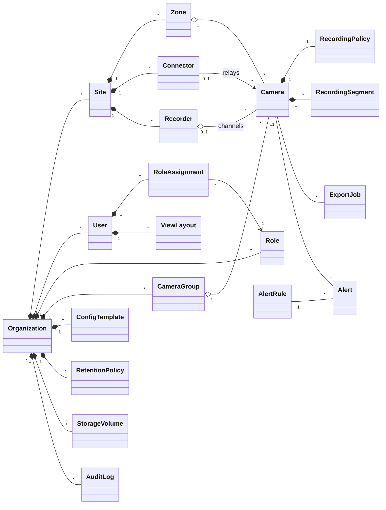
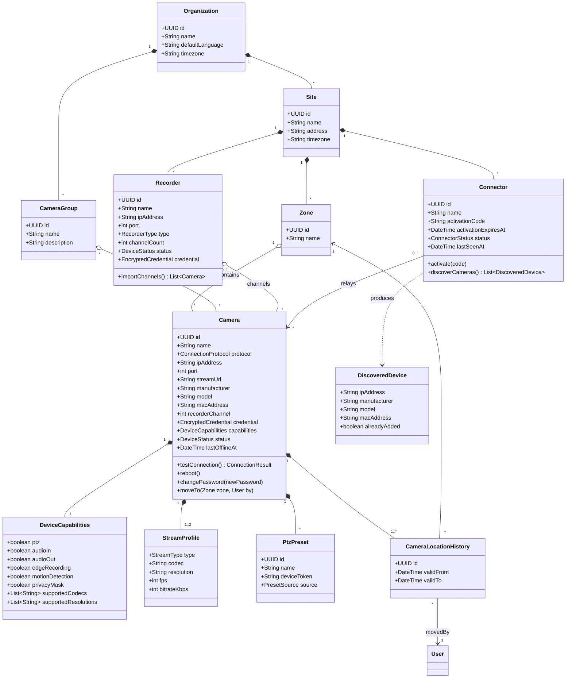
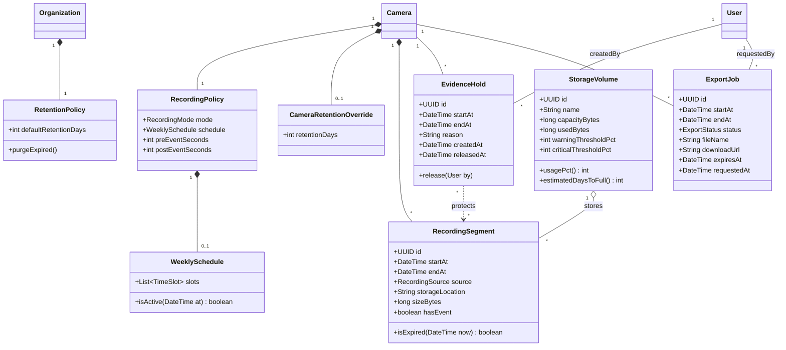
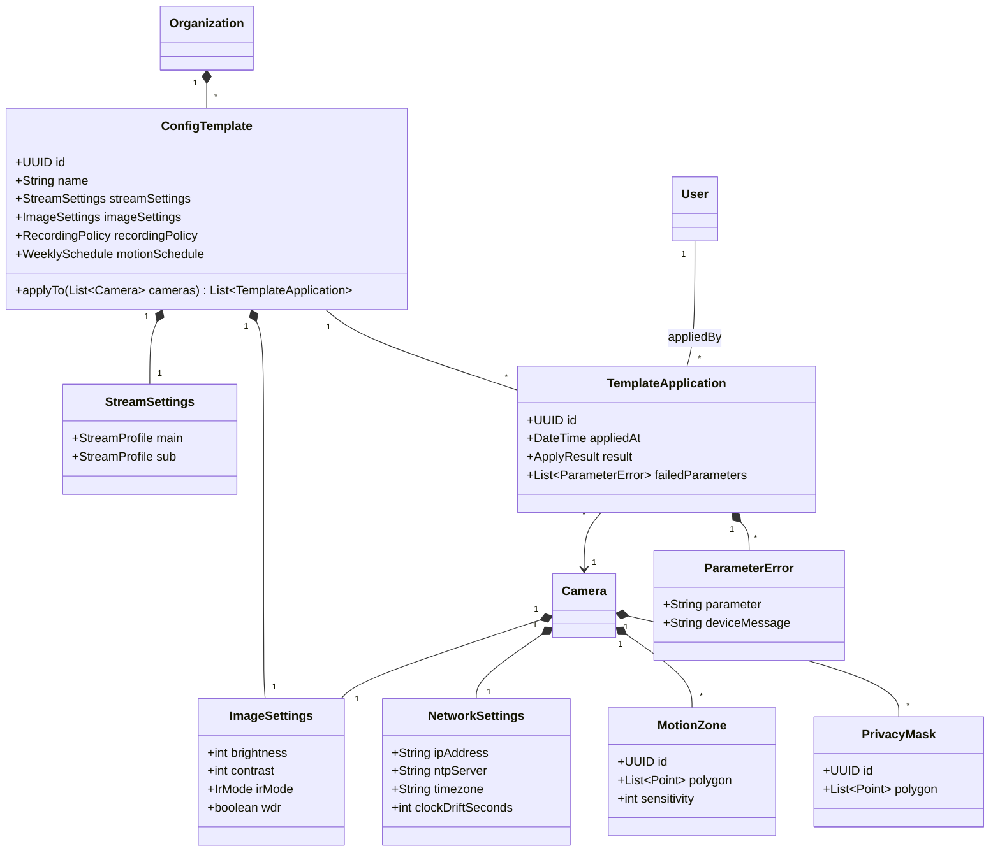
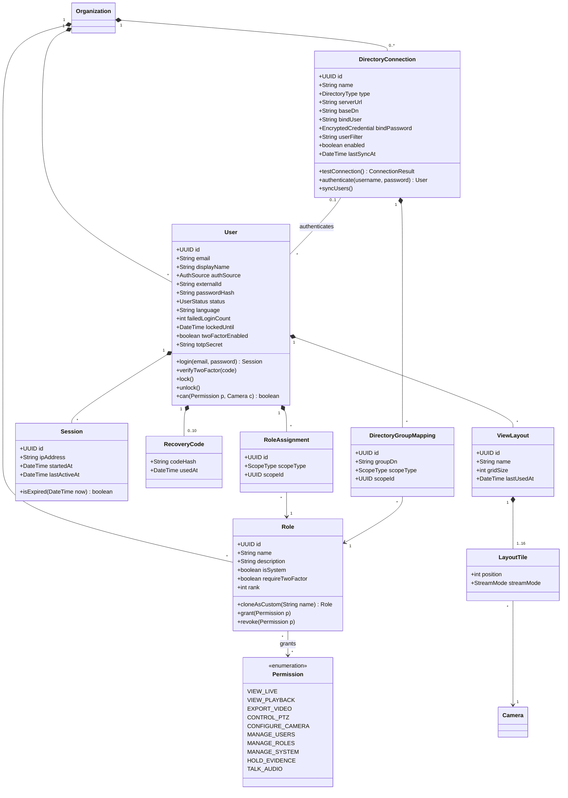
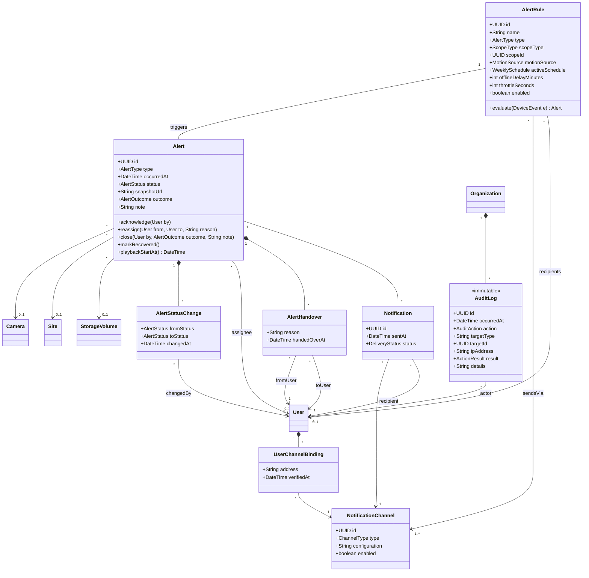

# Class Diagram (Domain Model) – CamHub: Nền tảng Web quản lý Camera IP

> Ngày: 21/10/2026 · Người soạn: Business Analyst · Phiên bản: 0.4 (Bản nháp)
> Tài liệu đầu vào: [BRD_IP_Camera_Web.md](BRD_IP_Camera_Web.md) (BRS v0.6), [PRD_IP_Camera_Web.md](PRD_IP_Camera_Web.md) (PRD v0.4), [Use_Case_IP_Camera_Web.md](Use_Case_IP_Camera_Web.md) (v0.2)

| Phiên bản | Ngày | Thay đổi |
| --- | --- | --- |
| 0.4 | 21/10/2026 | Theo UCQ-01, UCQ-02: thêm `Alert.assignee`, `Alert.reassign()`, lớp `AlertHandover`; INV-27, INV-28 |
| 0.3 | 21/10/2026 | Chốt CD-04 (có LDAP/AD): thêm `DirectoryConnection`, `DirectoryGroupMapping`, `User.authSource`; INV-23 đến INV-26. Chốt CD-05: phân tích chuyển động phía máy chủ ngoài phạm vi 1.0 |
| 0.2 | 21/10/2026 | Chốt CD-01 đến CD-03: thêm `CameraLocationHistory`, vai trò tùy chỉnh, `MotionSource`; thêm INV-18 đến INV-22 |
| 0.1 | 21/10/2026 | Bản nháp đầu tiên |

## 1. Phạm vi và quy ước

Tài liệu này là **mô hình miền (domain model)**: nó mô tả các khái niệm nghiệp vụ, thuộc tính chính và quan hệ giữa chúng. Lớp service, controller, kiểu dữ liệu cơ sở dữ liệu và API thuộc về SADD, không có ở đây.

Quy ước:

- **Sơ đồ:** viết bằng Mermaid `classDiagram`, hiển thị được trên GitHub và VS Code (cần extension hỗ trợ Mermaid).
- **Tên:** lớp và thuộc tính dùng tiếng Anh để chuyển thẳng sang thiết kế; mô tả viết bằng tiếng Việt.
- **Phương thức:** chỉ ghi các hành vi nghiệp vụ quan trọng, không ghi getter/setter.
- **Quan hệ:**
  - `*--` hợp thành (composition): phần không tồn tại khi mất tổng thể.
  - `o--` kết tập (aggregation).
  - `-->` kết hợp có hướng.
  - `--` kết hợp.
  - `..>` phụ thuộc.
- **Bội số:** `"1"`, `"0..1"`, `"*"` (nhiều), `"1..*"`.
- **Sẵn sàng SaaS:** mọi lớp đều thuộc về đúng một `Organization` (PRD mục 4.1). Để sơ đồ gọn, quan hệ này chỉ được vẽ ở các lớp gốc. Các lớp còn lại ngầm có thuộc tính `organizationId`.

---

## 2. Sơ đồ tổng quan

Sơ đồ chỉ gồm tên lớp và các quan hệ chính; thuộc tính có ở các sơ đồ chi tiết bên dưới.

---

## 3. Tổ chức và thiết bị

Khi camera chuyển sang khu vực hoặc địa điểm khác, video cũ vẫn được giữ, vì `RecordingSegment` gắn với `Camera`, không gắn với `Zone` (CD-01). `CameraLocationHistory` lưu camera đã ở khu vực nào, trong khoảng thời gian nào.

---

## 4. Ghi hình và xem lại

---

## 5. Cấu hình camera

---

## 6. Người dùng, phân quyền và bố cục xem

Ngoài 5 vai trò hệ thống (`isSystem = true`), tổ chức tạo được vai trò tùy chỉnh (CD-02). Vai trò tùy chỉnh có thể tạo mới từ tập quyền hoặc sao chép từ một vai trò có sẵn.

Tổ chức có thể kết nối với LDAP/Active Directory (CD-04). Người dùng từ thư mục có `authSource = DIRECTORY`, đăng nhập bằng tài khoản của tổ chức và không có mật khẩu lưu trên CamHub. `DirectoryGroupMapping` ánh xạ nhóm trong thư mục sang vai trò và phạm vi, từ đó tạo `RoleAssignment` tự động.

---

## 7. Cảnh báo, thông báo và nhật ký

Cảnh báo chuyển động mặc định lấy từ sự kiện do camera gửi về (`motionSource = DEVICE`) (CD-03). Giá trị `SERVER` (máy chủ tự phân tích) chỉ là chỗ dành sẵn trong mô hình, ngoài phạm vi 1.0 (CD-05).

---

## 8. Kiểu liệt kê (Enumerations)

| Kiểu | Giá trị | Dùng ở |
| --- | --- | --- |
| DeviceStatus | ONLINE, OFFLINE, UNKNOWN | Camera, Recorder |
| ConnectorStatus | PENDING_ACTIVATION, ONLINE, OFFLINE | Connector |
| ConnectionProtocol | ONVIF, RTSP | Camera |
| RecorderType | NVR, DVR | Recorder |
| StreamType | MAIN, SUB | StreamProfile |
| StreamMode | AUTO, HIGH, LOW | LayoutTile |
| PresetSource | DEVICE, CAMHUB | PtzPreset |
| RecordingMode | CONTINUOUS, SCHEDULED, EVENT, OFF | RecordingPolicy |
| RecordingSource | CAMHUB, DEVICE | RecordingSegment |
| ExportStatus | QUEUED, PROCESSING, READY, FAILED, EXPIRED | ExportJob |
| ApplyResult | SUCCESS, PARTIAL, FAILED | TemplateApplication |
| IrMode | AUTO, DAY, NIGHT | ImageSettings |
| UserStatus | ACTIVE, LOCKED, DISABLED | User |
| AuthSource | LOCAL, DIRECTORY | User |
| DirectoryType | ACTIVE_DIRECTORY, LDAP | DirectoryConnection |
| ScopeType | ORGANIZATION, SITE, GROUP, CAMERA | RoleAssignment, AlertRule |
| AlertType | MOTION, CAMERA_OFFLINE, SITE_OFFLINE, STORAGE_THRESHOLD | AlertRule, Alert |
| MotionSource | DEVICE (mặc định), SERVER (dự phòng cho phiên bản sau) | AlertRule |
| AlertStatus | NEW, IN_PROGRESS, CLOSED, RECOVERED | Alert |
| AlertOutcome | REAL, FALSE_ALARM, OTHER | Alert |
| ChannelType | WEB, EMAIL, TELEGRAM, ZALO | NotificationChannel |
| DeliveryStatus | PENDING, SENT, FAILED | Notification |
| AuditAction | LOGIN, LOGIN_FAILED, VIEW_PLAYBACK, EXPORT_VIDEO, CHANGE_CONFIG, CHANGE_PERMISSION, CHANGE_ROLE, MOVE_CAMERA, HOLD_EVIDENCE, RELEASE_EVIDENCE, TALK_AUDIO, REBOOT_CAMERA, CHANGE_CAMERA_PASSWORD | AuditLog |
| ActionResult | SUCCESS, FAILURE | AuditLog |

---

## 9. Mô tả lớp và truy vết

| Lớp | Mô tả | BR | US |
| --- | --- | --- | --- |
| Organization | Gốc của mọi dữ liệu; ở phiên bản 1.0 chỉ có một bản ghi, ở SaaS mỗi khách hàng là một bản ghi | Ràng buộc SaaS (BRS 7) | — |
| Site | Một cơ sở vật lý có lắp camera | BR-05 | US-05 |
| Zone | Khu vực trong địa điểm; mỗi camera thuộc đúng một khu vực | BR-05 | US-05 |
| CameraGroup | Nhóm logic, một camera có thể thuộc nhiều nhóm | BR-05 | US-05 |
| Connector | Bộ kết nối tại địa điểm, kết nối ra máy chủ để không phải mở cổng router | BR-01, BR-06 | US-01, US-06 |
| DiscoveredDevice | Kết quả dò tìm ONVIF, chưa phải camera đã thêm | BR-01 | US-01 |
| Recorder | Đầu ghi NVR/DVR; mỗi kênh là một Camera | BR-03 | US-03 |
| Camera | Thiết bị camera đã thêm vào hệ thống | BR-02, 04, 26 | US-02, 04, 28 |
| CameraLocationHistory | Lịch sử khu vực/địa điểm của camera; video cũ được giữ khi chuyển | BR-05 | US-05 |
| DeviceCapabilities | Khả năng camera báo qua ONVIF; quyết định tùy chọn được hiển thị | BR-27 | US-29 |
| StreamProfile | Luồng chính/phụ của camera | BR-10, 21 | US-11, 23 |
| PtzPreset | Vị trí PTZ đặt trước, từ camera hoặc tạo trên CamHub | BR-35 | US-13 |
| RecordingPolicy, WeeklySchedule | Chế độ và lịch ghi của camera | BR-14 | US-16 |
| RetentionPolicy, CameraRetentionOverride | Thời gian lưu mặc định của tổ chức và giá trị ghi đè theo camera | BR-19 | US-21 |
| RecordingSegment | Một đoạn video đã ghi, trên máy chủ hoặc trên thiết bị | BR-15, 16, 17, 20 | US-17, 18, 19, 22 |
| EvidenceHold | Đánh dấu "Giữ lại phục vụ điều tra", chặn việc tự xóa | RULE-02 | US-21 |
| ExportJob | Yêu cầu xuất clip, chạy nền, có liên kết tải hết hạn | BR-18 | US-20 |
| StorageVolume | Vùng lưu trữ video và ngưỡng cảnh báo | BR-37 | US-35, 39 |
| ConfigTemplate, TemplateApplication, ParameterError | Mẫu cấu hình và kết quả áp dụng cho từng camera | BR-25, 27 | US-27, 29 |
| StreamSettings, ImageSettings, NetworkSettings | Nhóm tham số cấu hình camera | BR-21, 22, 23 | US-23, 24, 25 |
| MotionZone, PrivacyMask | Vùng phát hiện chuyển động và vùng che riêng tư | BR-24 | US-26 |
| User, Session, RecoveryCode | Tài khoản cá nhân, phiên đăng nhập, mã dự phòng 2FA | BR-28, 36 | US-30, 31 |
| Role, Permission, RoleAssignment | Vai trò (hệ thống và tùy chỉnh), quyền và phạm vi gán quyền | BR-29, BR-39 | US-32, US-43 |
| DirectoryConnection, DirectoryGroupMapping | Kết nối LDAP/AD và ánh xạ nhóm thư mục sang vai trò, phạm vi | BR-40 | US-44 |
| ViewLayout, LayoutTile | Bố cục lưới xem trực tiếp đã lưu của người dùng | BR-09, 34 | US-09, 10 |
| AlertRule | Quy tắc sinh cảnh báo: loại, phạm vi, lịch, kênh, người nhận | BR-31, 32, 37 | US-34, 35, 36 |
| Alert, AlertStatusChange, AlertHandover | Cảnh báo, lịch sử trạng thái, lịch sử chuyển giao người phụ trách | BR-33, 38 | US-37, 38 |
| NotificationChannel, UserChannelBinding, Notification | Kênh gửi, địa chỉ nhận của người dùng, lượt gửi | BR-32 | US-36, 42 |
| AuditLog | Nhật ký thao tác, không sửa/xóa được | BR-30 | US-33 |

---

## 10. Quy tắc ràng buộc trên mô hình

| ID | Ràng buộc | Nguồn |
| --- | --- | --- |
| INV-01 | Mọi đối tượng và mọi quan hệ giữa các đối tượng phải cùng một `Organization` | Ràng buộc SaaS |
| INV-02 | `Camera` thuộc đúng 1 `Zone`; `Zone` của camera phải thuộc cùng `Site` với `Recorder` và `Connector` của camera (nếu có) | US-05 AC2 |
| INV-03 | `Camera.protocol = RTSP` thì `streamUrl` bắt buộc; `ONVIF` thì `ipAddress`, `port` bắt buộc | US-02 AC1 |
| INV-04 | `Camera` có tối đa 1 `StreamProfile` mỗi `StreamType` | BR-10 |
| INV-05 | `PtzPreset`, lệnh PTZ chỉ hợp lệ khi `capabilities.ptz = true`; tương tự âm thanh với `audioIn/audioOut` | US-12 AC1, US-15 AC1 |
| INV-06 | `RecordingSegment` hết hạn khi `endAt + retentionDays < now`, trong đó `retentionDays` lấy từ `CameraRetentionOverride` nếu có, nếu không lấy từ `RetentionPolicy` | BR-19 |
| INV-07 | Segment nằm trong khoảng của một `EvidenceHold` chưa `release` thì không bị xóa | RULE-02 |
| INV-08 | `ExportJob.endAt − startAt ≤ 60 phút`; `expiresAt = thời điểm READY + 24 giờ` | US-20 AC1, AC3 |
| INV-09 | Người dùng tạo `ExportJob` phải có `EXPORT_VIDEO` trên camera đó; tạo/giải phóng `EvidenceHold` phải có `HOLD_EVIDENCE` | RULE-01, RULE-02 |
| INV-10 | `User.can(p, c)` đúng khi tồn tại `RoleAssignment` có `Role` cấp `p` và phạm vi (`ORGANIZATION`, `SITE`, `GROUP` hoặc `CAMERA`) bao trùm camera `c` | BR-29 |
| INV-11 | Nếu một `Role` của người dùng có `requireTwoFactor = true` thì người dùng phải có `twoFactorEnabled = true` để đăng nhập | US-31 AC2 |
| INV-12 | `failedLoginCount ≥ 5` thì `status = LOCKED` | RULE-04 |
| INV-13 | `ViewLayout.gridSize ∈ {1, 4, 9, 16}` và số `LayoutTile ≤ gridSize`; tile trỏ tới camera không còn quyền xem bị loại khỏi bố cục | US-09, US-10 AC3 |
| INV-14 | `Alert.status` chỉ chuyển NEW → IN_PROGRESS → CLOSED, hoặc NEW/IN_PROGRESS → RECOVERED (với cảnh báo mất kết nối); đóng cảnh báo bắt buộc có `outcome` | US-37, US-34 AC2 |
| INV-15 | Cùng `AlertRule` và cùng camera không sinh `Notification` mới trong `throttleSeconds` | US-36 AC3 |
| INV-16 | `AuditLog` chỉ được tạo mới, không được sửa hoặc xóa; giữ tối thiểu 12 tháng | RULE-06, NFR-09 |
| INV-17 | `EncryptedCredential` (mật khẩu camera/đầu ghi) chỉ lưu ở dạng mã hóa | NFR-05 |
| INV-18 | Chuyển camera sang khu vực khác không xóa hoặc di chuyển `RecordingSegment`, `EvidenceHold`, `Alert` đã có; quyền xem video cũ được tính theo phạm vi **hiện tại** của camera | CD-01 |
| INV-19 | Mỗi camera có đúng một `CameraLocationHistory` đang hiệu lực (`validTo` rỗng); mỗi lần chuyển đóng bản ghi cũ, mở bản ghi mới và ghi `AuditLog` MOVE_CAMERA | CD-01, BR-30 |
| INV-20 | Vai trò hệ thống (`isSystem = true`) không xóa, đổi tên hoặc sửa quyền được; vai trò tùy chỉnh thì được | CD-02 |
| INV-21 | Không xóa được vai trò tùy chỉnh khi còn `RoleAssignment` trỏ tới nó; tên vai trò không trùng trong cùng `Organization` | CD-02 |
| INV-22 | Người tạo hoặc sửa vai trò phải có `MANAGE_ROLES` và không được cấp cho vai trò một quyền mà chính mình không có | CD-02 |
| INV-23 | `authSource = LOCAL` thì `passwordHash` bắt buộc; `authSource = DIRECTORY` thì `passwordHash` rỗng, `externalId` và `DirectoryConnection` bắt buộc | CD-04 |
| INV-24 | Với người dùng `DIRECTORY`, khóa tài khoản do thư mục quyết định; tài khoản bị vô hiệu hóa trong thư mục thì `status = DISABLED` ở lần đồng bộ hoặc đăng nhập kế tiếp | CD-04, RULE-05 |
| INV-25 | 2FA (INV-11) vẫn áp dụng cho người dùng `DIRECTORY` | CD-04, BR-36 |
| INV-26 | `RoleAssignment` sinh từ `DirectoryGroupMapping` được cập nhật mỗi lần đồng bộ; Admin không sửa tay được các gán quyền này, chỉ sửa ánh xạ | CD-04 |
| INV-27 | Người có MANAGE_USERS phạm vi `SITE` (Site Manager) chỉ tạo được người dùng cục bộ và chỉ gán `RoleAssignment` có phạm vi nằm trong địa điểm của mình; không gán được vai trò chứa quyền mà mình không có | UCQ-01, INV-22 |
| INV-28 | `Alert.reassign()` chỉ hợp lệ khi `status = IN_PROGRESS`, người gọi là `assignee` hiện tại hoặc có MANAGE_SYSTEM, và người nhận có VIEW_LIVE trên camera/địa điểm của cảnh báo; mỗi lần chuyển giao tạo một `AlertHandover` | UCQ-02 |

---

## 11. Điểm cần xác nhận

| Mã | Câu hỏi | Trạng thái |
| --- | --- | --- |
| CD-01 | Camera chuyển khu vực/địa điểm thì video cũ có giữ không? | Đã chốt: **có giữ** (INV-18, INV-19) |
| CD-02 | Có cần vai trò tùy chỉnh ngoài 5 vai trò mặc định không? | Đã chốt: **có** (INV-20 đến INV-22; BR-39, US-43) |
| CD-03 | Cảnh báo chuyển động lấy từ đâu? | Đã chốt: **mặc định từ sự kiện của camera** (`MotionSource.DEVICE`) |
| CD-04 | Có tích hợp LDAP/AD (OQ-05) không? | Đã chốt: **có** (`DirectoryConnection`, INV-23 đến INV-26; BR-40, US-44) |
| CD-05 | Máy chủ tự phân tích chuyển động có thuộc phạm vi 1.0 không? | Đã chốt: **ngoài phạm vi 1.0** |
