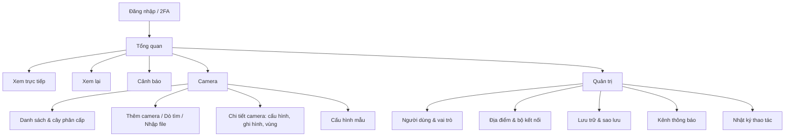

# PRD – CamHub: Nền tảng Web quản lý Camera IP (phiên bản 1.0)

> Ngày: 21/10/2026 · Người soạn: Product Owner / Business Analyst · Phiên bản PRD: 0.1 (Bản nháp)
> Tài liệu đầu vào: [BRD_IP_Camera_Web.md](BRD_IP_Camera_Web.md) (BRS v0.3)

| Phiên bản | Ngày | Người sửa | Thay đổi |
| --- | --- | --- | --- |
| 0.1 | 21/10/2026 | PO/BA | Tạo bản nháp đầu tiên từ BRS v0.3 |

**Quyết định đã chốt làm cơ sở cho PRD này:**

- **Mô hình:** triển khai nội bộ trước, chuyển sang SaaS ở phiên bản sau (OQ-01).
- **Phạm vi:** phiên bản 1.0 gồm toàn bộ yêu cầu nghiệp vụ BR-01 đến BR-38.
- **Giả định chưa chốt:** sản phẩm được tự phát triển. OQ-02 (tự phát triển hay mua VMS) vẫn mở; nếu quyết định mua, PRD này dùng làm bộ tiêu chí đánh giá nhà cung cấp.

---

## 1. Tổng quan

### 1.1 Vấn đề

Tổ chức dùng camera IP của nhiều hãng, mỗi hãng một phần mềm riêng. Người giám sát phải mở nhiều ứng dụng, tìm lại video chậm, cấu hình từng camera thủ công, và tài khoản dùng chung nên không truy vết được ai đã làm gì (BRS mục 3.1, P1–P5).

### 1.2 Giải pháp

CamHub là ứng dụng web cho phép người dùng làm mọi việc ngay trên trình duyệt:

- Thêm camera của mọi hãng qua ONVIF/RTSP.
- Xem trực tiếp nhiều camera.
- Xem lại và xuất video.
- Cấu hình camera từ xa, kể cả hàng loạt.
- Nhận và xử lý cảnh báo.
- Phân quyền chi tiết và ghi nhật ký mọi thao tác quan trọng.

### 1.3 Ngoài phạm vi phiên bản 1.0

- Ứng dụng di động native
- Phân tích hình ảnh bằng AI
- Camera analog không qua đầu ghi
- Nâng cấp firmware hàng loạt
- Tích hợp kiểm soát ra vào, báo cháy
- Thanh toán, gói cước
- Vận hành nhiều khách hàng (SaaS)

---

## 2. Mục tiêu sản phẩm và chỉ số

| Mục tiêu nghiệp vụ (BRS) | Chỉ số sản phẩm | Mục tiêu | Cách đo trong sản phẩm |
| --- | --- | --- | --- |
| BO-01 Hợp nhất giám sát | % camera ở trạng thái trực tuyến trên tổng camera đã khai báo | ≥ 95% | Bảng điều khiển trạng thái camera |
| BO-02 Thêm camera nhanh | Thời gian trung vị từ lúc bấm "Thêm camera" đến khi có hình | ≤ 2 phút | Sự kiện `camera_add_started` → `camera_first_frame` |
| BO-03 Tìm video nhanh | Thời gian trung vị từ lúc mở Xem lại đến khi xuất clip hoặc đóng | ≤ 1 phút | Sự kiện `playback_opened` → `export_requested` |
| BO-04 Giảm công cấu hình | Số camera trung bình mỗi lần áp cấu hình mẫu; thời gian cấu hình 10 camera | Giảm 70% so với baseline | Sự kiện `template_applied`; đo baseline trước pilot |
| BO-05 An toàn truy cập | % thao tác quan trọng có bản ghi nhật ký | 100% | Kiểm thử tự động đối chiếu thao tác với nhật ký |

Chỉ số phụ, dùng để theo dõi sức khỏe sản phẩm:

- Tỷ lệ phiên xem trực tiếp bị lỗi phát hình
- Số cảnh báo chưa xử lý quá 30 phút
- Điểm hài lòng của người dùng pilot (mục tiêu ≥ 4/5)

---

## 3. Người dùng và persona

| Persona | Vai trò hệ thống | Mục tiêu chính | Khó khăn hiện tại | Thiết bị chính |
| --- | --- | --- | --- | --- |
| **Lan – Nhân viên giám sát** | Operator | Theo dõi nhiều camera suốt ca, phản ứng nhanh khi có cảnh báo | Nhảy giữa nhiều app, bỏ sót sự kiện | Màn hình lớn phòng giám sát |
| **Minh – Kỹ thuật viên** | Technician | Lắp đặt và cấu hình camera nhanh, ít đi lại | Phải đăng nhập từng camera để cấu hình | Laptop, điện thoại tại hiện trường |
| **Hương – Quản lý chi nhánh** | Site Manager | Nắm tình hình chi nhánh, cung cấp bằng chứng khi có khiếu nại | Phải nhờ IT trích xuất video | Máy tính, điện thoại |
| **Tuấn – Quản trị IT** | Admin | Quản lý người dùng, quyền, hạ tầng an toàn | Tài khoản dùng chung, không có nhật ký | Máy tính |
| **Viewer** | Viewer | Xem nhanh một vài camera được cấp quyền | Không có quyền truy cập riêng | Điện thoại |

Đặc điểm chi tiết của từng vai trò có trong BRS mục 4.6.

---

## 4. Phạm vi phát hành 1.0

Phiên bản 1.0 phát hành **toàn bộ 38 yêu cầu nghiệp vụ**, chia thành 7 epic. Mức MoSCoW từ BRS dùng để **sắp thứ tự phát triển** qua các mốc ở mục 10, không dùng để loại yêu cầu.

| Epic | Tên | Yêu cầu nghiệp vụ | Số user story |
| --- | --- | --- | --- |
| EP-01 | Kết nối và quản lý camera | BR-01 đến BR-07 | 7 |
| EP-02 | Xem trực tiếp | BR-08 đến BR-13, BR-34, BR-35 | 8 |
| EP-03 | Ghi hình và xem lại | BR-14 đến BR-20 | 7 |
| EP-04 | Cấu hình camera | BR-21 đến BR-27 | 7 |
| EP-05 | Người dùng, phân quyền, nhật ký | BR-28 đến BR-30, BR-36 | 4 |
| EP-06 | Cảnh báo | BR-31 đến BR-33, BR-37, BR-38 | 5 |
| EP-07 | Nền tảng và sẵn sàng SaaS | NFR-01 đến NFR-12, ràng buộc mục 7 BRS | 4 |

### 4.1 Yêu cầu sẵn sàng SaaS (áp dụng từ phiên bản 1.0)

Phiên bản 1.0 chỉ chạy cho một tổ chức, nhưng phải đáp ứng các điều kiện sau để lên SaaS mà không phải làm lại:

- Mọi bản ghi dữ liệu (camera, người dùng, video, nhật ký, cảnh báo) gắn với một mã Tổ chức.
- Phân quyền luôn kiểm tra phạm vi Tổ chức trước phạm vi Địa điểm/Nhóm.
- Cấu hình hệ thống (thời gian lưu, kênh thông báo, chính sách 2FA) lưu theo Tổ chức, không lưu toàn cục.
- Lưu trữ video tách thư mục/bucket theo Tổ chức.

---

## 5. Hành trình người dùng chính

| Hành trình | Persona | Các bước chính | User story liên quan |
| --- | --- | --- | --- |
| HT-01 Lắp đặt địa điểm mới (SC-01) | Minh | Cài bộ kết nối → dò tìm camera → thêm hàng loạt → gán địa điểm/khu vực → áp cấu hình mẫu | US-01, US-05, US-06, US-27 |
| HT-02 Xử lý cảnh báo đêm (SC-02) | Lan | Nhận thông báo → mở cảnh báo → xem trực tiếp lưới 4 → PTZ đến preset → ghi chú, đóng cảnh báo | US-36, US-38, US-09, US-12, US-13, US-37 |
| HT-03 Trích xuất bằng chứng (SC-03) | Lan, Hương | Chọn camera → xem lại đồng bộ → tua, tìm đoạn → xuất clip → nhật ký ghi lại | US-17, US-19, US-18, US-20, US-33 |
| HT-04 Camera mất kết nối (SC-04) | Minh | Nhận cảnh báo → kiểm tra trạng thái → khởi động lại từ xa → xem lại từ thẻ nhớ | US-34, US-04, US-28, US-22 |

---

## 6. Yêu cầu chức năng (user story và tiêu chí chấp nhận)

Quy ước:

- **Dạng user story:** "Là [vai trò], tôi muốn [hành động], để [giá trị]".
- **Tiêu chí chấp nhận (AC):** mọi AC phải đạt thì story mới được coi là hoàn thành.
- **Cột BR:** truy vết về yêu cầu nghiệp vụ trong BRS.
- **Cột Ưu tiên:** mức MoSCoW lấy từ BRS.

### EP-01 Kết nối và quản lý camera

**US-01 Dò tìm camera ONVIF** · BR-01 · Must
Là Kỹ thuật viên, tôi muốn hệ thống tự tìm camera trong mạng của địa điểm, để không phải nhập IP từng camera.
- AC1: Bấm "Dò tìm" thì sau ≤ 30 giây hiển thị danh sách camera ONVIF trong mạng LAN của bộ kết nối, gồm IP, hãng, model, địa chỉ MAC.
- AC2: Camera đã có trong hệ thống được đánh dấu "Đã thêm" và không cho chọn lại.
- AC3: Có thể chọn nhiều camera, nhập tài khoản chung một lần và thêm tất cả.
- AC4: Camera sai mật khẩu được báo lỗi riêng và không chặn các camera khác.

**US-02 Thêm camera thủ công** · BR-02 · Must
Là Kỹ thuật viên, tôi muốn thêm camera bằng IP/cổng/tài khoản hoặc URL RTSP, để kết nối được camera không bật ONVIF.
- AC1: Form có hai chế độ: "ONVIF" (IP, cổng, tài khoản, mật khẩu) và "RTSP" (URL đầy đủ).
- AC2: Bấm "Kiểm tra kết nối" thì sau ≤ 10 giây hiển thị khung hình xem trước hoặc thông báo lỗi cụ thể (sai mật khẩu, không tới được địa chỉ, sai đường dẫn).
- AC3: Camera chỉ được lưu sau khi kiểm tra kết nối thành công, hoặc khi người dùng chọn "Lưu dù chưa kết nối".

**US-03 Thêm đầu ghi NVR/DVR** · BR-03 · Should
Là Kỹ thuật viên, tôi muốn thêm một đầu ghi và nhận mọi kênh của nó, để không phải thêm từng camera.
- AC1: Sau khi thêm đầu ghi, hệ thống liệt kê toàn bộ kênh kèm tên kênh lấy từ đầu ghi.
- AC2: Người dùng chọn kênh cần dùng; mỗi kênh trở thành một camera trong hệ thống, liên kết với đầu ghi gốc.
- AC3: Khi đầu ghi mất kết nối, mọi kênh của nó chuyển trạng thái "Mất kết nối".

**US-04 Trạng thái camera** · BR-04 · Must
Là Operator, tôi muốn thấy camera nào đang mất kết nối, để báo kỹ thuật kịp thời.
- AC1: Mỗi camera hiển thị trạng thái Trực tuyến / Mất kết nối; trạng thái cập nhật trong ≤ 60 giây sau khi thay đổi.
- AC2: Camera mất kết nối hiển thị thời điểm mất kết nối gần nhất.
- AC3: Trang tổng quan hiển thị số camera trực tuyến / tổng số theo từng địa điểm.

**US-05 Tổ chức và lọc camera** · BR-05 · Must
Là Site Manager, tôi muốn sắp camera theo địa điểm, khu vực, nhóm, để tìm nhanh trong hàng trăm camera.
- AC1: Cây phân cấp Địa điểm → Khu vực → Nhóm → Camera; kéo thả camera giữa các nhóm.
- AC2: Một camera có thể thuộc nhiều nhóm nhưng chỉ thuộc một khu vực.
- AC3: Ô tìm kiếm theo tên; bộ lọc theo trạng thái và hãng; kết quả hiển thị trong ≤ 1 giây với 500 camera.

**US-06 Kết nối địa điểm xa không mở cổng** · BR-06 · Should
Là Admin, tôi muốn kết nối camera ở chi nhánh không có IP tĩnh, để không phải cấu hình router.
- AC1: Admin tạo "Bộ kết nối" cho địa điểm và nhận mã kích hoạt dùng một lần, hết hạn sau 24 giờ.
- AC2: Bộ kết nối chỉ cần kết nối ra ngoài (outbound) qua HTTPS (cổng 443), không yêu cầu mở cổng vào.
- AC3: Trang địa điểm hiển thị trạng thái bộ kết nối và thời điểm liên lạc gần nhất.

**US-07 Nhập camera từ file** · BR-07 · Could
Là Kỹ thuật viên, tôi muốn nhập danh sách camera từ file, để triển khai địa điểm lớn nhanh hơn.
- AC1: Tải được file mẫu (.xlsx và .csv) với các cột: tên, IP, cổng, tài khoản, mật khẩu, khu vực, nhóm.
- AC2: Sau khi tải lên, hệ thống hiển thị bản xem trước, đánh dấu dòng lỗi kèm lý do trước khi xác nhận.
- AC3: Chỉ các dòng hợp lệ được thêm; có báo cáo kết quả số dòng thành công/lỗi.

### EP-02 Xem trực tiếp

**US-08 Xem trực tiếp trên trình duyệt** · BR-08 · Must
Là Operator, tôi muốn xem camera trên trình duyệt mà không cài gì, để làm việc từ bất kỳ máy nào.
- AC1: Phát được trên 2 phiên bản mới nhất của Chrome, Edge, Firefox, Safari (kể cả Safari iOS) mà không cần plugin.
- AC2: Hình ảnh hiển thị trong ≤ 3 giây sau khi mở (NFR-01); độ trễ ≤ 2 giây trong LAN.
- AC3: Camera dùng chuẩn nén trình duyệt không giải mã được (ví dụ H.265 trên một số trình duyệt) vẫn xem được nhờ máy chủ chuyển đổi, hoặc hiển thị thông báo hướng dẫn.

**US-09 Lưới nhiều camera** · BR-09 · Must
Là Operator, tôi muốn xem nhiều camera cùng lúc, để giám sát toàn khu vực.
- AC1: Chọn bố cục 1, 4, 9, 16 ô; kéo thả camera từ cây vào ô.
- AC2: Ở lưới 9 và 16, các ô mặc định dùng luồng phụ; nhấp đúp một ô để phóng to và chuyển sang luồng chính.
- AC3: Ô của camera mất kết nối hiển thị trạng thái thay vì màn hình đen.

**US-10 Lưu bố cục xem** · BR-34 · Must
Là Operator, tôi muốn lưu bố cục và danh sách camera đang xem, để mở lại ngay ở ca sau.
- AC1: Lưu được tối thiểu 10 bố cục có tên cho mỗi người dùng.
- AC2: Khi đăng nhập lại, hệ thống mở bố cục dùng gần nhất.
- AC3: Camera bị thu hồi quyền tự biến khỏi bố cục đã lưu của người đó.

**US-11 Tự chuyển luồng theo băng thông** · BR-10 · Should
Là Operator ở chi nhánh mạng yếu, tôi muốn hình ảnh không bị đứng, để vẫn theo dõi được.
- AC1: Khi băng thông đo được thấp hơn bitrate luồng đang xem trong 5 giây liên tục, hệ thống chuyển sang luồng phụ và hiển thị biểu tượng "Chất lượng thấp".
- AC2: Người dùng chọn thủ công "Cao / Thấp / Tự động" cho từng ô; chế độ thủ công không bị tự chuyển.

**US-12 Điều khiển PTZ** · BR-11 · Must
Là Operator, tôi muốn xoay, nghiêng, zoom camera, để theo dõi đối tượng di chuyển.
- AC1: Nút điều khiển PTZ chỉ hiển thị với camera có hỗ trợ PTZ.
- AC2: Điều khiển bằng nút trên màn hình, kéo chuột trên khung hình, và phím mũi tên khi ô đang được chọn.
- AC3: Khi hai người cùng điều khiển một camera, người có vai trò cao hơn được ưu tiên; người còn lại thấy thông báo "Đang được điều khiển bởi [tên]".

**US-13 Preset PTZ** · BR-35 · Must
Là Operator, tôi muốn gọi nhanh vị trí đặt sẵn, để chuyển đến điểm cần xem trong 1 thao tác.
- AC1: Lưu preset có tên từ vị trí hiện tại; xem và gọi danh sách preset của camera.
- AC2: Preset đọc từ camera (nếu camera đã có) được hiển thị cùng preset tạo trên CamHub.

**US-14 Chụp ảnh, phóng to, toàn màn hình** · BR-12 · Should
Là Operator, tôi muốn chụp nhanh khung hình, để lưu bằng chứng tức thời.
- AC1: Nút "Chụp ảnh" tải về ảnh PNG có ghi tên camera và thời điểm.
- AC2: Phóng to kỹ thuật số bằng cuộn chuột hoặc chụm ngón tay, tối đa 8x.
- AC3: Chế độ toàn màn hình cho một ô hoặc cả lưới.

**US-15 Âm thanh hai chiều** · BR-13 · Could
Là Operator, tôi muốn nghe và nói qua camera, để cảnh báo người tại hiện trường.
- AC1: Biểu tượng loa/micro chỉ hiển thị với camera có hỗ trợ âm thanh.
- AC2: Âm thanh mặc định tắt; bật đàm thoại phải giữ nút "Nhấn để nói".
- AC3: Mỗi lần đàm thoại được ghi nhật ký.

### EP-03 Ghi hình và xem lại

**US-16 Chế độ ghi hình** · BR-14 · Must
Là Admin, tôi muốn đặt chế độ ghi cho từng camera, để cân bằng lưu trữ và nhu cầu bằng chứng.
- AC1: Chọn chế độ Liên tục / Theo lịch (lịch tuần theo khung 30 phút) / Theo sự kiện (ghi trước sự kiện 10 giây, sau sự kiện 30 giây; cả hai giá trị chỉnh được).
- AC2: Áp được một chế độ ghi cho nhiều camera cùng lúc.
- AC3: Biểu tượng trạng thái "Đang ghi" hiển thị trên ô xem trực tiếp.

**US-17 Xem lại theo dòng thời gian** · BR-15 · Must
Là Operator, tôi muốn chọn ngày giờ trên timeline, để tìm đúng đoạn cần xem.
- AC1: Timeline phóng to được từ 24 giờ đến 1 phút; đoạn có ghi hình, đoạn có sự kiện và khoảng trống được tô màu khác nhau.
- AC2: Chọn mốc thời gian thì video bắt đầu phát trong ≤ 3 giây (NFR-02).
- AC3: Lịch chọn ngày đánh dấu các ngày có dữ liệu.

**US-18 Điều khiển phát lại** · BR-16 · Must
Là Operator, tôi muốn tua nhanh và xem từng khung hình, để rà video dài nhanh hơn.
- AC1: Tốc độ 0,5x, 1x, 2x, 4x, 8x, 16x; tạm dừng; tới/lùi một khung hình khi đang dừng.
- AC2: Phím tắt: Space (phát/dừng), mũi tên trái/phải (lùi/tới 10 giây).

**US-19 Xem lại đồng bộ nhiều camera** · BR-17 · Should
Là Operator, tôi muốn phát lại nhiều camera cùng mốc thời gian, để theo dấu một người qua nhiều góc quay.
- AC1: Chọn tối đa 4 camera vào chế độ đồng bộ; một timeline chung điều khiển tất cả.
- AC2: Độ lệch thời gian giữa các camera khi phát ≤ 1 giây.

**US-20 Xuất clip** · BR-18 · Must
Là Site Manager, tôi muốn xuất đoạn video ra file, để gửi cho bên liên quan.
- AC1: Chọn điểm bắt đầu/kết thúc trên timeline; một lần xuất dài tối đa 60 phút.
- AC2: File xuất định dạng MP4 (H.264), phát được bằng trình phát phổ biến; tên file gồm tên camera và khoảng thời gian.
- AC3: Xuất chạy nền; khi xong người dùng nhận thông báo kèm liên kết tải, liên kết hết hạn sau 24 giờ.
- AC4: Chỉ người có quyền "Xuất video" thấy nút xuất (RULE-01); mỗi lần xuất được ghi nhật ký (US-33).

**US-21 Thời gian lưu trữ** · BR-19 · Must
Là Admin, tôi muốn đặt thời gian lưu video theo camera, để kiểm soát dung lượng và tuân thủ quy định.
- AC1: Thời gian lưu mặc định theo Tổ chức (giá trị chờ OQ-04); ghi đè được cho từng camera, từ 1 đến 365 ngày.
- AC2: Video quá hạn tự xóa hằng ngày; đoạn được đánh dấu "Giữ lại phục vụ điều tra" không bị xóa (RULE-02).
- AC3: Chỉ Site Manager trở lên được đánh dấu và bỏ đánh dấu "Giữ lại"; thao tác này được ghi nhật ký.

**US-22 Xem lại từ thiết bị** · BR-20 · Should
Là Operator, tôi muốn xem video lưu trên thẻ nhớ hoặc đầu ghi, để có dữ liệu cả khi máy chủ không ghi được.
- AC1: Timeline hiển thị nguồn "Thiết bị" song song với nguồn "CamHub" khi camera hỗ trợ ONVIF Profile G hoặc là kênh của đầu ghi.
- AC2: Xuất clip từ nguồn thiết bị theo cùng quy tắc của US-20.

### EP-04 Cấu hình camera

**US-23 Cấu hình luồng video** · BR-21 · Must
Là Kỹ thuật viên, tôi muốn chỉnh độ phân giải, fps, bitrate, chuẩn nén từ CamHub, để không phải vào giao diện của từng camera.
- AC1: Hiển thị giá trị hiện tại của luồng chính và luồng phụ; chỉ liệt kê giá trị camera hỗ trợ (US-29).
- AC2: Bấm "Áp dụng" thì sau ≤ 15 giây hiển thị kết quả thành công hoặc thất bại cho từng tham số.

**US-24 Cấu hình hình ảnh** · BR-22 · Should
Là Kỹ thuật viên, tôi muốn chỉnh sáng, tương phản, hồng ngoại, WDR, để hình ảnh rõ hơn mà không cần đến hiện trường.
- AC1: Thanh trượt có xem trước trực tiếp; nút "Khôi phục giá trị trước".

**US-25 Cấu hình mạng và thời gian** · BR-23 · Should
Là Kỹ thuật viên, tôi muốn đặt IP, NTP, múi giờ cho camera, để thời gian video chính xác.
- AC1: Trước khi đổi IP, hệ thống cảnh báo rằng camera có thể mất kết nối và tự cập nhật địa chỉ mới sau khi đổi.
- AC2: Danh sách camera đánh dấu những camera lệch giờ quá 5 giây so với máy chủ.

**US-26 Vùng chuyển động và vùng che riêng tư** · BR-24 · Must
Là Kỹ thuật viên, tôi muốn vẽ vùng phát hiện chuyển động và vùng che, để giảm cảnh báo giả và bảo vệ quyền riêng tư.
- AC1: Vẽ vùng trên khung hình bằng lưới ô hoặc đa giác (tùy khả năng camera); chỉnh độ nhạy 1–100.
- AC2: Vùng che riêng tư được áp dụng cả trên luồng xem trực tiếp và video ghi lại (RULE-03).

**US-27 Cấu hình mẫu** · BR-25 · Should
Là Kỹ thuật viên, tôi muốn tạo mẫu cấu hình và áp cho nhiều camera, để cấu hình hàng loạt trong một lần.
- AC1: Tạo mẫu gồm luồng video, hình ảnh, chế độ ghi, lịch phát hiện chuyển động.
- AC2: Áp mẫu cho các camera đã chọn; kết quả hiển thị từng camera: thành công / một phần (kèm tham số lỗi) / thất bại.

**US-28 Đổi mật khẩu, khởi động lại** · BR-26 · Should
Là Kỹ thuật viên, tôi muốn đổi mật khẩu và khởi động lại camera từ xa, để xử lý sự cố nhanh.
- AC1: Đổi mật khẩu cho một hoặc nhiều camera; hệ thống tự cập nhật mật khẩu đã lưu khi đổi thành công.
- AC2: Khởi động lại yêu cầu xác nhận; trạng thái camera được theo dõi đến khi trực tuyến lại.

**US-29 Chỉ hiển thị tham số được hỗ trợ** · BR-27 · Must
Là Kỹ thuật viên, tôi muốn chỉ thấy tùy chọn camera thực sự hỗ trợ, để không cấu hình sai.
- AC1: Các tùy chọn được lấy từ khả năng camera báo qua ONVIF; tùy chọn không hỗ trợ bị ẩn.
- AC2: Khi camera từ chối một thay đổi, hiển thị tên tham số và thông báo lỗi do camera trả về.

### EP-05 Người dùng, phân quyền, nhật ký

**US-30 Đăng nhập tài khoản cá nhân** · BR-28 · Must
Là người dùng, tôi muốn đăng nhập bằng tài khoản riêng, để mọi thao tác gắn với tôi.
- AC1: Đăng nhập bằng email và mật khẩu; mật khẩu tối thiểu 10 ký tự.
- AC2: Khóa tài khoản sau 5 lần sai liên tiếp (RULE-04); mở khóa qua email hoặc do Admin.
- AC3: Phiên đăng nhập hết hạn sau 12 giờ không hoạt động.

**US-31 Xác thực hai lớp** · BR-36 · Must
Là Admin, tôi muốn bắt buộc 2FA cho các vai trò quan trọng, để giảm rủi ro lộ mật khẩu.
- AC1: Hỗ trợ ứng dụng xác thực (TOTP); có 10 mã dự phòng dùng một lần.
- AC2: Admin bật bắt buộc 2FA theo vai trò; người dùng thuộc vai trò đó phải thiết lập 2FA ở lần đăng nhập kế tiếp.

**US-32 Phân quyền theo vai trò và phạm vi** · BR-29 · Must
Là Admin, tôi muốn gán vai trò và phạm vi camera cho từng người, để mỗi người chỉ thấy và làm đúng việc của mình.
- AC1: Có 5 vai trò mặc định (Admin, Site Manager, Technician, Operator, Viewer) với quyền như BRS mục 4.6.
- AC2: Phạm vi gán theo Địa điểm, Nhóm hoặc từng camera.
- AC3: Quyền tách riêng: Xem trực tiếp, Xem lại, Xuất video, Điều khiển PTZ, Cấu hình, Quản lý người dùng.
- AC4: Thay đổi quyền có hiệu lực trong ≤ 60 giây, kể cả với phiên đang mở.

**US-33 Nhật ký thao tác** · BR-30 · Must
Là Admin/Pháp chế, tôi muốn xem ai đã làm gì, để truy vết khi có sự cố.
- AC1: Ghi nhật ký đăng nhập (thành công/thất bại), xem lại, xuất video, thay đổi cấu hình, thay đổi quyền, đàm thoại.
- AC2: Mỗi bản ghi gồm người thực hiện, thời điểm, địa chỉ IP, đối tượng, kết quả.
- AC3: Lọc theo người, thời gian, loại thao tác, camera; xuất CSV.
- AC4: Không vai trò nào sửa hoặc xóa được nhật ký (RULE-06); lưu tối thiểu 12 tháng (NFR-09).

### EP-06 Cảnh báo

**US-34 Cảnh báo mất kết nối** · BR-31 · Must
Là Kỹ thuật viên, tôi muốn được báo khi camera mất kết nối, để xử lý trước khi mất dữ liệu.
- AC1: Admin cấu hình thời gian chờ trước khi cảnh báo (mặc định 5 phút).
- AC2: Khi camera kết nối lại, cảnh báo tự chuyển trạng thái "Đã phục hồi".
- AC3: Nhiều camera cùng địa điểm mất kết nối cùng lúc được gộp thành một cảnh báo cấp địa điểm.

**US-35 Cảnh báo dung lượng lưu trữ** · BR-37 · Must
Là Admin, tôi muốn được báo khi lưu trữ sắp đầy, để không bị dừng ghi.
- AC1: Ngưỡng cảnh báo cấu hình được (mặc định 85% và 95%).
- AC2: Cảnh báo hiển thị dung lượng còn lại và số ngày ước tính trước khi đầy.

**US-36 Cảnh báo chuyển động đa kênh** · BR-32 · Should
Là Operator, tôi muốn nhận cảnh báo chuyển động qua web, email, Telegram và Zalo, để phản ứng kịp thời ngoài giờ.
- AC1: Cấu hình theo camera hoặc nhóm: khung giờ áp dụng, kênh nhận, người nhận.
- AC2: Thông báo gồm tên camera, thời điểm, ảnh chụp sự kiện và liên kết mở cảnh báo.
- AC3: Cùng một camera không gửi quá 1 thông báo mỗi 2 phút (chống spam); giá trị này chỉnh được.

**US-37 Xử lý cảnh báo** · BR-33 · Should
Là Operator, tôi muốn xác nhận và ghi chú cảnh báo, để cả ca biết cảnh báo nào đã có người xử lý.
- AC1: Trạng thái cảnh báo: Mới → Đang xử lý → Đã đóng; mỗi chuyển trạng thái ghi người và thời điểm.
- AC2: Khi đóng cảnh báo bắt buộc chọn kết quả (Thật / Báo giả / Khác) và cho phép ghi chú.

**US-38 Mở xem lại từ cảnh báo** · BR-38 · Should
Là Operator, tôi muốn mở ngay video tại thời điểm cảnh báo, để xác minh trong vài giây.
- AC1: Bấm cảnh báo thì mở xem lại tại thời điểm cảnh báo trừ 10 giây, kèm nút chuyển sang xem trực tiếp.

### EP-07 Nền tảng và sẵn sàng SaaS

**US-39 Bảng tổng quan hệ thống** · NFR-04, mục 6.3 BRS · Must
Là Admin, tôi muốn xem sức khỏe hệ thống, để phát hiện sớm vấn đề.
- AC1: Hiển thị số camera trực tuyến/mất kết nối, dung lượng lưu trữ, số cảnh báo đang mở, trạng thái các bộ kết nối.

**US-40 Sao lưu và khôi phục** · NFR-10, NFR-11 · Must
Là Admin, tôi muốn hệ thống sao lưu tự động, để khôi phục được khi có sự cố.
- AC1: Sao lưu cấu hình, người dùng, nhật ký mỗi giờ (RPO ≤ 1 giờ); giữ tối thiểu 30 bản.
- AC2: Quy trình khôi phục được kiểm thử, hoàn tất trong ≤ 4 giờ (RTO).

**US-41 Đa ngôn ngữ và responsive** · NFR-07 · Must
Là người dùng, tôi muốn dùng giao diện tiếng Việt hoặc tiếng Anh trên mọi màn hình, để làm việc thuận tiện.
- AC1: Chuyển ngôn ngữ trong hồ sơ người dùng; mặc định tiếng Việt.
- AC2: Mọi màn hình dùng được ở chiều rộng 360px; lưới xem trực tiếp trên điện thoại tối đa 4 ô.

**US-42 Trung tâm thông báo trên web** · BR-32 · Should
Là Operator, tôi muốn thấy cảnh báo mới ngay trên web, để không bỏ sót khi đang xem camera.
- AC1: Biểu tượng chuông hiển thị số cảnh báo chưa xử lý; cảnh báo mới hiện toast kèm âm báo tắt/bật được.

Yêu cầu sẵn sàng SaaS (mục 4.1) là ràng buộc kiến trúc, được kiểm tra ở bước review thiết kế và kiểm thử phân quyền, không viết thành user story riêng.

---

## 7. Trải nghiệm người dùng

### 7.1 Sơ đồ màn hình

### 7.2 Nguyên tắc thiết kế

- **Ưu tiên màn hình giám sát:** Xem trực tiếp là trang mặc định của Operator. Giao diện nền tối giúp giảm mỏi mắt trong ca dài, và người dùng có thể chuyển sang nền sáng.
- **Ẩn chức năng theo quyền:** người dùng không thấy nút của chức năng họ không có quyền, thay vì thấy rồi bị báo lỗi.
- **Trạng thái rõ ràng:** mỗi ô camera luôn hiện một trong các trạng thái Đang tải, Đang phát, Mất kết nối, Không có quyền, Chất lượng thấp.
- **Thao tác hàng loạt:** mọi danh sách camera cho chọn nhiều camera cùng lúc để áp mẫu, đổi mật khẩu hoặc gán nhóm.
- **Dùng được bằng bàn phím:** có phím tắt cho xem trực tiếp, PTZ và phát lại.

---

## 8. Yêu cầu phi chức năng (mức sản phẩm)

Các yêu cầu dưới đây kế thừa NFR-01 đến NFR-12 trong BRS và bổ sung chi tiết kỹ thuật đã được tách khỏi yêu cầu nghiệp vụ.

| ID | Yêu cầu | Nguồn |
| --- | --- | --- |
| PNFR-01 | Trình duyệt hỗ trợ: 2 phiên bản mới nhất của Chrome, Edge, Firefox, Safari (macOS, iOS) | NFR-08 |
| PNFR-02 | Phát trực tiếp qua WebRTC (độ trễ thấp), dự phòng HLS khi mạng chặn WebRTC | NFR-01, BR-08 |
| PNFR-03 | Nhận luồng H.264 và H.265; tự chuyển mã khi trình duyệt không giải mã được H.265 | BR-08 |
| PNFR-04 | Định dạng xuất clip: MP4 (H.264, AAC nếu có âm thanh) | BR-18 |
| PNFR-05 | Giao thức camera: ONVIF Profile S (luồng, PTZ), G (ghi/xem lại trên thiết bị), T (luồng nâng cao, sự kiện); RTSP | BR-01, BR-02, BR-20 |
| PNFR-06 | Quy mô: 500 camera, 100 người dùng đồng thời, tối đa 16 luồng đồng thời mỗi người dùng | NFR-03 |
| PNFR-07 | Bảo mật: TLS 1.2 trở lên; mật khẩu người dùng băm bằng thuật toán chuyên dụng (ví dụ Argon2/bcrypt); mật khẩu camera mã hóa AES-256 khi lưu | NFR-05 |
| PNFR-08 | Kiểm thử xâm nhập trước go-live; không còn lỗi mức nghiêm trọng/cao | BRS mục 7 |
| PNFR-09 | Sẵn sàng 99,5%/tháng; RTO ≤ 4 giờ; RPO ≤ 1 giờ | NFR-04, NFR-10, NFR-11 |

---

## 9. Tích hợp và phụ thuộc

| Hệ thống | Mục đích | Phụ thuộc BRS | Ghi chú |
| --- | --- | --- | --- |
| Camera, NVR/DVR (ONVIF/RTSP) | Luồng video, PTZ, cấu hình, sự kiện, xem lại trên thiết bị | D-04 | Cần danh sách model để kiểm thử tương thích |
| Bộ kết nối tại chỗ | Kết nối địa điểm sau NAT | D-02 | Đội phát triển xây dựng; chạy trên máy nhỏ hoặc Docker tại địa điểm |
| Máy chủ email (SMTP) | Gửi cảnh báo, mở khóa tài khoản | D-03 | Dùng hạ tầng email của tổ chức |
| Telegram Bot API | Gửi cảnh báo | D-03 | Người dùng liên kết tài khoản Telegram một lần |
| Zalo Official Account | Gửi cảnh báo | D-03 | Cần tổ chức có Zalo OA đã xác thực (OQ-P02) |
| LDAP/Active Directory | Đăng nhập một lần | OQ-05 | Ngoài phạm vi 1.0 nếu OQ-05 = Không |

---

## 10. Kế hoạch phát hành

Phiên bản 1.0 gồm toàn bộ phạm vi và được chia thành 3 mốc nội bộ. Thời lượng của từng mốc là đề xuất, cần đội phát triển ước lượng lại.

| Mốc | Nội dung | Story chính | Điều kiện chuyển mốc |
| --- | --- | --- | --- |
| M1 – Alpha nội bộ (khoảng 8 tuần) | Toàn bộ story **Must** | US-01, 02, 04, 05, 08, 09, 10, 12, 13, 16, 17, 18, 20, 21, 23, 26, 29, 30, 31, 32, 33, 34, 35, 39, 40, 41 | Đạt NFR-01, NFR-02 với 20 camera; demo HT-01 và HT-03 |
| M2 – Beta pilot (khoảng 6 tuần) | Story **Should** và chạy pilot tại 1 địa điểm | US-03, 06, 11, 14, 19, 22, 24, 25, 27, 28, 36, 37, 38, 42 | Pilot 20–50 camera thuộc ≥ 3 hãng chạy ổn định 2 tuần; không còn lỗi nghiêm trọng |
| M3 – GA phiên bản 1.0 (khoảng 4 tuần) | Story **Could**, hoàn thiện, kiểm thử xâm nhập, UAT | US-07, 15; sửa lỗi pilot | Đạt toàn bộ tiêu chí nghiệm thu BRS mục 7; ký phê duyệt |

---

## 11. Đo lường và phân tích

| Sự kiện | Thuộc tính chính | Dùng cho |
| --- | --- | --- |
| `camera_add_started`, `camera_first_frame` | phương thức (dò tìm/thủ công/file), hãng | BO-02 |
| `live_view_opened`, `live_view_error` | số ô, loại luồng, mã lỗi | NFR-01, chất lượng phát |
| `playback_opened`, `export_requested`, `export_completed` | số camera, độ dài clip | BO-03 |
| `template_applied` | số camera, kết quả | BO-04 |
| `alert_created`, `alert_acknowledged`, `alert_closed` | loại, kênh, thời gian xử lý, kết quả | Chỉ số phụ |

Sự kiện đo lường không chứa hình ảnh hay dữ liệu cá nhân ngoài mã người dùng nội bộ (REF-02).

---

## 12. Rủi ro, giả định và câu hỏi mở

**Rủi ro sản phẩm** (bổ sung cho R-01 đến R-05 trong BRS)

| Mã | Rủi ro | Giảm thiểu |
| --- | --- | --- |
| PR-01 | Chuyển mã H.265 tốn tài nguyên máy chủ khi nhiều người xem | Khuyến nghị cấu hình luồng phụ H.264; giới hạn số phiên chuyển mã đồng thời; đo tải ở M1 |
| PR-02 | Phạm vi 1.0 lớn (42 story) gây chậm tiến độ | Phát triển theo thứ tự MoSCoW qua các mốc M1–M3; review phạm vi tại cuối M1 |
| PR-03 | Độ trễ WebRTC qua Internet cao ở chi nhánh | Đo tại pilot; dự phòng HLS |

**Giả định**

- Sản phẩm tự phát triển (OQ-02 chưa chốt).
- Máy chủ và lưu trữ do IT cung cấp đúng quy mô PNFR-06 trước M2.

**Câu hỏi mở của PRD**

| Mã | Câu hỏi | Người trả lời |
| --- | --- | --- |
| OQ-P01 | Giới hạn 60 phút mỗi lần xuất clip có phù hợp với nhu cầu điều tra không? | An ninh / Vận hành |
| OQ-P02 | Tổ chức đã có Zalo Official Account đã xác thực chưa? | IT |
| OQ-P03 | Có cần đóng dấu chìm (watermark) tên người xuất lên clip không? | Pháp chế |
| OQ-P04 | Tối đa 16 luồng đồng thời mỗi người dùng có đủ cho phòng giám sát không? | An ninh / Vận hành |
| OQ-02, 03, 04, 05 | Xem BRS mục 7 | — |

---

## 13. Ma trận truy vết BR → User story

| BR | US | BR | US | BR | US |
| --- | --- | --- | --- | --- | --- |
| BR-01 | US-01 | BR-14 | US-16 | BR-27 | US-29 |
| BR-02 | US-02 | BR-15 | US-17 | BR-28 | US-30 |
| BR-03 | US-03 | BR-16 | US-18 | BR-29 | US-32 |
| BR-04 | US-04 | BR-17 | US-19 | BR-30 | US-33 |
| BR-05 | US-05 | BR-18 | US-20 | BR-31 | US-34 |
| BR-06 | US-06 | BR-19 | US-21 | BR-32 | US-36, US-42 |
| BR-07 | US-07 | BR-20 | US-22 | BR-33 | US-37 |
| BR-08 | US-08 | BR-21 | US-23 | BR-34 | US-10 |
| BR-09 | US-09 | BR-22 | US-24 | BR-35 | US-13 |
| BR-10 | US-11 | BR-23 | US-25 | BR-36 | US-31 |
| BR-11 | US-12 | BR-24 | US-26 | BR-37 | US-35 |
| BR-12 | US-14 | BR-25 | US-27 | BR-38 | US-38 |
| BR-13 | US-15 | BR-26 | US-28 | NFR | US-39, US-40, US-41 |

---

## 14. Phê duyệt

| Vai trò | Họ tên | Chữ ký | Ngày |
| --- | --- | --- | --- |
| Product Owner | | | |
| Project Sponsor | | | |
| Trưởng nhóm phát triển | | | |
| Trưởng bộ phận IT | | | |
| Đại diện An ninh / Vận hành | | | |
