# SADD – CamHub: Nền tảng Web quản lý Camera IP

**Software Architecture and Design Description**, theo cấu trúc IEEE 1016-2009 (*Software Design Descriptions*).

> Ngày: 21/10/2026 · Người soạn: Solution Architect / Business Analyst · Phiên bản: 0.1 (Bản nháp)

## 0. Thông tin tài liệu (Frontmatter)

| Mục | Nội dung |
| --- | --- |
| Hệ thống | CamHub – Nền tảng Web quản lý Camera IP, phiên bản 1.0 |
| Trạng thái | Bản nháp, chờ review kiến trúc |
| Phạm vi | Kiến trúc và thiết kế mức thành phần cho phiên bản 1.0 triển khai nội bộ, sẵn sàng chuyển sang SaaS |
| Người đọc | Đội phát triển, đội vận hành IT, Product Owner, người review bảo mật |

**Lịch sử thay đổi**

| Phiên bản | Ngày | Thay đổi |
| --- | --- | --- |
| 0.1 | 21/10/2026 | Bản nháp đầu tiên |

**Tài liệu tham chiếu**

| Mã | Tài liệu |
| --- | --- |
| SREF-01 | [BRD_IP_Camera_Web.md](BRD_IP_Camera_Web.md) – BRS v0.6 |
| SREF-02 | [PRD_IP_Camera_Web.md](PRD_IP_Camera_Web.md) – PRD v0.4 |
| SREF-03 | [Class_Diagram_IP_Camera_Web.md](Class_Diagram_IP_Camera_Web.md) – Domain model v0.4 |
| SREF-04 | [Use_Case_IP_Camera_Web.md](Use_Case_IP_Camera_Web.md) – Use case v0.2 |
| SREF-05 | IEEE 1016-2009 – Standard for Information Technology – Systems Design – Software Design Descriptions |
| SREF-06 | ONVIF Profile S, G, T Specifications |
| SREF-07 | OWASP Application Security Verification Standard (ASVS) 4.0 |

**Quyết định công nghệ đã chốt (21/10/2026)**

| Hạng mục | Lựa chọn |
| --- | --- |
| Backend chính | Java 21 + Spring Boot 3 |
| Giao tiếp thiết bị | Python 3.12 + FastAPI + `onvif-zeep` (Device Gateway) |
| Frontend | Vue 3 |
| Triển khai | Docker Compose, nội bộ |

**Giả định:** sản phẩm được tự phát triển. Câu hỏi OQ-02 trong BRS (tự phát triển hay mua VMS) chưa chốt chính thức.

---

## 1. Giới thiệu

### 1.1 Mục đích

Tài liệu mô tả CamHub được xây dựng như thế nào để đáp ứng BRS, PRD, mô hình miền và use case. Nội dung gồm:

- Các thành phần của hệ thống và cách chúng giao tiếp.
- Cách dữ liệu được lưu trữ.
- Các luồng xử lý chính.
- Lý do của từng quyết định thiết kế.

### 1.2 Cấu trúc tài liệu theo IEEE 1016

IEEE 1016 mô tả thiết kế qua các **góc nhìn thiết kế (design viewpoint)**. Mỗi góc nhìn trả lời một nhóm mối quan tâm của stakeholder. Tài liệu dùng cả 12 góc nhìn của chuẩn:

| Mục | Góc nhìn (viewpoint) | Trả lời câu hỏi |
| --- | --- | --- |
| 3.1 | Context | Hệ thống giao tiếp với ai, với hệ thống nào bên ngoài? |
| 3.2 | Composition | Hệ thống gồm những thành phần nào? |
| 3.3 | Logical | Các module và lớp chính bên trong là gì? |
| 3.4 | Dependency | Thành phần nào phụ thuộc thành phần nào? |
| 3.5 | Information | Dữ liệu lưu ở đâu, cấu trúc ra sao, giữ bao lâu? |
| 3.6 | Patterns use | Dùng những mẫu thiết kế nào? |
| 3.7 | Interface | Các giao diện (API, giao thức) giữa thành phần là gì? |
| 3.8 | Structure | Mã nguồn được tổ chức thế nào? |
| 3.9 | Interaction | Các thành phần phối hợp ra sao trong luồng chính? |
| 3.10 | State dynamics | Các đối tượng chuyển trạng thái thế nào? |
| 3.11 | Algorithm | Các thuật toán nghiệp vụ quan trọng hoạt động ra sao? |
| 3.12 | Resource | Cần bao nhiêu tài nguyên, triển khai ở đâu? |

Sau các góc nhìn là phần thiết kế bảo mật (mục 4), lý do thiết kế (mục 5), truy vết (mục 6) và rủi ro (mục 7).

### 1.3 Thuật ngữ

| Thuật ngữ | Giải thích |
| --- | --- |
| Core Backend | Ứng dụng Spring Boot chứa toàn bộ nghiệp vụ |
| Device Gateway | Dịch vụ Python giao tiếp với camera qua ONVIF |
| Media Server | MediaMTX: nhận luồng RTSP, phát WebRTC/HLS, ghi hình |
| Media Worker | Dịch vụ Python + FFmpeg: xuất clip, chuyển mã, chụp ảnh sự kiện |
| Site Connector | Agent đặt tại địa điểm, mở đường hầm ra ngoài để máy chủ truy cập camera sau NAT |
| WHEP | WebRTC-HTTP Egress Protocol: chuẩn HTTP để trình duyệt nhận luồng WebRTC |
| Modular monolith | Một ứng dụng triển khai duy nhất nhưng chia thành các module có ranh giới rõ |
| Outbox | Mẫu ghi sự kiện vào bảng trong cùng giao dịch, rồi mới gửi sang message broker |

---

## 2. Stakeholder và mối quan tâm thiết kế

| Stakeholder | Mối quan tâm (design concern) | Góc nhìn trả lời |
| --- | --- | --- |
| Đội phát triển | Ranh giới module, công nghệ, API, cách tổ chức mã | 3.2, 3.3, 3.4, 3.7, 3.8 |
| Đội vận hành IT | Triển khai, sao lưu, khôi phục, giám sát, tài nguyên | 3.12, 4 |
| Người review bảo mật | Xác thực, phân quyền, mã hóa, nhật ký, bảo vệ luồng video | 3.7, 4 |
| Product Owner | Đáp ứng NFR hiệu năng, khả năng mở rộng sang SaaS | 3.6, 3.12, 5, 6 |
| Pháp chế | Lưu trữ, xóa dữ liệu hình ảnh, nhật ký không sửa được | 3.5, 3.11, 4 |
| Đội kiểm thử | Luồng xử lý và trạng thái để viết test case | 3.9, 3.10, 3.11 |

---

## 3. Các góc nhìn thiết kế (Design views)

### 3.1 Context view

CamHub nằm giữa người dùng trên trình duyệt, thiết bị camera tại các địa điểm và các dịch vụ của tổ chức.

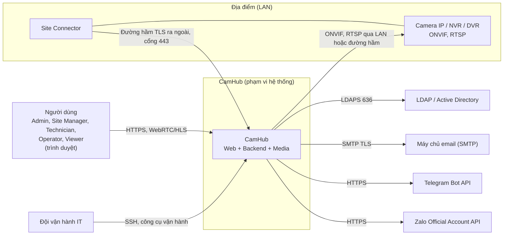

| Bên ngoài | Giao tiếp | Hướng | Ghi chú |
| --- | --- | --- | --- |
| Trình duyệt | HTTPS (REST, WebSocket), WebRTC (WHEP), HLS | Vào | Mọi truy cập qua reverse proxy |
| Camera / NVR | ONVIF (SOAP/HTTP), RTSP | Ra | Trực tiếp trong LAN của máy chủ, hoặc qua Site Connector |
| Site Connector | Đường hầm qua WebSocket TLS cổng 443 | Connector chủ động kết nối vào | Không cần mở cổng tại địa điểm (BR-06) |
| LDAP/AD | LDAPS | Ra | Tài khoản dịch vụ chỉ đọc (D-06) |
| SMTP, Telegram, Zalo | SMTP TLS, HTTPS | Ra | Gửi cảnh báo (BR-32) |

### 3.2 Composition view

Hệ thống gồm 6 thành phần ứng dụng, 4 kho dữ liệu và 1 bộ công cụ vận hành. Mỗi thành phần chạy trong một container riêng.

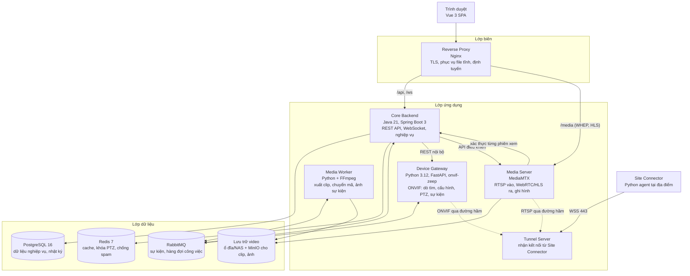

| Thành phần | Công nghệ | Trách nhiệm | UC chính |
| --- | --- | --- | --- |
| Web App | Vue 3, Vite, Pinia, Vue Router, vue-i18n, PrimeVue; player: WebRTC (WHEP) và hls.js dự phòng | Giao diện, phát video, timeline, vẽ vùng | Tất cả |
| Reverse Proxy | Nginx | Kết thúc TLS, phục vụ SPA, định tuyến `/api`, `/ws`, `/media`, giới hạn tốc độ | — |
| Core Backend | Java 21, Spring Boot 3, Spring Security, Spring Data JPA, Flyway, Spring AMQP, Resilience4j | Toàn bộ nghiệp vụ, phân quyền, nhật ký, lập lịch, điều phối các dịch vụ khác | UC-01 đến UC-63 |
| Device Gateway | Python 3.12, FastAPI, `onvif-zeep` (async), WS-Discovery | Dò tìm, đọc khả năng, cấu hình, PTZ, nhận sự kiện ONVIF, tìm video trên thiết bị (Profile G) | UC-10 đến UC-12, UC-22, UC-31, UC-40 đến UC-42, UC-51 |
| Media Server | MediaMTX | Kéo RTSP từ camera, phát WebRTC/HLS, ghi hình thành đoạn fMP4, phục vụ phát lại | UC-20, UC-31 |
| Media Worker | Python + FFmpeg | Xuất clip MP4, chuyển mã H.265 sang H.264 khi cần, chụp ảnh sự kiện | UC-33, UC-51 |
| Tunnel Server và Site Connector | Đường hầm ngược qua WebSocket TLS (dùng `chisel` hoặc công cụ tương đương); Connector chạy kèm dò tìm WS-Discovery tại chỗ | Cho máy chủ truy cập camera sau NAT mà không mở cổng tại địa điểm | UC-10, UC-15 |
| PostgreSQL | PostgreSQL 16 | Dữ liệu nghiệp vụ, nhật ký thao tác (phân vùng theo tháng) | — |
| Redis | Redis 7 | Cache quyền, khóa điều khiển PTZ, bộ đếm chống spam cảnh báo, phiên WebSocket | UC-22, UC-51 |
| RabbitMQ | RabbitMQ 3.13 | Sự kiện thiết bị, hàng đợi xuất clip, gửi thông báo | UC-33, UC-51 |
| Lưu trữ | Ổ đĩa/NAS cho video ghi; MinIO (S3) cho clip xuất, ảnh sự kiện, ảnh chụp | Lưu tệp, tách thư mục/bucket theo Tổ chức | UC-31, UC-33 |
| Vận hành | Prometheus, Grafana, Loki, container sao lưu (pgBackRest) | Giám sát, log tập trung, sao lưu | UC-60 đến UC-62 |

### 3.3 Logical view

Core Backend là một **modular monolith** gồm 11 module, bám theo các gói use case và nhóm lớp trong mô hình miền.

| Module (Core) | Lớp miền chính (SREF-03) | Trách nhiệm | UC |
| --- | --- | --- | --- |
| `identity` | User, Session, RecoveryCode, DirectoryConnection, DirectoryGroupMapping | Đăng nhập cục bộ/LDAP, 2FA, phiên, đồng bộ thư mục | UC-01, 02, 06, 07, 63 |
| `access` | Role, Permission, RoleAssignment | Vai trò, gán quyền, kiểm tra quyền (`PermissionEvaluator`) | UC-03, 04, 05 |
| `organization` | Organization, Site, Zone, CameraGroup | Cây phân cấp, chuyển camera | UC-14 |
| `device` | Camera, Recorder, Connector, DeviceCapabilities, StreamProfile, PtzPreset, CameraLocationHistory | Danh mục thiết bị, trạng thái, điều phối Device Gateway | UC-10 đến 16, 22, 23, 42 |
| `liveview` | ViewLayout, LayoutTile | Bố cục, cấp token xem, khóa PTZ | UC-20, 21, 24, 25 |
| `recording` | RecordingPolicy, RecordingSegment, RetentionPolicy, EvidenceHold, StorageVolume | Chính sách ghi, chỉ mục đoạn ghi, xóa quá hạn, giữ lại | UC-30, 31, 32, 34, 35, 36 |
| `export` | ExportJob | Tạo và theo dõi công việc xuất clip | UC-33 |
| `configuration` | ConfigTemplate, TemplateApplication, ImageSettings, NetworkSettings, MotionZone, PrivacyMask | Cấu hình camera, áp mẫu | UC-40, 41 |
| `alerting` | AlertRule, Alert, AlertStatusChange, AlertHandover | Đánh giá sự kiện, tạo cảnh báo, xử lý, chuyển giao | UC-50, 51, 52 |
| `notification` | NotificationChannel, UserChannelBinding, Notification | Gửi web/email/Telegram/Zalo, thử lại | UC-51, 53 |
| `audit` | AuditLog | Ghi và tra cứu nhật ký chỉ thêm (append-only) | UC-08 |
| `platform` (dùng chung) | — | Ngữ cảnh Tổ chức, mã hóa, outbox, lập lịch, sức khỏe hệ thống | UC-60 |

Device Gateway gồm 5 module:

| Module (Gateway) | Trách nhiệm |
| --- | --- |
| `discovery` | Gửi WS-Discovery trong LAN (hoặc yêu cầu Site Connector dò tìm tại chỗ), trả danh sách thiết bị |
| `capabilities` | Đọc `GetCapabilities`, `GetProfiles`, `GetVideoEncoderConfigurationOptions`… thành `DeviceCapabilities` |
| `control` | Ghi cấu hình (luồng, hình ảnh, mạng, NTP, vùng), PTZ, preset, khởi động lại, đổi mật khẩu |
| `events` | Đăng ký PullPoint với từng camera, chuẩn hóa sự kiện chuyển động, đẩy vào RabbitMQ |
| `edge_playback` | Tìm và lấy đường dẫn video trên thẻ nhớ/đầu ghi (ONVIF Profile G) |

### 3.4 Dependency view

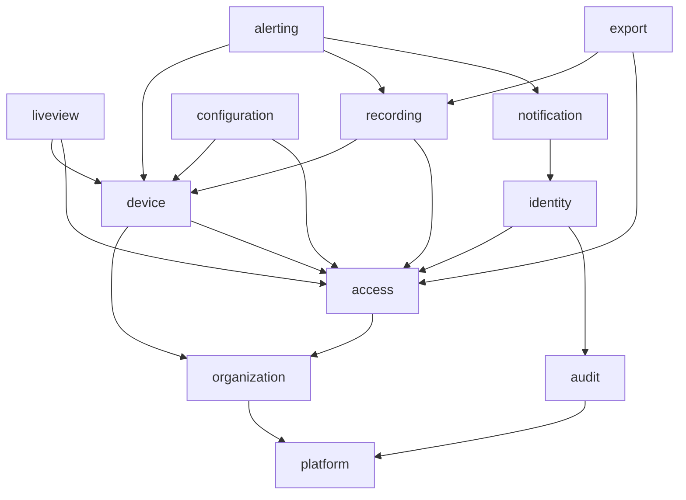

Quy tắc phụ thuộc:

- **Không phụ thuộc vòng.** Kiểm tra tự động trong CI bằng ArchUnit hoặc Spring Modulith.
- **Chỉ gọi qua API công khai.** Một module chỉ gọi interface `api` của module khác, không truy cập trực tiếp repository hay entity của module đó.
- **Tác dụng phụ đi qua sự kiện nội bộ.** Ví dụ, mọi module phát `AuditableEvent` và module `audit` lắng nghe để ghi nhật ký. Nhờ vậy `audit` không phụ thuộc ngược vào các module nghiệp vụ.
- **Mọi module phụ thuộc `platform`.** Đây là phần dùng chung: ngữ cảnh Tổ chức, mã hóa, outbox. Sơ đồ không vẽ đủ các mũi tên này để gọn.
- **Device Gateway và Media Worker không truy cập PostgreSQL.** Chúng nhận lệnh qua REST/RabbitMQ và trả kết quả về Core.

### 3.5 Information view

#### 3.5.1 Kho dữ liệu

| Dữ liệu | Kho | Thời gian lưu | Bảo vệ |
| --- | --- | --- | --- |
| Dữ liệu nghiệp vụ (camera, người dùng, quyền, cấu hình, cảnh báo) | PostgreSQL | Suốt vòng đời | Sao lưu mỗi giờ (RPO ≤ 1 giờ) |
| Mật khẩu camera/đầu ghi, mật khẩu tài khoản LDAP, TOTP secret | PostgreSQL, cột mã hóa AES-256-GCM | Suốt vòng đời | Khóa chính lấy từ Docker secret; tách khóa theo Tổ chức (envelope encryption) |
| Mật khẩu người dùng cục bộ | PostgreSQL | Suốt vòng đời | Băm Argon2id |
| Nhật ký thao tác | PostgreSQL, bảng phân vùng theo tháng | ≥ 12 tháng | Trigger chặn UPDATE/DELETE; vai trò DB của ứng dụng chỉ có quyền INSERT/SELECT |
| Chỉ mục đoạn ghi (`recording_segment`) | PostgreSQL | Theo thời gian lưu của camera | — |
| Tệp video ghi | Ổ đĩa/NAS, MediaMTX ghi fMP4 | Theo `RetentionPolicy` | Quyền thư mục chỉ cho Media Server và Media Worker |
| Clip xuất, ảnh sự kiện, ảnh chụp | MinIO, bucket theo Tổ chức | Clip: 24 giờ sau khi READY; ảnh sự kiện: theo cảnh báo (90 ngày) | URL ký có thời hạn |
| Cache quyền, khóa PTZ, bộ đếm chống spam | Redis | Vài giây đến vài phút | Không chứa dữ liệu cá nhân ngoài mã người dùng |

#### 3.5.2 Ánh xạ mô hình miền sang cơ sở dữ liệu

- **Bảng và khóa:** mỗi lớp thực thể trong SREF-03 tương ứng một bảng. Lớp giá trị (StreamSettings, ImageSettings, WeeklySchedule…) lưu dạng cột `jsonb` của bảng cha.
- **Cột bắt buộc trên mọi bảng:** `organization_id` (INV-01). Đây là cột đầu của mọi chỉ mục tổng hợp.
- **Cách ly Tổ chức (sẵn sàng SaaS):** bật PostgreSQL Row-Level Security, chính sách `organization_id = current_setting('app.org_id')`. Core đặt biến này ở đầu mỗi giao dịch.
- **Lịch sử thay đổi:** quan hệ nhiều-nhiều (camera–nhóm, vai trò–quyền) dùng bảng nối. `CameraLocationHistory` và `AlertHandover` là bảng lịch sử chỉ thêm.
- **Quản lý lược đồ:** Flyway, mỗi thay đổi là một migration đánh số.

Các bảng chính và chỉ mục quan trọng:

| Bảng | Chỉ mục chính | Phục vụ |
| --- | --- | --- |
| `camera` | `(organization_id, zone_id)`, `(organization_id, status)` | Cây camera, lọc trạng thái (US-05 AC3 ≤ 1 giây) |
| `recording_segment` | `(camera_id, start_at)`, phân vùng theo tháng | Timeline, phát lại, xóa quá hạn |
| `role_assignment` | `(user_id)`, `(organization_id, scope_type, scope_id)` | Kiểm tra quyền |
| `alert` | `(organization_id, status, occurred_at desc)` | Danh sách cảnh báo đang mở |
| `audit_log` | `(organization_id, occurred_at)`, `(actor_id, occurred_at)`, phân vùng theo tháng | Tra cứu nhật ký (UC-08) |
| `outbox_event` | `(published_at) where published_at is null` | Gửi sự kiện sang RabbitMQ |

#### 3.5.3 Cấu trúc thư mục lưu trữ video

```text
/recordings/{organizationId}/{cameraId}/{yyyy-MM-dd}/{HH-mm-ss}.mp4
```

- **Đoạn ghi:** MediaMTX ghi đoạn dài 60 giây. Sau mỗi đoạn, Core nhận sự kiện (hook `runOnRecordSegmentComplete`) và tạo bản ghi `recording_segment`.
- **Tách theo Tổ chức:** thư mục gốc theo `organizationId` (PRD mục 4.1) cho phép tách ổ đĩa hoặc bucket theo khách hàng khi lên SaaS.

### 3.6 Patterns use view

| Mẫu | Áp dụng ở đâu | Lý do |
| --- | --- | --- |
| Modular monolith | Core Backend | Đội nhỏ, một tổ chức ở bản 1.0; vẫn giữ ranh giới module để tách dịch vụ khi cần (ADR-01) |
| Ports and adapters | Module `device`: interface `DeviceControlPort`; adapter gọi Device Gateway | Đổi được cách giao tiếp thiết bị (ví dụ SDK hãng) mà không sửa nghiệp vụ |
| Transactional outbox | Core → RabbitMQ | Không mất sự kiện khi lỗi giữa ghi DB và gửi broker |
| Idempotent consumer | Media Worker, `notification`, `alerting` | RabbitMQ có thể gửi lặp; mỗi thông điệp có `messageId` |
| Circuit breaker, retry, timeout | Gọi Device Gateway, SMTP, Telegram, Zalo, LDAP | Camera và dịch vụ ngoài có thể chậm hoặc lỗi; không để kéo sập Core (Resilience4j) |
| Shared-database multi-tenancy với RLS | PostgreSQL | Sẵn sàng SaaS với chi phí thấp (ADR-09) |
| Signed short-lived token | Truy cập luồng video, tải clip | Media Server và MinIO không cần biết mô hình quyền |
| Strategy | Chọn nguồn phát lại (CamHub/thiết bị), chọn kênh thông báo | Thêm nguồn/kênh mới không sửa luồng chính |
| State machine | Alert, ExportJob, Connector | Đảm bảo INV-14 và trạng thái hợp lệ |

### 3.7 Interface view

#### 3.7.1 API cho trình duyệt (Core, qua `/api/v1`)

REST/JSON, tài liệu OpenAPI sinh tự động (springdoc). Thông tin xác thực:

- **Access token:** JWT, hết hạn sau 15 phút.
- **Refresh token:** lưu trong cookie `HttpOnly`, `Secure`, `SameSite=Strict`; phiên hết hạn sau 12 giờ không hoạt động (US-30 AC3).

| Nhóm | Endpoint chính | UC |
| --- | --- | --- |
| Xác thực | `POST /auth/login`, `POST /auth/2fa/verify`, `POST /auth/refresh`, `POST /auth/logout` | UC-01, 02 |
| Người dùng, vai trò | `/users`, `/roles`, `/users/{id}/assignments`, `/directory-connections`, `/directory-connections/{id}/test` | UC-03 đến 07 |
| Tổ chức | `/sites`, `/sites/{id}/zones`, `/camera-groups`, `POST /cameras/{id}/move` | UC-14 |
| Thiết bị | `POST /sites/{id}/discovery`, `/cameras`, `POST /cameras/test-connection`, `/recorders`, `POST /cameras/import`, `/connectors` | UC-10 đến 16 |
| Xem trực tiếp | `/layouts`, `POST /cameras/{id}/live-session` (trả URL WHEP/HLS + token), `POST /cameras/{id}/ptz`, `/cameras/{id}/presets` | UC-20 đến 25 |
| Ghi hình | `/cameras/{id}/recording-policy`, `GET /cameras/{id}/timeline?from&to&source`, `POST /cameras/{id}/playback-session`, `/evidence-holds`, `/retention-policy` | UC-30 đến 36 |
| Xuất clip | `POST /exports`, `GET /exports/{id}` | UC-33 |
| Cấu hình | `GET/PUT /cameras/{id}/config/{section}`, `/config-templates`, `POST /config-templates/{id}/apply`, `POST /cameras/{id}/reboot`, `POST /cameras/password` | UC-40 đến 42 |
| Cảnh báo | `/alert-rules`, `/alerts`, `POST /alerts/{id}/acknowledge`, `POST /alerts/{id}/reassign`, `POST /alerts/{id}/close`, `/me/channel-bindings` | UC-50 đến 53 |
| Hệ thống | `GET /system/overview`, `GET /system/backups` (chỉ xem), `GET /audit-logs`, `GET /audit-logs/export` | UC-08, 60 |

Quy ước chung của API:

- **Lỗi:** theo RFC 7807 (`application/problem+json`).
- **Phân trang:** `?page&size`.
- **Thao tác hàng loạt:** trả về kết quả của từng phần tử, không dừng khi một phần tử lỗi.

#### 3.7.2 Kênh thời gian thực

`/ws` dùng WebSocket với STOMP, đẩy về trình duyệt:

- trạng thái camera (`/topic/org/{id}/camera-status`)
- cảnh báo mới (`/user/queue/alerts`)
- tiến độ xuất clip và áp mẫu (`/user/queue/jobs`)
- thông báo khóa PTZ

#### 3.7.3 Giao diện nội bộ

| Từ → Đến | Giao thức | Nội dung |
| --- | --- | --- |
| Core → Device Gateway | REST nội bộ (mTLS trong mạng Docker) | `POST /discover`, `POST /devices/{id}/capabilities`, `PUT /devices/{id}/config`, `POST /devices/{id}/ptz`, `GET /devices/{id}/edge-recordings` |
| Device Gateway → RabbitMQ | AMQP, exchange `device.events` | `MotionDetected`, `DeviceOnline`, `DeviceOffline` |
| Core → RabbitMQ | AMQP, exchange `jobs` | `ExportRequested`, `NotificationRequested`, `SnapshotRequested` |
| Media Worker → RabbitMQ | AMQP, exchange `job.results` | `ExportCompleted`, `ExportFailed`, `SnapshotCreated` |
| Core → MediaMTX | HTTP API điều khiển | Tạo/xóa đường dẫn luồng cho mỗi camera, bật/tắt ghi hình theo `RecordingPolicy` |
| MediaMTX → Core | HTTP (xác thực ngoài) `POST /internal/media/authorize` | Mỗi phiên đọc luồng/phát lại được Core kiểm tra token và quyền VIEW_LIVE/VIEW_PLAYBACK |
| MediaMTX → Core | Hook khi hoàn tất đoạn ghi | Tạo `recording_segment` |

Ví dụ thông điệp sự kiện chuyển động:

```json
{
  "messageId": "6f1c…",
  "type": "MotionDetected",
  "organizationId": "…",
  "cameraId": "…",
  "occurredAt": "2026-10-21T23:40:05+07:00",
  "source": "DEVICE",
  "payload": { "onvifTopic": "tns1:VideoSource/MotionAlarm", "state": true }
}
```

### 3.8 Structure view

```text
camhub/
├── core/                      # Java 21, Spring Boot 3 (Gradle)
│   └── src/main/java/vn/camhub/
│       ├── platform/          # org context, crypto, outbox, scheduler
│       ├── identity/
│       │   ├── api/           # interface công khai cho module khác
│       │   ├── web/           # REST controller, DTO
│       │   ├── application/   # use case service
│       │   ├── domain/        # entity, value object, quy tắc INV
│       │   └── infrastructure/# JPA repository, LDAP adapter
│       ├── access/ organization/ device/ liveview/ recording/
│       ├── export/ configuration/ alerting/ notification/ audit/
│       └── CamHubApplication.java
├── device-gateway/            # Python 3.12, FastAPI
│   └── app/{discovery,capabilities,control,events,edge_playback}/
├── media-worker/              # Python + FFmpeg
├── site-connector/            # Python agent + tunnel client
├── web/                       # Vue 3 + Vite
│   └── src/{views,components,stores,services,player,i18n}/
├── deploy/
│   ├── docker-compose.yml
│   ├── nginx/ mediamtx/ prometheus/ grafana/
│   └── backup/
└── docs/                      # BRS, PRD, class diagram, use case, SADD
```

Mỗi module của Core có 5 lớp: `api`, `web`, `application`, `domain`, `infrastructure`. Phụ thuộc chỉ đi một chiều theo thứ tự `web → application → domain`; lớp `infrastructure` hiện thực các interface mà `domain` khai báo.

### 3.9 Interaction view

#### 3.9.1 Đăng nhập LDAP kèm 2FA (UC-01, UC-02)

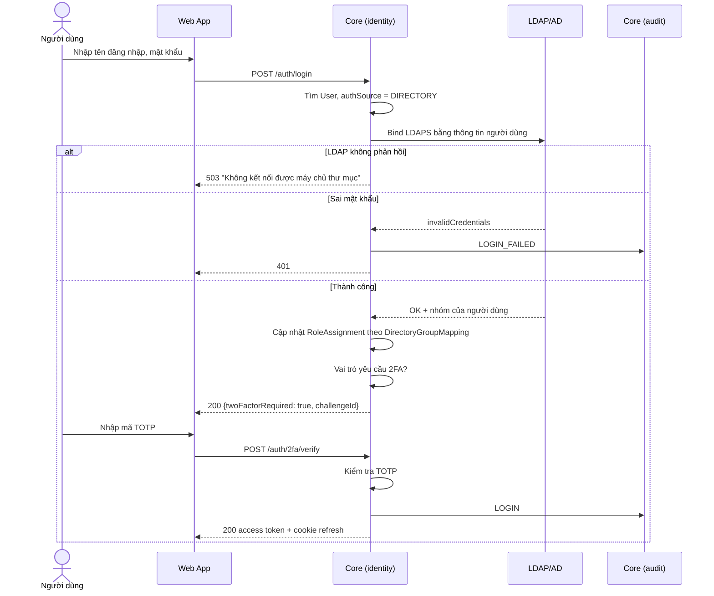

#### 3.9.2 Bắt đầu xem trực tiếp (UC-20)

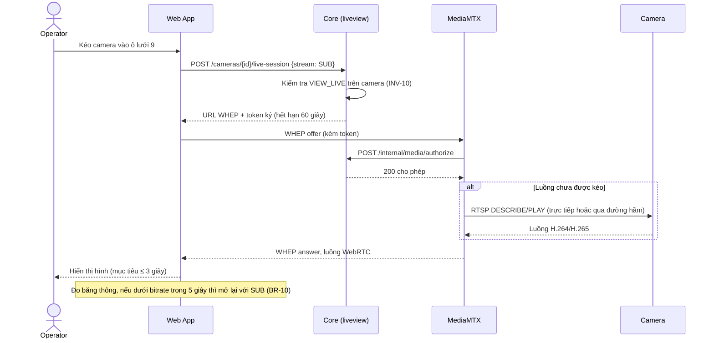

Nếu luồng là H.265 và trình duyệt không giải mã được, Core cấp URL luồng chuyển mã: MediaMTX gọi FFmpeg để tạo đường dẫn `{camera}_h264` theo yêu cầu (PNFR-03). Số phiên chuyển mã đồng thời có giới hạn (PR-01).

#### 3.9.3 Sự kiện chuyển động → cảnh báo → thông báo (UC-51)

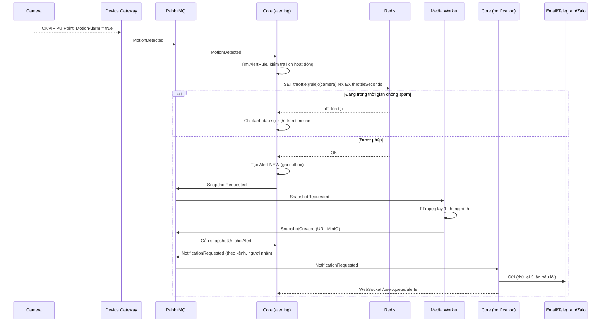

#### 3.9.4 Xuất clip (UC-33)

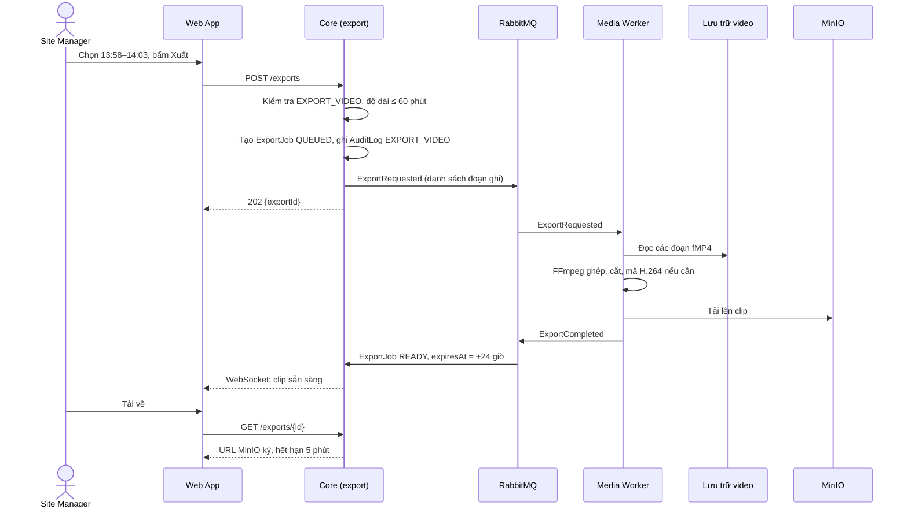

#### 3.9.5 Dò tìm camera qua Site Connector (UC-10)

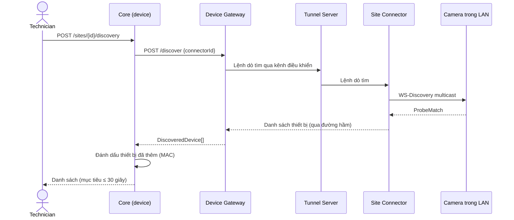

### 3.10 State dynamics view

#### Cảnh báo (Alert) – INV-14, INV-28

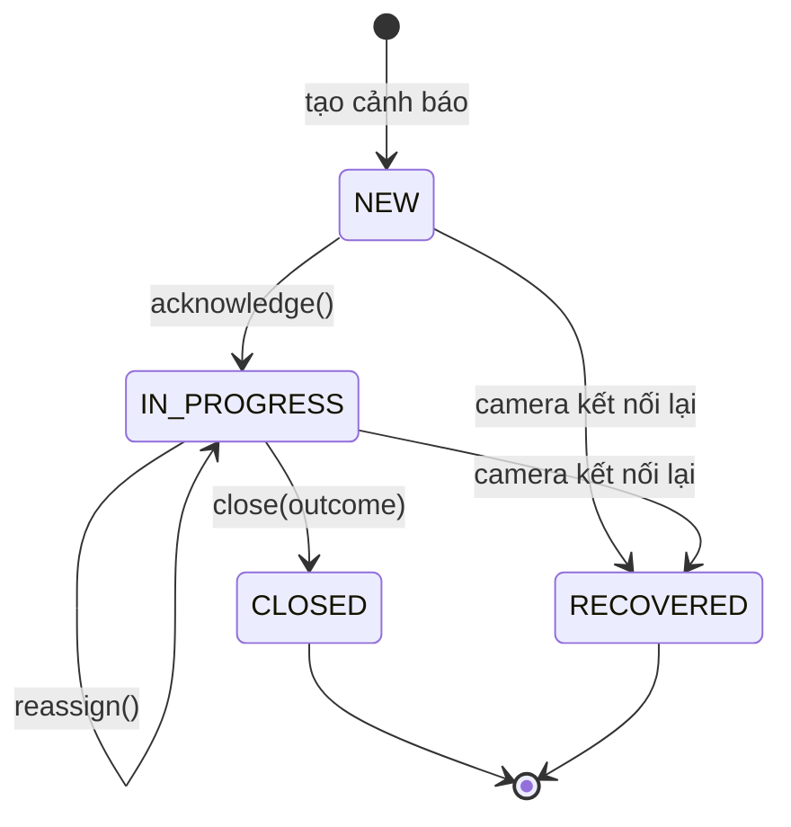

#### Công việc xuất clip (ExportJob) – INV-08

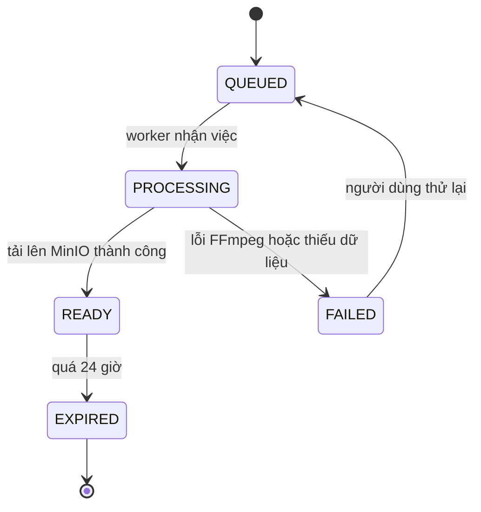

#### Trạng thái camera và bộ kết nối

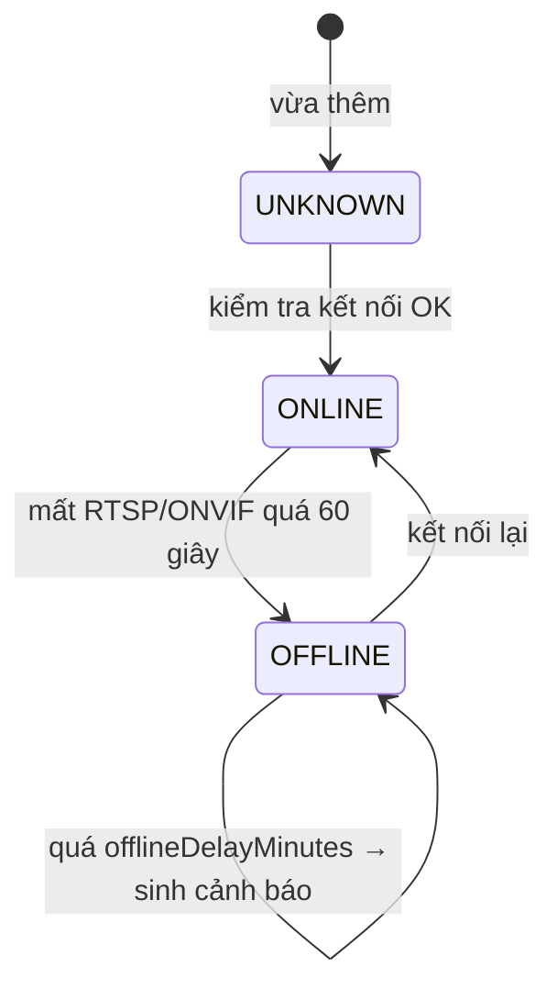

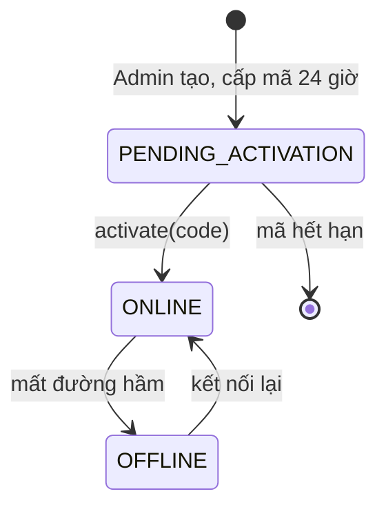

### 3.11 Algorithm view

#### 3.11.1 Kiểm tra quyền (INV-10, INV-27)

```text
can(user, permission, camera):
    key = "perm:{org}:{user}:{version}"            # version tăng khi quyền đổi
    scopes = redis.get(key) or loadAndCache(user)  # cache TTL 60 giây
    for a in scopes where permission in a.role.permissions:
        if a.scopeType == ORGANIZATION: return true
        if a.scopeType == SITE   and camera.siteId == a.scopeId: return true
        if a.scopeType == GROUP  and a.scopeId in camera.groupIds: return true
        if a.scopeType == CAMERA and camera.id == a.scopeId: return true
    return false
```

- **Quyền mới có hiệu lực nhanh:** khi gán quyền thay đổi, Core tăng `version` của người dùng. Cache cũ không còn được dùng, nên quyền mới có hiệu lực trong ≤ 60 giây (US-32 AC4).
- **Phiên xem đang mở:** được kiểm tra lại mỗi 60 giây qua `/internal/media/authorize`.
- **Video cũ của camera đã chuyển chỗ:** quyền tính theo vị trí hiện tại `camera.siteId` (INV-18).

#### 3.11.2 Xóa video quá hạn (UC-36, INV-06, INV-07)

```text
hằng ngày 02:00, theo từng camera:
    days = override(camera).retentionDays ?? org.retentionPolicy.defaultRetentionDays
    cutoff = now() - days
    segments = select * from recording_segment
               where camera_id = :c and end_at < :cutoff
                 and not exists (evidence_hold h where h.camera_id = :c
                                 and h.released_at is null
                                 and segment overlaps [h.start_at, h.end_at])
    xóa tệp theo lô 500, rồi xóa bản ghi; ghi tổng số vào log vận hành
```

#### 3.11.3 Chống spam cảnh báo (INV-15)

Dùng lệnh Redis `SET throttle:{ruleId}:{cameraId} 1 NX EX {throttleSeconds}`. Lệnh thành công thì gửi thông báo; thất bại thì chỉ đánh dấu sự kiện trên timeline. Lệnh này nguyên tử, nên vẫn đúng khi chạy nhiều tiến trình.

#### 3.11.4 Khóa điều khiển PTZ (UC-22)

- **Giữ khóa:** `ptz:lock:{cameraId}` = `{userId, rank}`, hết hạn sau 30 giây và được gia hạn mỗi khi có lệnh PTZ.
- **Yêu cầu mới:** được cấp khóa nếu khóa trống hoặc `rank` người yêu cầu ≥ `rank` người đang giữ. Lấy khóa bằng Lua script để đảm bảo nguyên tử. Người mất khóa nhận thông báo qua WebSocket.

#### 3.11.5 Chuyển luồng theo băng thông (BR-10)

Chạy ở trình duyệt:
1. Đo `availableIncomingBitrate` qua `RTCPeerConnection.getStats()` mỗi giây.
2. Nếu giá trị đo nhỏ hơn bitrate của luồng đang xem trong 5 giây liên tục: mở phiên mới với luồng phụ, đổi ô sang luồng mới khi đã có khung hình đầu tiên, rồi đóng phiên cũ.
3. Chỉ thử quay lại luồng chính khi băng thông ≥ 1,5 lần bitrate luồng chính trong 30 giây, để tránh chuyển qua lại liên tục.

### 3.12 Resource view

#### 3.12.1 Ước tính tài nguyên (cần IT xác nhận)

Giả định: 500 camera, 1080p, H.265, bitrate trung bình luồng chính 2 Mbps, luồng phụ 0,5 Mbps; thời gian lưu 30 ngày.

| Hạng mục | Công thức | Kết quả |
| --- | --- | --- |
| Băng thông vào khi ghi toàn bộ luồng chính | 500 × 2 Mbps | ≈ 1 Gbps |
| Dung lượng 1 camera ghi liên tục mỗi ngày | 2 Mbps × 86.400 giây ÷ 8 | ≈ 21,6 GB |
| Ghi liên tục cả 500 camera trong 30 ngày | 21,6 GB × 500 × 30 | ≈ 324 TB |
| Ghi theo sự kiện, giả sử 20% thời gian có ghi | 324 TB × 20% | ≈ 65 TB |
| Băng thông ra cho 100 người xem đồng thời, lưới 16 luồng phụ | 100 × 16 × 0,5 Mbps | ≈ 800 Mbps (trường hợp xấu nhất) |

Dung lượng lưu trữ là yếu tố chi phí lớn nhất (R-03). Thời gian lưu mặc định (OQ-04) và tỷ lệ camera ghi liên tục cần chốt trước khi mua phần cứng.

#### 3.12.2 Triển khai (Docker Compose)

Docker Compose chạy trên từng máy. Bản 1.0 đề xuất 3 máy chủ, mỗi máy một tệp compose riêng.

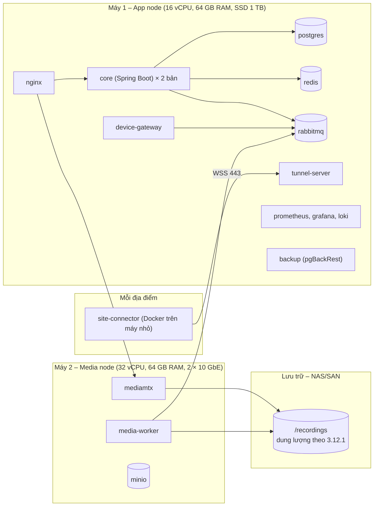

| Thành phần | Số bản ở 1.0 | Mở rộng khi |
| --- | --- | --- |
| core | 2 (sau Nginx, cân bằng tải) | Thêm bản khi CPU > 70%; ứng dụng không giữ trạng thái phiên |
| device-gateway | 1 | Chia camera theo nhóm cho nhiều bản khi > 500 camera |
| mediamtx | 1 | Thêm media node, mỗi node phụ trách một nhóm camera |
| media-worker | 1, chạy 4 job song song | Thêm bản khi hàng đợi xuất clip > 50 |
| postgres | 1 chính + bản sao lưu liên tục (WAL) | Thêm bản sao chỉ đọc khi cần (OQ-03) |

#### 3.12.3 Sao lưu và khôi phục (NFR-10, NFR-11, UC-61, UC-62)

| Dữ liệu | Cách sao lưu | RPO |
| --- | --- | --- |
| PostgreSQL | pgBackRest: bản đầy đủ hằng ngày, gửi WAL liên tục; giữ ≥ 30 bản | ≤ 1 giờ (thực tế vài phút) |
| Cấu hình triển khai | Thư mục `deploy/` trong Git; Docker secret sao lưu riêng có mã hóa | Mỗi thay đổi |
| MinIO | Sao chép sang máy khác hằng giờ | ≤ 1 giờ |
| Video ghi | Không sao lưu (dung lượng quá lớn); bảo vệ bằng RAID trên NAS | — |

Khôi phục do đội vận hành IT thực hiện theo runbook (UC-62), mục tiêu ≤ 4 giờ:
1. Dựng lại máy từ tệp compose.
2. Khôi phục PostgreSQL về thời điểm cần.
3. Kiểm tra sức khỏe các container.
4. Đối chiếu số camera trực tuyến.

Runbook được diễn tập mỗi quý.

---

## 4. Thiết kế bảo mật

| Lớp | Biện pháp | Yêu cầu |
| --- | --- | --- |
| Truyền tải | TLS 1.2+ ở Nginx; HSTS; mTLS giữa các dịch vụ nội bộ; LDAPS; đường hầm Site Connector qua WSS | NFR-05, PNFR-07 |
| Xác thực | Mật khẩu băm Argon2id; khóa tài khoản sau 5 lần sai; TOTP 2FA bắt buộc theo vai trò; LDAP bind bằng tài khoản người dùng | BR-28, BR-36, BR-40, RULE-04 |
| Phiên | JWT access 15 phút; refresh token xoay vòng, lưu trong cookie HttpOnly; thu hồi khi đổi mật khẩu hoặc vô hiệu hóa tài khoản | US-30 |
| Phân quyền | Kiểm tra ở tầng application của Core cho mọi API (`@PreAuthorize` + `PermissionEvaluator`); RLS theo Tổ chức trong DB | BR-29, INV-01, INV-10 |
| Bảo vệ luồng video | Token ký HMAC hết hạn 60 giây cho mỗi phiên xem; MediaMTX hỏi Core cho mỗi phiên đọc; URL camera không bao giờ gửi tới trình duyệt | BR-29 |
| Bí mật | Mật khẩu camera, LDAP, TOTP mã hóa AES-256-GCM; khóa chính trong Docker secret, quay vòng hằng năm | NFR-05, INV-17 |
| Nhật ký | Mọi thao tác ở INV/AuditAction được ghi; bảng chỉ cho INSERT/SELECT; xuất CSV có ghi nhật ký | BR-30, RULE-06 |
| Quyền riêng tư | Vùng che riêng tư áp dụng trên camera (thiết bị tự che), không chỉ che ở giao diện | BR-24, RULE-03 |
| Dữ liệu đo lường | Sự kiện phân tích không chứa hình ảnh hay dữ liệu cá nhân ngoài mã người dùng | PRD mục 11 |
| Kiểm thử | Quét phụ thuộc (OWASP Dependency-Check, pip-audit, npm audit) trong CI; kiểm thử xâm nhập trước go-live theo OWASP ASVS mức 2 | PNFR-08 |

---

## 5. Lý do thiết kế (Design rationale)

| ADR | Quyết định | Phương án đã cân nhắc | Lý do chọn |
| --- | --- | --- | --- |
| ADR-01 | Core là modular monolith | Microservices | Một tổ chức, đội nhỏ; ít chi phí vận hành; ranh giới module cho phép tách dịch vụ khi lên SaaS |
| ADR-02 | Core Java/Spring Boot, phần thiết bị dùng Python | Toàn Java; toàn Python | Spring mạnh về bảo mật, LDAP, phân quyền nhiều tầng; Python có thư viện ONVIF tốt hơn và là nơi đặt phân tích video sau này (đã chốt 21/10/2026) |
| ADR-03 | MediaMTX làm Media Server | Tự viết dựa trên GStreamer; Wowza; Janus | Mã nguồn mở (MIT), hỗ trợ sẵn RTSP vào, WebRTC (WHEP)/HLS ra, ghi hình, phát lại, xác thực ngoài qua HTTP; cần xác minh hiệu năng ở PoC |
| ADR-04 | PostgreSQL | MySQL; MongoDB | Hỗ trợ RLS cho đa Tổ chức, `jsonb`, phân vùng bảng cho nhật ký và đoạn ghi |
| ADR-05 | RabbitMQ | Kafka; Redis Streams | Hàng đợi công việc có xác nhận, thử lại, dead-letter; đủ cho lưu lượng sự kiện của 500 camera; vận hành đơn giản hơn Kafka |
| ADR-06 | Docker Compose | Kubernetes | Đủ cho 3 máy ở bản 1.0, đội vận hành nội bộ dễ quản lý; ảnh container giữ nguyên khi chuyển sang Kubernetes cho SaaS (đã chốt) |
| ADR-07 | Vue 3 + PrimeVue | React; Angular | Đã chốt 21/10/2026; PrimeVue có sẵn bảng, cây, lịch phù hợp giao diện quản trị |
| ADR-08 | WebRTC (WHEP) chính, HLS dự phòng | Chỉ HLS; MJPEG | WebRTC đạt độ trễ ≤ 2 giây (NFR-01); HLS dự phòng khi mạng chặn UDP |
| ADR-09 | Một DB chung cho các Tổ chức, cách ly bằng `organization_id` + RLS | Mỗi Tổ chức một DB/schema | Chi phí thấp, đơn giản khi số khách hàng SaaS còn ít; vẫn chuyển được sang DB riêng cho khách hàng lớn |
| ADR-10 | Đường hầm ngược qua WSS cho Site Connector | VPN site-to-site; mở cổng router | Chỉ cần kết nối ra ngoài cổng 443 (US-06 AC2), không cần cấu hình mạng tại địa điểm |
| ADR-11 | Cảnh báo chuyển động lấy từ sự kiện ONVIF của camera | Phân tích trên máy chủ | Đã chốt (CD-03, CD-05); không tốn CPU máy chủ; `MotionSource.SERVER` dành cho bản sau |

---

## 6. Truy vết

### 6.1 Yêu cầu phi chức năng → thiết kế

| NFR / PNFR | Thiết kế đáp ứng | Cách kiểm chứng |
| --- | --- | --- |
| NFR-01 Live ≤ 3 giây, độ trễ ≤ 2 giây | WebRTC/WHEP, MediaMTX kéo luồng sẵn cho camera đang ghi, luồng phụ cho lưới lớn | Đo `first_frame` ở PoC với 20 camera, kiểm thử tải 100 camera |
| NFR-02 Phát lại ≤ 3 giây | Chỉ mục `recording_segment(camera_id, start_at)`; phát lại qua MediaMTX | Kiểm thử tải |
| NFR-03 500 camera, 100 người dùng | Core 2 bản không trạng thái; media node riêng; ước tính ở 3.12.1 | Kiểm thử tải (Gatling cho API, công cụ giả lập RTSP) |
| NFR-04 Sẵn sàng 99,5% | 2 bản Core, healthcheck và tự khởi động lại container, giám sát Prometheus | Theo dõi uptime hằng tháng |
| NFR-05, PNFR-07 Bảo mật | Mục 4 | Kiểm thử xâm nhập |
| NFR-06 Tuân thủ dữ liệu cá nhân | Xóa theo hạn (3.11.2), vùng che riêng tư, nhật ký, phân quyền | Pháp chế review |
| NFR-07 Đa ngôn ngữ, 360px | vue-i18n, giao diện responsive | Kiểm thử giao diện |
| NFR-08, PNFR-01 Trình duyệt | WebRTC + hls.js; kiểm thử trên 4 trình duyệt | Ma trận kiểm thử trình duyệt |
| NFR-09 Nhật ký 12 tháng | Bảng phân vùng theo tháng, chặn sửa/xóa | Kiểm tra cấu hình DB |
| NFR-10, NFR-11 RTO ≤ 4 giờ, RPO ≤ 1 giờ | pgBackRest + WAL, runbook diễn tập | Diễn tập khôi phục hằng quý |
| NFR-12 Gián đoạn ghi | Camera có thẻ nhớ tiếp tục ghi tại chỗ; phát lại nguồn thiết bị (Profile G) | Kiểm thử ngắt media node |
| PNFR-03 H.265 | Chuyển mã theo yêu cầu bằng FFmpeg, giới hạn số phiên | PoC đo CPU mỗi phiên chuyển mã |

### 6.2 Use case → thành phần

| Gói use case | Thành phần chính |
| --- | --- |
| A. Truy cập (UC-01 đến UC-08) | Web, Core `identity`, `access`, `audit`; LDAP |
| B. Camera (UC-10 đến UC-16) | Core `device`, `organization`; Device Gateway; Tunnel Server, Site Connector |
| C. Xem trực tiếp (UC-20 đến UC-25) | Web player; Core `liveview`; MediaMTX; Device Gateway (PTZ) |
| D. Ghi hình (UC-30 đến UC-36) | Core `recording`, `export`; MediaMTX; Media Worker; lưu trữ, MinIO |
| E. Cấu hình (UC-40 đến UC-42) | Core `configuration`, `device`; Device Gateway |
| F. Cảnh báo (UC-50 đến UC-53) | Device Gateway `events`; RabbitMQ; Core `alerting`, `notification`; Media Worker (ảnh); Redis |
| G. Nền tảng (UC-60 đến UC-63) | Core `platform`; Prometheus, Grafana; pgBackRest; đội vận hành IT |

---

## 7. Rủi ro kiến trúc và việc cần làm tiếp

| Mã | Rủi ro / việc cần làm | Hướng xử lý |
| --- | --- | --- |
| AR-01 | Hiệu năng MediaMTX với 500 luồng ghi đồng thời và chuyển mã H.265 chưa được kiểm chứng | PoC 2 tuần trước M1: 50 camera thật + giả lập RTSP đến 500 luồng; đo CPU, RAM, độ trễ |
| AR-02 | Mức tuân thủ ONVIF không đồng đều giữa các hãng (R-01) | Lập danh sách camera kiểm thử (D-04); bộ kiểm thử tương thích tự động trong Device Gateway |
| AR-03 | Một Media node là điểm lỗi đơn cho ghi hình | Camera có thẻ nhớ ghi tại chỗ (NFR-12); quyết định OQ-03 về máy chủ dự phòng |
| AR-04 | Dung lượng lưu trữ rất lớn (3.12.1) | Chốt OQ-04 và tỷ lệ ghi liên tục trước khi mua phần cứng |
| AR-05 | OQ-02 (tự phát triển hay mua) chưa chốt chính thức | SADD giả định tự phát triển; cần Sponsor xác nhận |
| AR-06 | Đường hầm cho nhiều luồng video qua Internet có thể bị nghẽn | Mỗi Media node chỉ kéo luồng của địa điểm xa khi ghi hoặc có người xem; theo dõi băng thông từng Connector |
