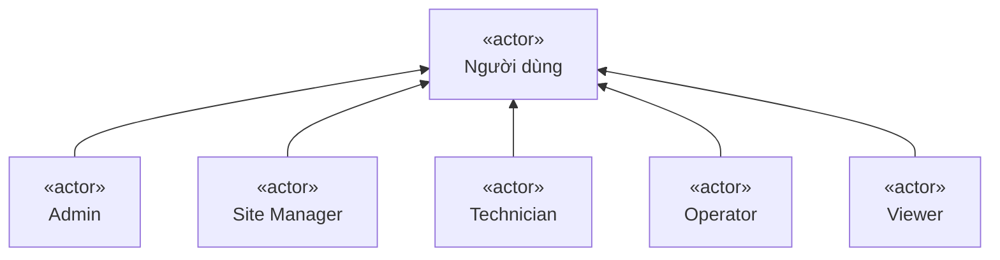
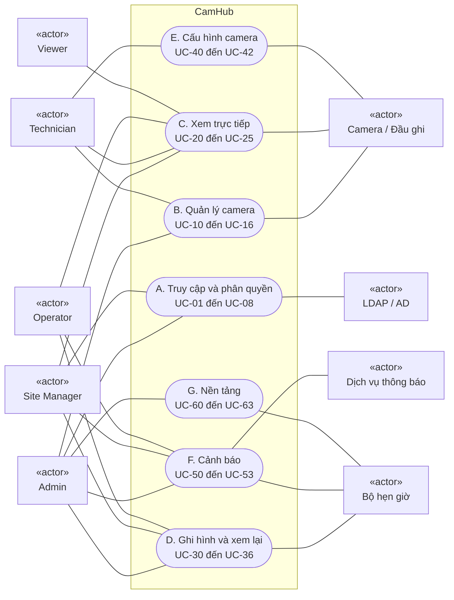
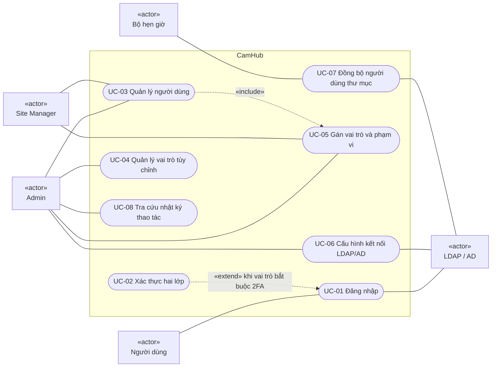
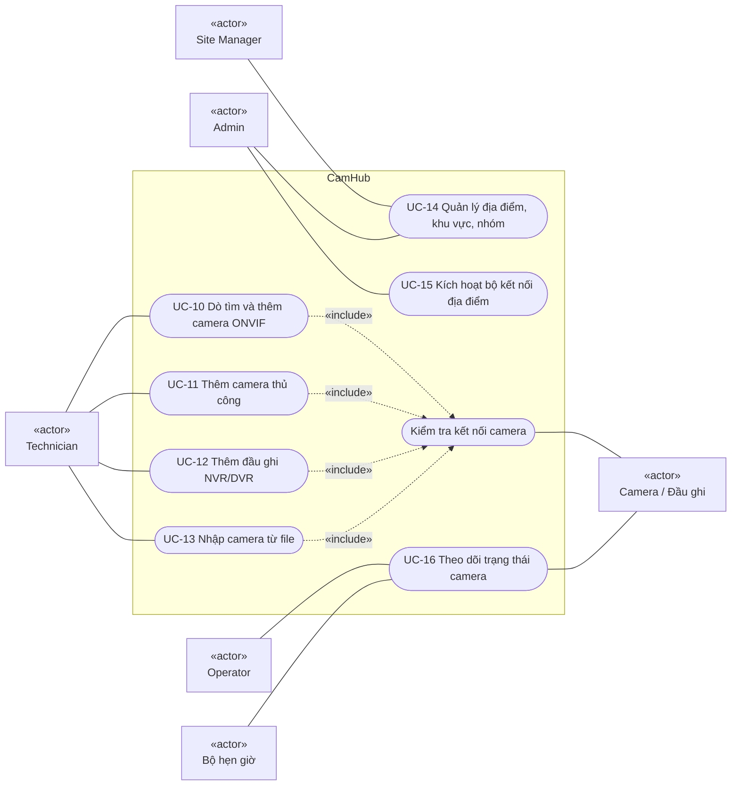
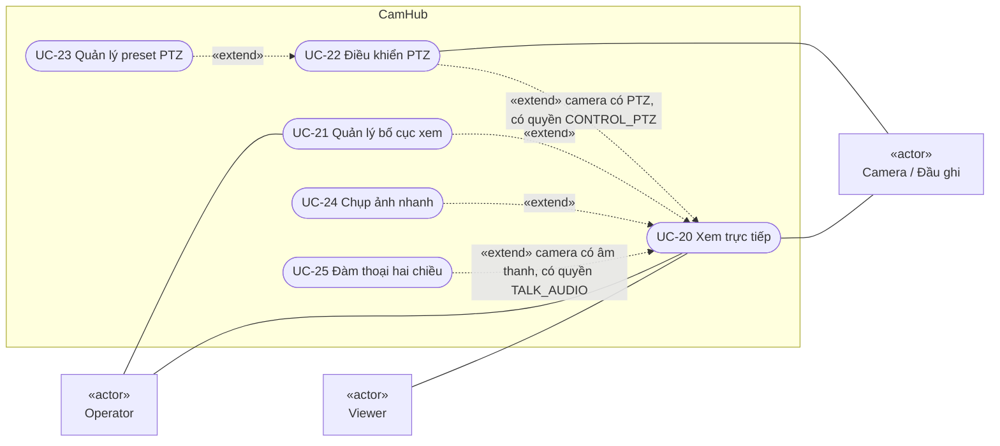
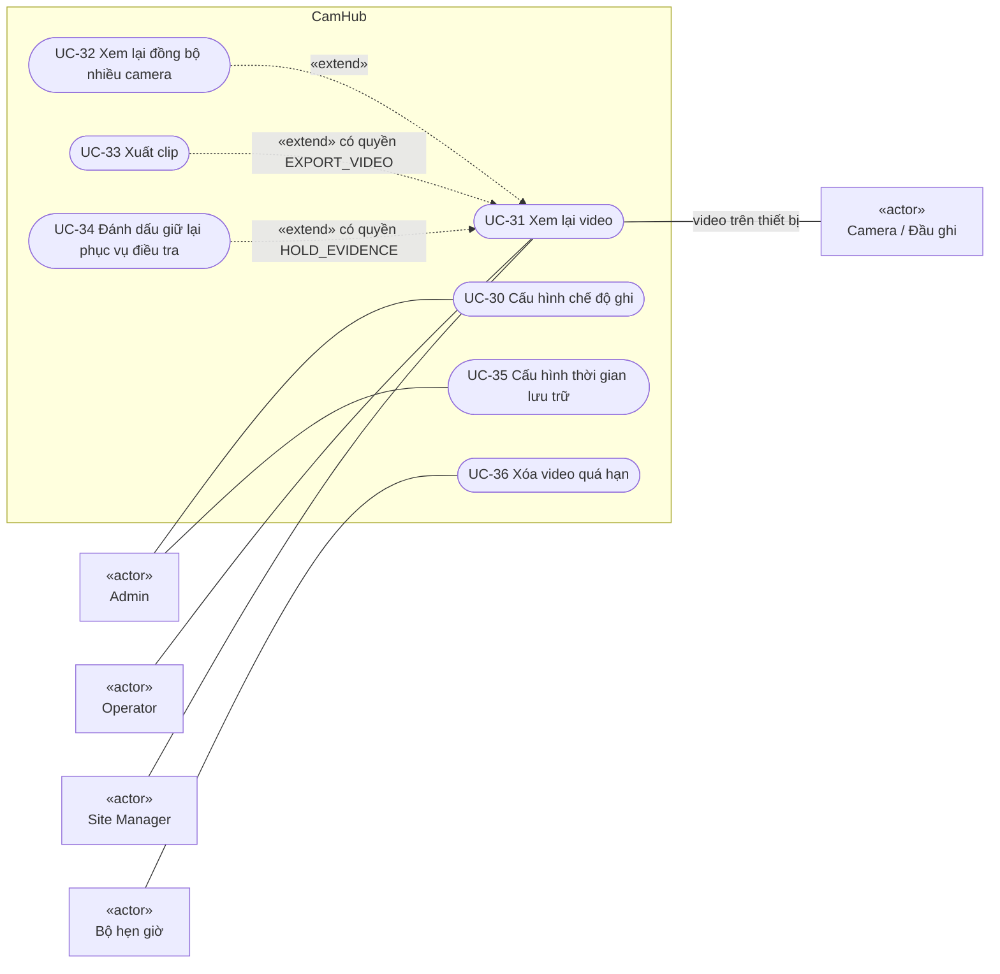
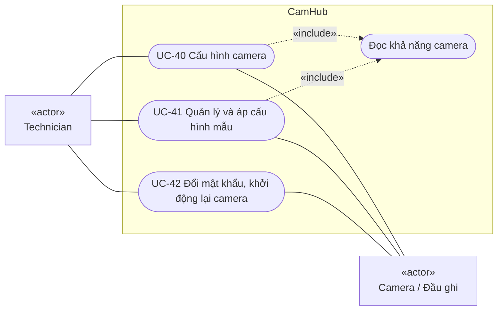
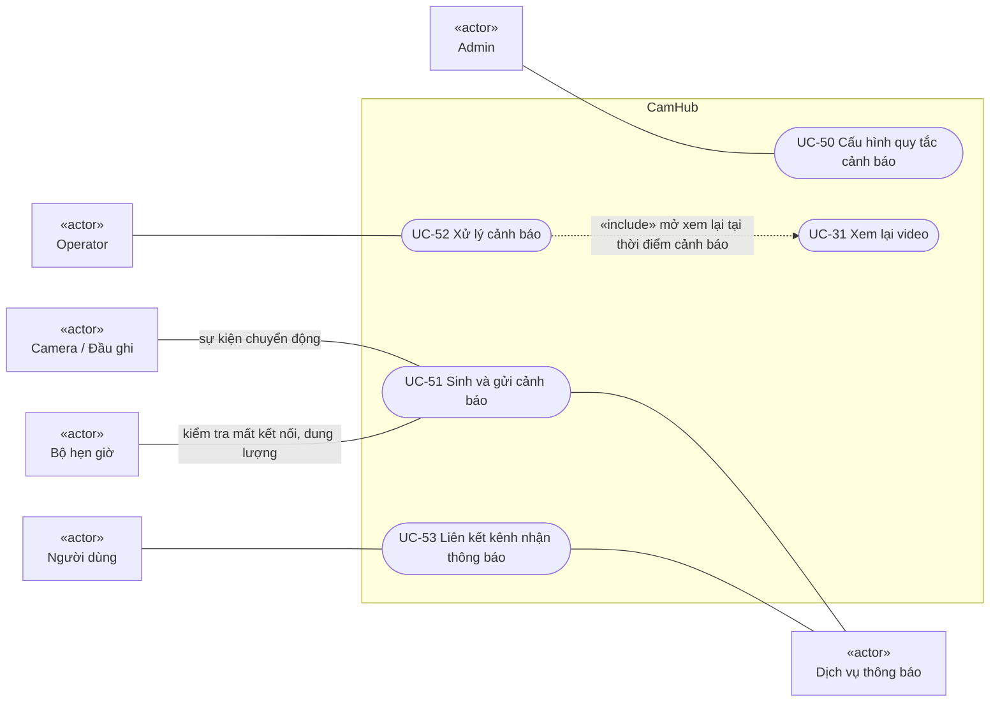
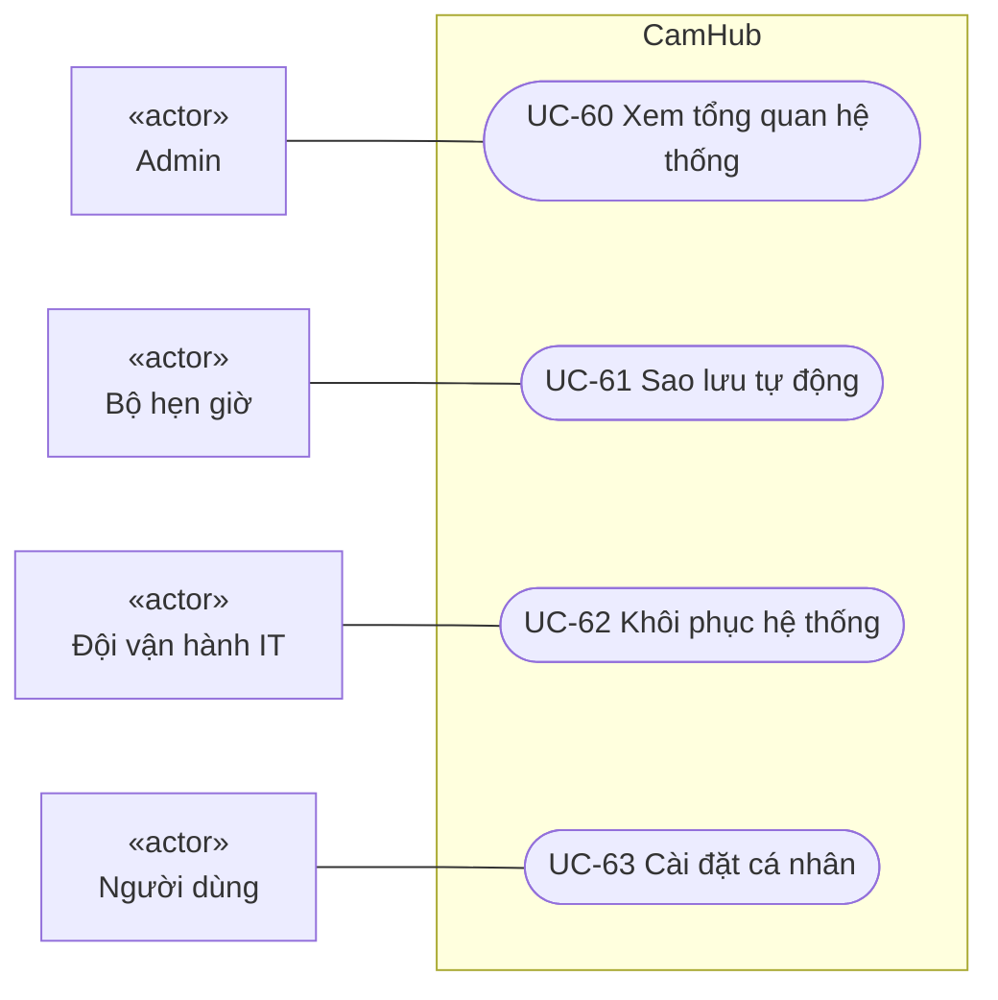

# Use Case – CamHub: Nền tảng Web quản lý Camera IP

> Ngày: 21/10/2026 · Người soạn: Business Analyst · Phiên bản: 0.2 (Bản nháp)
> Tài liệu đầu vào: [BRD_IP_Camera_Web.md](BRD_IP_Camera_Web.md) (BRS v0.6) · [PRD_IP_Camera_Web.md](PRD_IP_Camera_Web.md) (PRD v0.4) · [Class_Diagram_IP_Camera_Web.md](Class_Diagram_IP_Camera_Web.md) (v0.4)

| Phiên bản | Ngày | Thay đổi |
| --- | --- | --- |
| 0.2 | 21/10/2026 | Chốt UCQ-01 (Site Manager tạo được người dùng), UCQ-02 (chuyển giao cảnh báo), UCQ-03 (chỉ đội vận hành IT khôi phục hệ thống; thêm tác nhân "Đội vận hành IT") |
| 0.1 | 21/10/2026 | Bản nháp đầu tiên |

## 1. Phạm vi và quy ước

Tài liệu mô tả **ai** (tác nhân) tương tác với CamHub để đạt **mục tiêu gì** (use case). Gồm 4 phần:

- Danh sách tác nhân
- Sơ đồ use case theo từng gói chức năng
- Danh mục 39 use case, mỗi use case truy vết về BR (BRS) và US (PRD)
- Đặc tả chi tiết cho 11 use case cốt lõi

Quy ước:

- **Mã use case:** `UC-xx`, nhóm theo gói. Gói A (Truy cập) dùng UC-01 đến UC-09, gói B (Camera) dùng UC-10 đến UC-19, và cứ thế tiếp tục.
- **Cách vẽ:** Mermaid không có loại sơ đồ use case riêng, nên sơ đồ dùng `flowchart`.
  - Tác nhân là hình chữ nhật có nhãn «actor».
  - Use case là hình bo tròn.
  - Khung `CamHub` là ranh giới hệ thống.
- **Quan hệ:**
  - Đường liền: tác nhân tham gia use case.
  - `«include»`: use case luôn gọi use case khác.
  - `«extend»`: use case mở rộng, chỉ xảy ra khi có điều kiện.
- **Phân quyền:** vai trò có thể tùy chỉnh (BR-39), nên tác nhân ở đây là **vai trò mặc định**. Người dùng thực hiện được một use case khi vai trò của họ có quyền tương ứng (cột Quyền ở mục 4, INV-10).

---

## 2. Tác nhân

### 2.1 Tác nhân là con người

| Tác nhân | Mô tả | Quyền điển hình (Permission) |
| --- | --- | --- |
| Người dùng | Tác nhân tổng quát: mọi người có tài khoản CamHub. Các tác nhân bên dưới kế thừa từ đây | — |
| Admin | Quản trị hệ thống, người dùng, vai trò, tích hợp | Tất cả |
| Site Manager | Quản lý địa điểm được giao; tạo được người dùng mới trong địa điểm của mình | VIEW_LIVE, VIEW_PLAYBACK, EXPORT_VIDEO, HOLD_EVIDENCE, CONTROL_PTZ, MANAGE_USERS (trong phạm vi) |
| Technician | Lắp đặt, cấu hình camera | VIEW_LIVE, CONFIGURE_CAMERA, CONTROL_PTZ |
| Operator | Giám sát, xem lại, xử lý cảnh báo | VIEW_LIVE, VIEW_PLAYBACK, CONTROL_PTZ, TALK_AUDIO |
| Viewer | Chỉ xem trực tiếp | VIEW_LIVE |

Mũi tên chỉ quan hệ kế thừa: mọi vai trò đều là "Người dùng", nên đều thực hiện được các use case của Người dùng (đăng nhập, cài đặt cá nhân).

### 2.2 Tác nhân là hệ thống hoặc thời gian

| Tác nhân | Mô tả | Use case liên quan |
| --- | --- | --- |
| Camera / Đầu ghi | Thiết bị ONVIF/RTSP: cung cấp luồng, nhận lệnh cấu hình, PTZ, gửi sự kiện chuyển động | UC-10 đến UC-12, UC-20, UC-22, UC-31, UC-40, UC-42, UC-51 |
| LDAP / Active Directory | Thư mục người dùng của tổ chức | UC-01, UC-06, UC-07 |
| Dịch vụ thông báo | Email (SMTP), Telegram Bot API, Zalo OA | UC-51, UC-53 |
| Bộ hẹn giờ (Timer) | Kích hoạt công việc định kỳ: xóa video quá hạn, đồng bộ thư mục, sao lưu, kiểm tra trạng thái | UC-07, UC-16, UC-36, UC-51, UC-61 |
| Đội vận hành IT | Nhóm vận hành hạ tầng CamHub. Không phải vai trò trong ứng dụng; làm việc qua công cụ và quy trình vận hành | UC-62 |

Bộ kết nối tại chỗ (Connector) là một thành phần của CamHub, không phải tác nhân.

---

## 3. Sơ đồ use case

### 3.1 Tổng quan theo gói

### 3.2 Gói A – Truy cập và phân quyền

### 3.3 Gói B – Quản lý camera

### 3.4 Gói C – Xem trực tiếp

### 3.5 Gói D – Ghi hình và xem lại

### 3.6 Gói E – Cấu hình camera

### 3.7 Gói F – Cảnh báo

### 3.8 Gói G – Nền tảng

Admin của tổ chức không có chức năng khôi phục trong ứng dụng; chỉ Đội vận hành IT khôi phục hệ thống (UCQ-03).

---

## 4. Danh mục use case

| UC | Tên | Tác nhân chính | Quyền cần có | Mô tả ngắn | BR | US | Ưu tiên |
| --- | --- | --- | --- | --- | --- | --- | --- |
| UC-01 | Đăng nhập | Người dùng | — | Đăng nhập bằng tài khoản cục bộ hoặc LDAP/AD | BR-28, BR-40 | US-30, US-44 | Must |
| UC-02 | Xác thực hai lớp | Người dùng | — | Thiết lập và nhập mã TOTP, dùng mã dự phòng | BR-36 | US-31 | Must |
| UC-03 | Quản lý người dùng | Admin, Site Manager | MANAGE_USERS | Tạo, sửa, khóa, mở khóa, vô hiệu hóa tài khoản; Site Manager chỉ trong địa điểm của mình | BR-28, RULE-04, RULE-05 | US-30, US-32 | Must |
| UC-04 | Quản lý vai trò tùy chỉnh | Admin | MANAGE_ROLES | Tạo, sao chép, sửa, xóa vai trò tùy chỉnh | BR-39 | US-43 | Should |
| UC-05 | Gán vai trò và phạm vi | Admin, Site Manager | MANAGE_USERS | Gán vai trò cho người dùng theo Tổ chức/Địa điểm/Nhóm/Camera | BR-29 | US-32 | Must |
| UC-06 | Cấu hình kết nối LDAP/AD | Admin | MANAGE_SYSTEM | Khai báo máy chủ thư mục, ánh xạ nhóm sang vai trò | BR-40 | US-44 | Should |
| UC-07 | Đồng bộ người dùng thư mục | Bộ hẹn giờ | — | Đồng bộ mỗi giờ: tạo, cập nhật, vô hiệu hóa người dùng, cập nhật gán quyền | BR-40 | US-44 | Should |
| UC-08 | Tra cứu nhật ký thao tác | Admin | MANAGE_SYSTEM | Lọc, xem, xuất CSV nhật ký | BR-30 | US-33 | Must |
| UC-10 | Dò tìm và thêm camera ONVIF | Technician | CONFIGURE_CAMERA | Dò tìm camera trong LAN và thêm nhiều camera một lần | BR-01 | US-01 | Must |
| UC-11 | Thêm camera thủ công | Technician | CONFIGURE_CAMERA | Thêm camera bằng IP/cổng/tài khoản hoặc URL RTSP | BR-02 | US-02 | Must |
| UC-12 | Thêm đầu ghi NVR/DVR | Technician | CONFIGURE_CAMERA | Thêm đầu ghi, chọn kênh để tạo camera | BR-03 | US-03 | Should |
| UC-13 | Nhập camera từ file | Technician | CONFIGURE_CAMERA | Tải file mẫu, nhập, xem trước, xác nhận | BR-07 | US-07 | Could |
| UC-14 | Quản lý địa điểm, khu vực, nhóm | Admin, Site Manager | MANAGE_SYSTEM | Tạo cây phân cấp, gán và chuyển camera (giữ video cũ) | BR-05, RULE-07 | US-05 | Must |
| UC-15 | Kích hoạt bộ kết nối địa điểm | Admin | MANAGE_SYSTEM | Tạo mã kích hoạt, theo dõi trạng thái bộ kết nối | BR-06 | US-06 | Should |
| UC-16 | Theo dõi trạng thái camera | Operator; Bộ hẹn giờ | VIEW_LIVE | Xem trạng thái trực tuyến/mất kết nối; hệ thống kiểm tra định kỳ | BR-04 | US-04 | Must |
| UC-20 | Xem trực tiếp | Viewer, Operator | VIEW_LIVE | Xem một hoặc nhiều camera theo lưới, tự chuyển luồng | BR-08, BR-09, BR-10 | US-08, US-09, US-11 | Must |
| UC-21 | Quản lý bố cục xem | Operator | VIEW_LIVE | Lưu, mở, đổi tên, xóa bố cục | BR-34 | US-10 | Must |
| UC-22 | Điều khiển PTZ | Operator | CONTROL_PTZ | Xoay, nghiêng, zoom; xử lý tranh chấp điều khiển | BR-11 | US-12 | Must |
| UC-23 | Quản lý preset PTZ | Operator | CONTROL_PTZ | Lưu, gọi, xóa preset | BR-35 | US-13 | Must |
| UC-24 | Chụp ảnh nhanh | Operator | VIEW_LIVE | Chụp khung hình, phóng to số, toàn màn hình | BR-12 | US-14 | Should |
| UC-25 | Đàm thoại hai chiều | Operator | TALK_AUDIO | Nghe và nói qua camera | BR-13 | US-15 | Could |
| UC-30 | Cấu hình chế độ ghi | Admin | CONFIGURE_CAMERA | Đặt chế độ ghi liên tục/lịch/sự kiện cho một hoặc nhiều camera | BR-14 | US-16 | Must |
| UC-31 | Xem lại video | Operator, Site Manager | VIEW_PLAYBACK | Chọn thời điểm trên timeline, điều khiển phát lại, chọn nguồn CamHub/thiết bị | BR-15, BR-16, BR-20 | US-17, US-18, US-22 | Must |
| UC-32 | Xem lại đồng bộ nhiều camera | Operator | VIEW_PLAYBACK | Phát lại tối đa 4 camera trên một timeline | BR-17 | US-19 | Should |
| UC-33 | Xuất clip | Site Manager | EXPORT_VIDEO | Chọn khoảng thời gian, xuất nền, tải về | BR-18, RULE-01 | US-20 | Must |
| UC-34 | Đánh dấu giữ lại phục vụ điều tra | Site Manager | HOLD_EVIDENCE | Đánh dấu và bỏ đánh dấu đoạn video không bị tự xóa | RULE-02 | US-21 | Must |
| UC-35 | Cấu hình thời gian lưu trữ | Admin | MANAGE_SYSTEM | Đặt thời gian lưu mặc định và ghi đè theo camera | BR-19 | US-21 | Must |
| UC-36 | Xóa video quá hạn | Bộ hẹn giờ | — | Hằng ngày xóa video quá hạn, bỏ qua đoạn đang giữ lại | BR-19, RULE-02 | US-21 | Must |
| UC-40 | Cấu hình camera | Technician | CONFIGURE_CAMERA | Cấu hình luồng, hình ảnh, mạng, thời gian, vùng chuyển động, vùng che | BR-21 đến BR-24, BR-27 | US-23 đến US-26, US-29 | Must |
| UC-41 | Quản lý và áp cấu hình mẫu | Technician | CONFIGURE_CAMERA | Tạo mẫu, áp cho nhiều camera, xem kết quả từng camera | BR-25 | US-27 | Should |
| UC-42 | Đổi mật khẩu, khởi động lại camera | Technician | CONFIGURE_CAMERA | Đổi mật khẩu một hoặc nhiều camera; khởi động lại từ xa | BR-26 | US-28 | Should |
| UC-50 | Cấu hình quy tắc cảnh báo | Admin | MANAGE_SYSTEM | Loại cảnh báo, phạm vi, lịch, ngưỡng, kênh, người nhận, chống spam | BR-31, BR-32, BR-37 | US-34, US-35, US-36 | Must |
| UC-51 | Sinh và gửi cảnh báo | Camera; Bộ hẹn giờ | — | Nhận sự kiện hoặc kiểm tra định kỳ, tạo cảnh báo, gửi qua các kênh | BR-31, BR-32, BR-37 | US-34, US-35, US-36, US-42 | Must |
| UC-52 | Xử lý cảnh báo | Operator | VIEW_LIVE | Nhận, chuyển giao, xem lại tại thời điểm cảnh báo, ghi chú, đóng | BR-33, BR-38 | US-37, US-38, US-42 | Should |
| UC-53 | Liên kết kênh nhận thông báo | Người dùng | — | Liên kết tài khoản Telegram/Zalo, xác minh email nhận cảnh báo | BR-32 | US-36 | Should |
| UC-60 | Xem tổng quan hệ thống | Admin | MANAGE_SYSTEM | Xem trạng thái camera, lưu trữ, cảnh báo, bộ kết nối | NFR-04 | US-39 | Must |
| UC-61 | Sao lưu tự động | Bộ hẹn giờ | — | Sao lưu cấu hình, người dùng, nhật ký mỗi giờ | NFR-11 | US-40 | Must |
| UC-62 | Khôi phục hệ thống | Đội vận hành IT | — (ngoài ứng dụng) | Khôi phục từ một bản sao lưu theo quy trình vận hành | NFR-10 | US-40 | Must |
| UC-63 | Cài đặt cá nhân | Người dùng | — | Đổi ngôn ngữ, mật khẩu (tài khoản cục bộ), 2FA | NFR-07 | US-41 | Must |

Có 39 use case, được tạo từ 44 user story. Mọi US từ US-01 đến US-44 đều nằm trong ít nhất một use case (xem cột US).

---

## 5. Đặc tả chi tiết các use case cốt lõi

Mục này đặc tả 11 use case có luồng phức tạp hoặc rủi ro cao. Các use case còn lại có thể đặc tả theo cùng mẫu ở phiên bản sau.

### UC-01 Đăng nhập

| Mục | Nội dung |
| --- | --- |
| Tác nhân chính | Người dùng |
| Tác nhân phụ | LDAP / AD |
| Mục tiêu | Người dùng truy cập CamHub bằng tài khoản cá nhân |
| Tiền điều kiện | Tài khoản tồn tại (cục bộ) hoặc người dùng thuộc nhóm thư mục đã được ánh xạ (LDAP/AD); tài khoản không bị vô hiệu hóa |
| Kích hoạt | Người dùng mở CamHub khi chưa có phiên đăng nhập |
| Hậu điều kiện thành công | Có phiên đăng nhập; người dùng thấy trang mặc định theo vai trò; nhật ký LOGIN được ghi |
| Hậu điều kiện thất bại | Không có phiên; nhật ký LOGIN_FAILED được ghi |

**Luồng chính**
1. Người dùng nhập email (hoặc tên đăng nhập thư mục) và mật khẩu.
2. Hệ thống xác định nguồn xác thực của tài khoản: cục bộ hay thư mục.
3. Hệ thống kiểm tra mật khẩu với tài khoản cục bộ.
4. Hệ thống kiểm tra vai trò của người dùng; không có vai trò nào bắt buộc 2FA.
5. Hệ thống tạo phiên, ghi nhật ký LOGIN và mở trang mặc định (Operator: Xem trực tiếp; Admin: Tổng quan).

**Luồng thay thế**
- 2a. Tài khoản thư mục: hệ thống gửi thông tin đăng nhập tới LDAP/AD (LDAPS) để xác thực.
  - Lần đầu đăng nhập: hệ thống tạo `User` với `authSource = DIRECTORY` và gán vai trò theo ánh xạ nhóm.
  - Tiếp tục bước 4.
- 4a. Có vai trò bắt buộc 2FA: thực hiện UC-02, rồi tiếp tục bước 5.

**Ngoại lệ**
- 3a. Sai mật khẩu: tăng `failedLoginCount` và hiển thị thông báo chung "Email hoặc mật khẩu không đúng". Khi sai đến lần thứ 5, khóa tài khoản (RULE-04, INV-12).
- 2a-1. Không kết nối được LDAP/AD: người dùng thư mục thấy thông báo "Không kết nối được máy chủ thư mục". Tài khoản cục bộ vẫn đăng nhập được (US-44 AC5).
- 2a-2. Tài khoản bị vô hiệu hóa trong thư mục: hệ thống đặt `status = DISABLED` và từ chối đăng nhập (INV-24).

**Truy vết:** BR-28, BR-36, BR-40 · US-30, US-31, US-44 · INV-11, INV-12, INV-23 đến INV-25

### UC-05 Gán vai trò và phạm vi

| Mục | Nội dung |
| --- | --- |
| Tác nhân chính | Admin; Site Manager (trong địa điểm được giao) |
| Mục tiêu | Mỗi người dùng chỉ thấy và làm được việc trong phạm vi của mình |
| Tiền điều kiện | Người thực hiện có MANAGE_USERS trên phạm vi định gán |
| Hậu điều kiện | `RoleAssignment` được tạo/xóa; quyền có hiệu lực trong ≤ 60 giây, kể cả với phiên đang mở; nhật ký CHANGE_PERMISSION |

**Luồng chính**
1. Người thực hiện mở hồ sơ người dùng và chọn "Thêm quyền".
2. Hệ thống hiển thị các vai trò mà người thực hiện được phép gán.
3. Người thực hiện chọn vai trò và phạm vi (Tổ chức, Địa điểm, Nhóm hoặc từng camera).
4. Hệ thống kiểm tra phạm vi nằm trong phạm vi của người thực hiện, lưu gán quyền và ghi nhật ký.

**Luồng thay thế**
- 1a. Người dùng chưa có tài khoản: người thực hiện tạo tài khoản cục bộ mới (UC-03), rồi tiếp tục bước 2. Site Manager tạo được người dùng mới, nhưng người dùng đó chỉ được gán phạm vi trong địa điểm của Site Manager (UCQ-01, INV-27).

**Ngoại lệ**
- 2a. Site Manager không thấy vai trò Admin và không gán được phạm vi ngoài địa điểm của mình.
- 3a. Người dùng có `authSource = DIRECTORY` và gán quyền sinh từ ánh xạ nhóm: không sửa tay được gán quyền đó. Hệ thống hướng người thực hiện tới UC-06 để sửa ánh xạ (INV-26).

**Truy vết:** BR-29 · US-32 · INV-10, INV-22, INV-26, INV-27

### UC-10 Dò tìm và thêm camera ONVIF

| Mục | Nội dung |
| --- | --- |
| Tác nhân chính | Technician |
| Tác nhân phụ | Camera |
| Mục tiêu | Thêm nhanh các camera trong mạng của một địa điểm |
| Tiền điều kiện | Địa điểm có bộ kết nối trực tuyến (UC-15) hoặc máy chủ CamHub cùng mạng LAN với camera |
| Hậu điều kiện | Camera được tạo, gán vào khu vực, ở trạng thái ONLINE và có `DeviceCapabilities` |

**Luồng chính**
1. Technician chọn địa điểm và bấm "Dò tìm".
2. Hệ thống dò tìm qua bộ kết nối và trong ≤ 30 giây hiển thị danh sách thiết bị (IP, hãng, model, MAC). Thiết bị đã thêm được đánh dấu và không chọn được.
3. Technician chọn các camera cần thêm, nhập tài khoản chung và chọn khu vực.
4. Với từng camera, hệ thống thực hiện "Kiểm tra kết nối": đăng nhập, đọc khả năng, lấy luồng chính/phụ.
5. Hệ thống tạo các camera thành công và hiển thị kết quả từng camera.

**Luồng thay thế**
- 3a. Mỗi camera có tài khoản riêng: Technician nhập tài khoản cho từng dòng.

**Ngoại lệ**
- 2a. Không tìm thấy thiết bị: hệ thống gợi ý kiểm tra mạng hoặc chuyển sang UC-11.
- 4a. Sai mật khẩu hoặc không có hình: camera đó được báo lỗi riêng, không chặn camera khác. Technician sửa lại hoặc bỏ qua.

**Truy vết:** BR-01 · US-01 · INV-02, INV-03

### UC-20 Xem trực tiếp

| Mục | Nội dung |
| --- | --- |
| Tác nhân chính | Viewer, Operator |
| Tác nhân phụ | Camera |
| Mục tiêu | Theo dõi hình ảnh thời gian thực của các camera được cấp quyền |
| Tiền điều kiện | Người dùng đã đăng nhập, có VIEW_LIVE trên ít nhất một camera |
| Hậu điều kiện | Không thay đổi dữ liệu; bố cục dùng gần nhất được ghi nhớ |

**Luồng chính**
1. Người dùng mở màn hình Xem trực tiếp; hệ thống mở bố cục dùng gần nhất (UC-21).
2. Người dùng chọn lưới 1/4/9/16 và kéo camera từ cây vào ô.
3. Hệ thống phát hình trong ≤ 3 giây: lưới 9 và 16 dùng luồng phụ, lưới 1 và 4 dùng luồng chính.
4. Người dùng nhấp đúp một ô để phóng to; hệ thống chuyển ô đó sang luồng chính.

**Luồng thay thế**
- 3a. Băng thông thấp hơn bitrate luồng đang xem trong 5 giây: hệ thống chuyển sang luồng phụ và hiện biểu tượng "Chất lượng thấp" (BR-10).
- 3b. Trình duyệt không giải mã được chuẩn nén của camera: máy chủ chuyển mã. Nếu không chuyển mã được, hệ thống hiện hướng dẫn.
- 4a. Người dùng mở PTZ (UC-22), chụp ảnh (UC-24) hoặc đàm thoại (UC-25), nếu camera và quyền cho phép.

**Ngoại lệ**
- 3c. Camera mất kết nối: ô hiển thị trạng thái "Mất kết nối" kèm thời điểm, không hiện màn hình đen.
- 3d. Quyền bị thu hồi trong lúc xem: ô dừng phát trong ≤ 60 giây và hiển thị "Không có quyền".

**Truy vết:** BR-08, BR-09, BR-10 · US-08, US-09, US-11 · INV-05, INV-13

### UC-22 Điều khiển PTZ

| Mục | Nội dung |
| --- | --- |
| Tác nhân chính | Operator |
| Tác nhân phụ | Camera |
| Tiền điều kiện | Đang ở UC-20; camera có `capabilities.ptz = true`; người dùng có CONTROL_PTZ |
| Hậu điều kiện | Camera ở vị trí mới |

**Luồng chính**
1. Operator chọn ô camera; hệ thống hiện bảng điều khiển PTZ.
2. Operator điều khiển bằng nút, kéo chuột trên khung hình hoặc phím mũi tên.
3. Hệ thống gửi lệnh tới camera và hình ảnh thay đổi theo.

**Luồng thay thế**
- 2a. Operator chọn một preset; hệ thống đưa camera về vị trí đó (UC-23).

**Ngoại lệ**
- 2b. Người khác đang điều khiển:
  - Người có `Role.rank` cao hơn được ưu tiên.
  - Người có rank thấp hơn thấy "Đang được điều khiển bởi [tên]" và không gửi được lệnh.

**Truy vết:** BR-11, BR-35 · US-12, US-13 · INV-05

### UC-31 Xem lại video

| Mục | Nội dung |
| --- | --- |
| Tác nhân chính | Operator, Site Manager |
| Tác nhân phụ | Camera / Đầu ghi (nguồn video trên thiết bị) |
| Mục tiêu | Tìm và xem lại đoạn video cần thiết |
| Tiền điều kiện | Có VIEW_PLAYBACK trên camera; camera có video trong khoảng thời gian cần xem |
| Hậu điều kiện | Nhật ký VIEW_PLAYBACK được ghi (camera, khoảng thời gian) |

**Luồng chính**
1. Người dùng chọn camera và ngày; lịch đánh dấu các ngày có dữ liệu.
2. Hệ thống hiển thị timeline với đoạn ghi, đoạn có sự kiện và khoảng trống tô màu khác nhau.
3. Người dùng chọn mốc thời gian; video bắt đầu phát trong ≤ 3 giây.
4. Người dùng tua (0,5x đến 16x), tạm dừng, xem từng khung hình.
5. Hệ thống ghi nhật ký VIEW_PLAYBACK.

**Luồng thay thế**
- 1a. Mở từ cảnh báo (UC-52): hệ thống bắt đầu phát tại thời điểm cảnh báo trừ 10 giây.
- 2a. Camera có video trên thiết bị: timeline hiển thị nguồn "Thiết bị" song song với nguồn "CamHub"; người dùng chọn nguồn.
- 4a. Người dùng thêm camera khác vào chế độ đồng bộ (UC-32), xuất clip (UC-33) hoặc đánh dấu giữ lại (UC-34).

**Ngoại lệ**
- 3a. Không có dữ liệu tại mốc đã chọn: hệ thống nhảy tới đoạn có dữ liệu gần nhất và thông báo.
- 3b. Camera đã chuyển sang khu vực khác: video cũ vẫn xem được nếu người dùng có quyền trên vị trí **hiện tại** của camera (RULE-07, INV-18).

**Truy vết:** BR-15, BR-16, BR-20, RULE-07 · US-17, US-18, US-22, US-38 · INV-18

### UC-33 Xuất clip

| Mục | Nội dung |
| --- | --- |
| Tác nhân chính | Site Manager (hoặc vai trò có EXPORT_VIDEO) |
| Tiền điều kiện | Đang ở UC-31; người dùng có EXPORT_VIDEO trên camera |
| Hậu điều kiện | `ExportJob` ở trạng thái READY với liên kết tải hết hạn sau 24 giờ; nhật ký EXPORT_VIDEO |

**Luồng chính**
1. Người dùng chọn điểm bắt đầu và kết thúc trên timeline, rồi bấm "Xuất".
2. Hệ thống kiểm tra độ dài ≤ 60 phút, tạo `ExportJob` ở trạng thái QUEUED và ghi nhật ký.
3. Hệ thống xử lý nền và tạo file MP4 (H.264).
4. Hệ thống thông báo cho người dùng kèm liên kết tải; trạng thái chuyển READY.
5. Người dùng tải file.

**Ngoại lệ**
- 1a. Người dùng không có EXPORT_VIDEO: không thấy nút "Xuất" (RULE-01).
- 2a. Khoảng thời gian dài hơn 60 phút: hệ thống yêu cầu rút ngắn (INV-08).
- 3a. Xuất lỗi: trạng thái FAILED, người dùng nhận thông báo lỗi và có thể thử lại.
- 5a. Liên kết quá 24 giờ: trạng thái EXPIRED; người dùng phải xuất lại.

**Truy vết:** BR-18, BR-30, RULE-01 · US-20 · INV-08, INV-09

### UC-40 Cấu hình camera

| Mục | Nội dung |
| --- | --- |
| Tác nhân chính | Technician |
| Tác nhân phụ | Camera |
| Tiền điều kiện | Camera ONLINE; người dùng có CONFIGURE_CAMERA |
| Hậu điều kiện | Tham số mới được áp dụng trên camera và lưu trên CamHub; nhật ký CHANGE_CONFIG |

**Luồng chính**
1. Technician mở chi tiết camera, chọn nhóm cấu hình: Luồng video, Hình ảnh, Mạng và thời gian, Vùng chuyển động, Vùng che.
2. Hệ thống đọc khả năng camera và giá trị hiện tại; chỉ hiển thị tùy chọn camera hỗ trợ (BR-27).
3. Technician thay đổi tham số; hình ảnh có xem trước trực tiếp nếu áp dụng được.
4. Technician bấm "Áp dụng"; hệ thống gửi tới camera và trong ≤ 15 giây hiển thị kết quả từng tham số.
5. Hệ thống lưu cấu hình và ghi nhật ký.

**Luồng thay thế**
- 3a. Đổi địa chỉ IP: hệ thống cảnh báo có thể mất kết nối, đổi xong thì tự cập nhật địa chỉ mới (US-25 AC1).
- 3b. Vẽ vùng chuyển động hoặc vùng che theo lưới ô hay đa giác, tùy khả năng camera. Vùng che áp dụng cho cả xem trực tiếp và video ghi.

**Ngoại lệ**
- 4a. Camera từ chối một tham số: hiển thị tên tham số và thông báo do camera trả về. Các tham số khác vẫn được áp dụng.
- 4b. Camera không phản hồi trong 15 giây: báo lỗi, giữ giá trị cũ trên CamHub.

**Truy vết:** BR-21 đến BR-24, BR-27 · US-23 đến US-26, US-29 · INV-05, INV-17

### UC-41 Quản lý và áp cấu hình mẫu

| Mục | Nội dung |
| --- | --- |
| Tác nhân chính | Technician |
| Tác nhân phụ | Camera |
| Tiền điều kiện | Có CONFIGURE_CAMERA trên các camera được chọn |
| Hậu điều kiện | Mỗi camera có một `TemplateApplication` với kết quả SUCCESS/PARTIAL/FAILED |

**Luồng chính**
1. Technician tạo hoặc chọn một mẫu: luồng, hình ảnh, chế độ ghi, lịch chuyển động.
2. Technician chọn các camera cần áp (theo khu vực, nhóm hoặc chọn tay).
3. Hệ thống áp mẫu cho từng camera; tham số camera không hỗ trợ được bỏ qua và ghi lại.
4. Hệ thống hiển thị bảng kết quả từng camera: thành công, một phần (kèm tham số lỗi), thất bại.

**Ngoại lệ**
- 3a. Camera mất kết nối khi đang áp: kết quả FAILED; Technician có thể áp lại riêng cho camera đó.

**Truy vết:** BR-25, BR-27 · US-27 · INV-01

### UC-51 Sinh và gửi cảnh báo

| Mục | Nội dung |
| --- | --- |
| Tác nhân chính | Camera (sự kiện chuyển động); Bộ hẹn giờ (kiểm tra mất kết nối, dung lượng) |
| Tác nhân phụ | Dịch vụ thông báo |
| Tiền điều kiện | Có `AlertRule` đang bật cho camera, địa điểm hoặc vùng lưu trữ liên quan |
| Hậu điều kiện | `Alert` ở trạng thái NEW; `Notification` được gửi qua các kênh của quy tắc |

**Luồng chính (chuyển động)**
1. Camera gửi sự kiện chuyển động (`motionSource = DEVICE`).
2. Hệ thống tìm quy tắc MOTION áp dụng cho camera và kiểm tra thời điểm nằm trong lịch hoạt động.
3. Hệ thống kiểm tra chống spam: không có thông báo cùng quy tắc, cùng camera trong `throttleSeconds` (INV-15).
4. Hệ thống tạo `Alert` kèm ảnh chụp sự kiện.
5. Hệ thống gửi thông báo tới người nhận qua web, email, Telegram, Zalo, gồm tên camera, thời điểm, ảnh và liên kết mở cảnh báo.

**Luồng thay thế**
- 1a. Mất kết nối: Bộ hẹn giờ phát hiện camera OFFLINE quá `offlineDelayMinutes`. Hệ thống tạo cảnh báo CAMERA_OFFLINE; nếu nhiều camera cùng địa điểm mất kết nối, tạo một cảnh báo SITE_OFFLINE. Tiếp tục bước 5.
- 1b. Dung lượng: Bộ hẹn giờ phát hiện vùng lưu trữ vượt ngưỡng cảnh báo hoặc ngưỡng nguy hiểm. Hệ thống tạo cảnh báo STORAGE_THRESHOLD kèm số ngày ước tính trước khi đầy. Tiếp tục bước 5.
- 1c. Camera kết nối lại: cảnh báo mất kết nối đang mở chuyển sang RECOVERED.

**Ngoại lệ**
- 2a. Ngoài lịch hoạt động: bỏ qua sự kiện.
- 3a. Trong thời gian chống spam: không gửi thông báo mới; sự kiện vẫn được đánh dấu trên timeline.
- 5a. Một kênh gửi lỗi: `Notification.status = FAILED`, thử lại 3 lần; các kênh khác không bị ảnh hưởng.

**Truy vết:** BR-31, BR-32, BR-37 · US-34, US-35, US-36, US-42 · INV-14, INV-15

### UC-52 Xử lý cảnh báo

| Mục | Nội dung |
| --- | --- |
| Tác nhân chính | Operator |
| Tiền điều kiện | Có cảnh báo NEW hoặc IN_PROGRESS trong phạm vi quyền của Operator |
| Hậu điều kiện | Cảnh báo CLOSED có `outcome`; lịch sử chuyển trạng thái được lưu |

**Luồng chính**
1. Operator nhận thông báo (chuông trên web hoặc kênh ngoài) và mở cảnh báo.
2. Hệ thống mở xem lại tại thời điểm cảnh báo trừ 10 giây (UC-31) kèm nút "Xem trực tiếp".
3. Operator bấm "Nhận xử lý"; cảnh báo chuyển IN_PROGRESS, ghi người và thời điểm.
4. Operator kiểm tra hình ảnh, có thể chuyển sang xem trực tiếp và PTZ (UC-20, UC-22).
5. Operator chọn kết quả (Thật / Báo giả / Khác), ghi chú và đóng cảnh báo.

**Luồng thay thế**
- 4a. Chuyển giao (UCQ-02): người đang xử lý chọn "Chuyển giao", chọn người nhận và có thể ghi lý do.
  - Người nhận phải có quyền trên camera hoặc địa điểm của cảnh báo.
  - Hệ thống đổi người phụ trách, ghi lịch sử và thông báo cho người nhận.
  - Cảnh báo vẫn ở trạng thái IN_PROGRESS; người nhận tiếp tục từ bước 4.

**Ngoại lệ**
- 3a. Người khác đã nhận xử lý: hệ thống hiển thị tên người đó; Operator vẫn xem được nhưng không nhận lại. Muốn đổi người phụ trách thì dùng chuyển giao (4a).
- 4b. Người nhận chuyển giao không có quyền trên camera hoặc địa điểm: không xuất hiện trong danh sách chọn (INV-28).
- 5a. Đóng mà không chọn kết quả: hệ thống không cho đóng (INV-14).

**Truy vết:** BR-33, BR-38 · US-37, US-38, US-42 · INV-14, INV-28

---

## 6. Ma trận truy vết User story → Use case

| US | UC | US | UC | US | UC | US | UC |
| --- | --- | --- | --- | --- | --- | --- | --- |
| US-01 | UC-10 | US-12 | UC-22 | US-23 | UC-40 | US-34 | UC-50, UC-51 |
| US-02 | UC-11 | US-13 | UC-23 | US-24 | UC-40 | US-35 | UC-50, UC-51 |
| US-03 | UC-12 | US-14 | UC-24 | US-25 | UC-40 | US-36 | UC-50, UC-51, UC-53 |
| US-04 | UC-16 | US-15 | UC-25 | US-26 | UC-40 | US-37 | UC-52 |
| US-05 | UC-14 | US-16 | UC-30 | US-27 | UC-41 | US-38 | UC-52, UC-31 |
| US-06 | UC-15 | US-17 | UC-31 | US-28 | UC-42 | US-39 | UC-60 |
| US-07 | UC-13 | US-18 | UC-31 | US-29 | UC-40 | US-40 | UC-61, UC-62 |
| US-08 | UC-20 | US-19 | UC-32 | US-30 | UC-01, UC-03 | US-41 | UC-63 |
| US-09 | UC-20 | US-20 | UC-33 | US-31 | UC-02 | US-42 | UC-51, UC-52 |
| US-10 | UC-21 | US-21 | UC-34, UC-35, UC-36 | US-32 | UC-03, UC-05 | US-43 | UC-04 |
| US-11 | UC-20 | US-22 | UC-31 | US-33 | UC-08 | US-44 | UC-01, UC-06, UC-07 |

---

## 7. Điểm cần xác nhận

| Mã | Câu hỏi | Trạng thái |
| --- | --- | --- |
| UCQ-01 | Site Manager có được tạo người dùng mới trong địa điểm của mình không? | Đã chốt: **có**, chỉ gán phạm vi trong địa điểm của mình (UC-03, UC-05, INV-27) |
| UCQ-02 | Có cho chuyển giao cảnh báo cho người khác không? | Đã chốt: **có** (UC-52 luồng 4a, INV-28) |
| UCQ-03 | Ai được khôi phục hệ thống (UC-62)? | Đã chốt: **chỉ đội vận hành IT**; không có chức năng khôi phục trong ứng dụng |
